# Codex 可靠性（Reliability）实现分析

> **分析对象**: `codex/codex-rs`（Rust 工作空间，v0.155.x 分支快照）
> **分析目标**: 拆解 Codex 作为"长时间运行的本地 AI 编码代理"，如何在**网络不稳定、模型上下文有限、命令执行有副作用、进程可能崩溃、远端会话可能断连**这五类现实故障下保持可用与可恢复。
> **配套文档**: `../codex-rust-v0.155.1-analysis.md`（整体架构）、`../app-server-architecture.md`（app-server）、`../app-server-api-reference.md`（API 参考）
>
> **阅读标记说明**
> - 目录中每章后的 ⭐ 数量 = 该章重要度（⭐⭐⭐ 核心必读 / ⭐⭐ 重要 / ⭐ 参考速查）
> - 章节标题下的 `> **重要度**：…` = 该节定位与一句话看点
> - 正文中的 `> ⭐ **重点**：…` 引用框 = 最关键、最值得移植的结论（全文 13 处）
> - 表格/清单中的 ⭐ 标记 = 该条目为同类中最关键项
> - **最短阅读路径**见目录末尾

---

## 重点导读（TL;DR）

### 十大关键机制（按重要性排序）

| # | 关键机制 | 一句话价值 | 代码锚点 | 详见 |
|---|----------|-----------|----------|------|
| 1 ⭐⭐⭐ | **失败语义集中化**：`CodexErr::retry_policy()` 把所有错误穷尽归类为 `Never / ServerDirected / Backoff / FallBackToHttp` | 消除散落的 `match status`，新增错误必须显式表态（编译期穷尽保证） | `protocol/src/error.rs:492` | §3.2 |
| 2 ⭐⭐⭐ | **服务端 deadline 至上**：`RetryAfter(Instant)` 绝对时刻全链路透传，过期归零、不重新计时、换传输也不绕过 | 避免"重试链多次转手后 deadline 被重置"的经典 bug | `http-client/src/retry_after.rs`、`core/src/responses_retry.rs:126` | §3.1、§4.1、§5.1 |
| 3 ⭐⭐⭐ | **终止性结果不可被重试绕过**：`is_terminal_sampling_outcome`（计费/预算/hook 拒绝/不完整响应） | 重试不会重复计费、不会绕过策略拒绝 | `core/src/responses_retry.rs:33` | §3.3 |
| 4 ⭐⭐⭐ | **流重试状态机**：双预算（普通 5 次 / 连接失败无限 5s→60s）+ UI 可见 + 耗尽后写入带 `turn_id` 的 `ExhaustedResponseRetry` | 网络整体不可用时无限等待，而不是报错终止；重试建议带身份不跳回合污染 | `core/src/responses_retry.rs`、`core/src/session/turn.rs:2140-2290` | §5.1、§5.2 |
| 5 ⭐⭐⭐ | **暂停前必须先 flush，flush 失败则不暂停**；暂停**不写终止事件**，因此可用原 `turn_id` 恢复 | 把"丢数据"与"无法恢复"两个风险同时消除 | `core/src/session/turn_suspension.rs` | §8.3 |
| 6 ⭐⭐⭐ | **写入幂等**：`pending_items` 仅在写成功后移除 + `persist()` 幂等 + fsync（含目录项）+ 跨进程 writer lock | 崩溃/磁盘失败不丢也不重复 | `rollout/src/recorder.rs:1774-1990` | §8.1、§8.4 |
| 7 ⭐⭐ | **工具证据幂等重放**：`ExecutedToolCallCache`（retry_cache）跨重试存活，冲突时宁可 `invalidate` | 重试不会重跑已执行的副作用（写文件/跑命令） | `core/src/tools/executed_tool_calls{.rs,/request_metadata.rs}`、`session/turn.rs:2167` | §5.4 |
| 8 ⭐⭐ | **事件序号化幂等重放**：`last_published_seq` + `recover_events()` 去重，恢复窗口 50s 硬上限，在途请求立即失败 | 断连不丢输出、不重复发布、不静默挂死 | `exec-server/src/client_recovery.rs` | §9.1 |
| 9 ⭐⭐ | **人工介入 fail-closed**：`Default for ReviewDecision = Denied`，超时 = `TimedOut` → 拒绝；但拒绝原因**回给模型**而非终止会话；裁定可固化为策略修正案 | 人不在时安全，人在时能永久减少下一次介入 | `core/src/tools/approvals.rs`、`protocol/src/protocol.rs:4638` | §7.4 |
| 10 ⭐⭐ | **取消两段式 + 清理有序**：`cancel()` → 100ms 宽限 → `abort()`；先让任务观测取消再 `clear_pending()` | 取消不会把"用户中断"误写成"用户拒绝"而污染历史 | `async-utils/src/lib.rs`、`core/src/tasks/mod.rs:688-800,1225` | §3.4、§5.3、§7.5 |

### 重点图表索引（⭐ 为核心图）

| 图 | 内容 | 位置 |
|----|------|------|
| 图 2 ⭐ | 可靠性总体架构（六层 + 错误中枢 + 可观测性） | §2 |
| 图 3 ⭐ | 错误 → 四种 `RetryPolicy` 分类与延迟计算 | §3.2 |
| 图 4 ⭐ | 三级错误恢复阶梯（传输自愈→语义自愈→人工介入） | §3.5 |
| 图 5 ⭐ | 三层重试栈（连接层 / 请求层 / 流层） | §4.1 |
| 图 6 ⭐ | **流重试状态机**（全文最核心） | §5.1 |
| 图 7 ⭐ | 取消令牌树与两段式中止 | §5.3 |
| 图 9 ⭐ | 压缩即检查点（CompactedItem 负载） | §6.1 |
| 图 11 ⭐ | 人工介入闭环（审批决策全路径，fail-closed） | §7.4 |
| 图 12 ⭐ | 进程级超时/取消（TERM→KILL、IO 排空） | §7.5 |
| 图 13/14 ⭐ | Rollout 写入恢复 + 会话恢复路径 | §8.1/§8.2 |
| 图 15 ⭐ | 暂停/恢复 worker 交接时序（9 步顺序约束） | §8.3 |
| 图 16 ⭐ | exec-server 断连按序号重放时序 | §9.1 |
| 图 17 ⭐ | 端到端示例：八机制协同 | §15.1 |

### 四条最值得移植的设计哲学

> ⭐ **① 错误先分类，再决定策略**——重试策略是**错误类型的方法**（`err.retry_delay(n)`），不是调用方的 `if`。
>
> ⭐ **② 重试要改变输入**——内容过滤→注入 guidance；上下文溢出→从头裁剪并重置预算；压缩失败→换模型。原样重发只给纯瞬时故障。
>
> ⭐ **③ 恢复宁缺勿错（正确性 > 恢复率）**——daemon 中断回合恢复设多重前置条件；恢复期网络策略 fail-closed；协议顺序错乱视为致命。
>
> ⭐ **④ 降级必须可见**——WS→HTTP 发 `Warning`、重连发 `Reconnecting... n/m`、提权重试走审批并记 `sandbox_outcome`。用户永远知道系统在自救。

---

## 目录

1. ⭐⭐ [可靠性的五个维度与八个横切关注点](#1-可靠性的五个维度与八个横切关注点)（§1.2 总览矩阵 ⭐⭐⭐）
2. ⭐⭐ [总体架构图](#2-总体架构图)
3. ⭐⭐⭐ [统一错误模型：可靠性的地基](#3-统一错误模型可靠性的地基)（§3.2 重试策略分类、§3.3 终止性结果、§3.5 三级恢复阶梯 ⭐⭐⭐）
4. ⭐⭐ [传输层可靠性（HTTP / WebSocket / SSE）](#4-传输层可靠性http--websocket--sse)（§4.1 三层重试栈、§4.6 重放幂等 ⭐⭐⭐）
5. ⭐⭐⭐ [回合级流重试：`handle_response_stream_error`](#5-回合级流重试handle_response_stream_error)（全文最核心；§5.3 取消、§5.4 幂等 ⭐⭐⭐）
6. ⭐⭐ [上下文窗口可靠性：压缩、裁剪与模型回退](#6-上下文窗口可靠性压缩裁剪与模型回退)（§6.1 检查点 ⭐⭐）
7. ⭐⭐⭐ [执行可靠性：沙箱、审批与"降级重试"](#7-执行可靠性沙箱审批与降级重试)（§7.4 人工介入闭环、§7.5 进程级超时/取消 ⭐⭐⭐）
8. ⭐⭐⭐ [状态持久化与崩溃恢复](#8-状态持久化与崩溃恢复)（§8.1 写入器、§8.3 暂停/恢复交接协议 ⭐⭐⭐）
9. ⭐⭐ [远程/分布式会话可靠性（exec-server、remote control、MCP）](#9-远程分布式会话可靠性exec-serverremote-controlmcp)（§9.1 序号重放 ⭐⭐⭐）
10. ⭐ [认证与配额可靠性](#10-认证与配额可靠性)
11. ⭐ [可观测性：让重试可被度量](#11-可观测性让重试可被度量)
12. ⭐ [测试策略：可靠性是被测出来的](#12-测试策略可靠性是被测出来的)
13. ⭐ [关键常量与默认值速查（含超时/取消/幂等清单）](#13-关键常量与默认值速查)（§13.1 超时全谱 ⭐⭐）
14. ⭐⭐⭐ [设计原则总结与可借鉴点](#14-设计原则总结与可借鉴点)（§14.1 十四条原则、§14.3 可借鉴清单 ⭐⭐⭐）
15. ⭐⭐ [八大关注点 × 层级 交叉矩阵](#15-八大关注点--层级-交叉矩阵)（§15.1 端到端例子 ⭐⭐）

> **最短阅读路径**（只看最重要的）：§重点导读 → §3.2/3.3/3.5 → §5.1/5.2 → §8.1/8.3 → §7.4 → §9.1 → §14.1/14.3 → §15.1

> **八个横切关注点**（错误恢复、超时、取消、重试、幂等、检查点、暂停/恢复、人工介入）已分别融入各章：
> §1.2 总览矩阵 · §3.4-3.5 取消与三级恢复阶梯 · §4.5-4.6 传输超时与重放幂等 · §5.3-5.4 取消令牌树与工具证据幂等 · §6.1 压缩即检查点 · §7.4-7.5 人工介入闭环与进程级超时/取消 · §8.3-8.4 暂停恢复交接协议与幂等写 · §9.4 远端层八关注点 · §10 认证/配额 · §11.1 可观测信号 · §12 分类测试 · §13.1-13.2 常量全谱 · §15 交叉矩阵与端到端例子

---

## 1. 可靠性的五个维度与八个横切关注点
### 1.1 五个失败维度

Codex 的"可靠性"不是单点重试，而是一组**分层的失败处理契约**。归纳为五个维度：

| 维度 | 失败来源 | Codex 的应对手段 | 核心代码 |
|------|----------|------------------|----------|
| **网络/传输可靠性** | 5xx、429、连接失败、SSE 断流、WebSocket 消息过大、TLS/代理故障 | 分层重试 + 服务端 `Retry-After` 优先 + WS→HTTP 传输降级 + 路由感知连接池 + TLS 后端回退 | `http-client/`、`codex-client/src/retry.rs`、`core/src/responses_retry.rs` |
| **上下文可靠性** | 上下文窗口溢出、长会话膨胀、压缩本身失败 | 自动压缩（inline/async/remote v2）、溢出时从头裁剪保缓存、压缩失败换模型、rollout 截断 | `core/src/compact*.rs`、`core/src/session/context_window.rs` |
| **执行可靠性与安全性** | 命令被沙箱拒绝、超时、被信号杀死、需要写权限/网络 | 沙箱拒绝 → 审批 → 提权重试（不重复打扰用户）、执行策略校验、超时与取消令牌 | `core/src/tools/orchestrator.rs`、`core/src/exec.rs`、`core/src/safety.rs`、`sandboxing/` |
| **状态持久性/可恢复性** | 进程崩溃、daemon 重启、磁盘写失败、并发写入 | JSONL rollout 追加写 + 内存 pending 队列 + 写失败重开句柄重试 + fsync 屏障 + 跨进程 writer lock + 中断回合恢复 | `rollout/src/recorder.rs`、`rollout/src/writer_lock.rs`、`core/src/session/daemon_recovery.rs` |
| **远端会话可靠性** | exec-server 断连、远程控制 WS 掉线、MCP 服务启动失败 | 序号化事件重放（`last_published_seq`）、指数退避重连（含抖动与"稳定后重置"）、MCP initialize 定时重试、Guardian 评审带 deadline 的有限重试 | `exec-server/src/client_recovery.rs`、`exec-server/src/remote/reconnect_backoff.rs`、`rmcp-client/src/streamable_http_retry.rs` |

贯穿这五个维度的三条通用原则：

1. **错误先分类，再决定策略**：`CodexErr::retry_policy()` 把每个错误映射到 `Never / ServerDirected / Backoff / FallBackToHttp` 四种策略之一，任何重试都必须先问"这个错误可重试吗"。
2. **服务端建议优先于本地退避**：只要拿到 `Retry-After`，就用服务端 deadline（`sleep_until`），本地指数退避只是兜底；**换传输也不允许绕过服务端 deadline**。
3. **重试必须可见、可度量、有预算**：`record_retry!` 宏把每次重试打到 `codex_otel.trace_safe`；UI 通过 `notify_stream_error` 显示 `Reconnecting... n/m`；预算耗尽后写入 `ExhaustedResponseRetry` 供上层（Guardian 等）按 turn_id 复用。

### 1.2 八个横切关注点

> **重要度**：⭐⭐⭐ 核心｜全文组织线索

上面五个维度是"按故障来源"切分的；而**错误恢复、超时、取消、重试、幂等、检查点、暂停/恢复、人工介入**是八个"按机制"切分的横切关注点。它们在每一层都以成对约束的形式出现——这是本文后续章节的组织线索：

| 关注点 | 一句话契约 | 代表实现 | 详见 |
|--------|-----------|----------|------|
| **错误恢复 Error Recovery** ⭐ | 先分类再恢复；恢复分三级：传输自愈 → 语义自愈（压缩/换模型/提权） → 人工介入 | `CodexErr::retry_policy()`、`handle_unauthorized`、`should_retry_with_current_model`、`client_recovery` | §3.4、§4.4、§6、§7.2、§9.1 |
| **超时 Timeout** | 每一个"等待"都必须有上限；上限来自配置并有硬顶；超时是**结构化结果**而非 panic | 流空闲 5min、WS 建连 15s、exec 10s、用户 shell 1h、恢复窗口 50s、hooks 1~3s、Guardian deadline | §4.5、§7.5、§9.1、§13 |
| **取消 Cancellation** ⭐ | `CancellationToken` 树 + `or_cancel` 包裹所有等待；宽限期后强制 `abort()`；取消是**有序清理**不是立刻返回 | `async-utils::OrCancelExt`、`abort_taken_tasks`、`ExecExpiration::Cancellation`、`fail_all_in_flight_work` | §3.4、§5.3、§7.5、§8.3 |
| **重试 Retry** ⭐ | 分层预算、指数退避 + 抖动、服务端 deadline 优先、重试要改变输入、耗尽后带身份上抛 | `run_with_retry`、`ResponsesStreamRetryState`、`backoff()`、`ExhaustedResponseRetry` | §4.1、§5、§6、§9.3 |
| **幂等 Idempotency** ⭐ | 重试/重放不得产生第二次副作用：请求可重建、序号去重、工具结果缓存复用、审批结果缓存、persist 幂等 | `make_req()`、`last_published_seq`、`ExecutedToolCallCache(retry_cache)`、`ApprovalCacheKey`、`persist()` | §4.6、§5.4、§7.4、§8.1、§9.1 |
| **检查点 Checkpoint** | 关键状态在"可证明已落盘"的点固化为可重放快照（压缩项、Guardian 历史、world state、序号、ordinal） | `RolloutItem::Compacted{replacement_history, guardian_history, retained_context}`、`checkpoint_sampling`、`world_state_checkpoint`、`flush()` 屏障 | §6.1、§8.1、§8.3 |
| **暂停 / 恢复 Pause & Resume** ⭐ | 暂停前必须 flush（持久化失败则**不**暂停）；暂停不写终止事件，因此可被原 ID 恢复；恢复有严格前置条件 | `Op::SuspendTurnAndShutdown` / `Op::RecoverTurn`、`daemon_recovery::interrupted_turn`、`RolloutRecorder::resume`、exec-server `resume(session_id)` | §8.2、§8.3、§9.1 |
| **人工介入 Human-in-the-loop** ⭐ | 机器无法裁定的失败升级为**带 id 的请求**并阻塞等待；决策可缓存/可修政策/可撤销/可超时（超时=拒绝） | `AskForApproval`、`Op::ExecApproval/PatchApproval/ResolveElicitation/UserInputAnswer/RequestPermissionsResponse/ApproveGuardianDeniedAction`、`ReviewDecision::{Denied,Abort,TimedOut}` | §7.4、§9.2、§10 |

**图 1｜1.2 八个横切关注点** ⭐

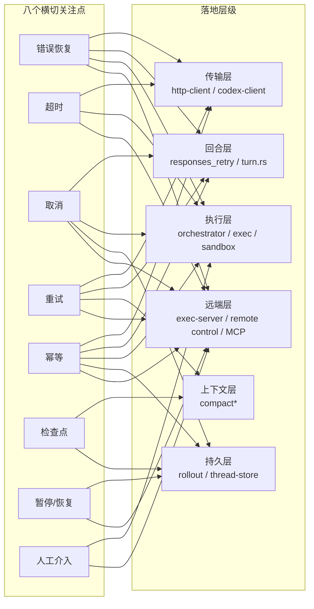

> ⭐ **重点**：八个关注点**从不单独存在**，总是成对出现（见下）。审阅或设计可靠性时，应逐对检查而不是逐点检查。

**成对约束**是理解 Codex 可靠性的关键，例如：

- 重试 ⟷ 幂等：任何重试路径都必须先回答"重放会不会造成第二次副作用"（§4.6、§5.4）。
- 取消 ⟷ 超时：等待要么被取消要么超时，二者共用 `tokio::select!`，且取消有**宽限期 + 强制 abort** 两段式（§7.5）。
- 暂停 ⟷ 检查点：`SuspendTurnAndShutdown` 的顺序是"先 flush，flush 失败就让原回合继续跑"——检查点不成立就不允许暂停（§8.3）。
- 人工介入 ⟷ 超时：审批超时的语义是 `ReviewDecision::TimedOut` → **拒绝**（fail-closed），`Default for ReviewDecision` 也是 `Denied`（§7.4）。
- 错误恢复 ⟷ 幂等 ⟷ 检查点：daemon 恢复只在"输入已进 rollout 且已 flush"时才捕获中断回合，且**不写终止事件**，从而允许用原 turn_id 恢复而不重复执行（§8.2、§8.3）。

---

## 2. 总体架构图

**图 2｜2. 总体架构图** ⭐

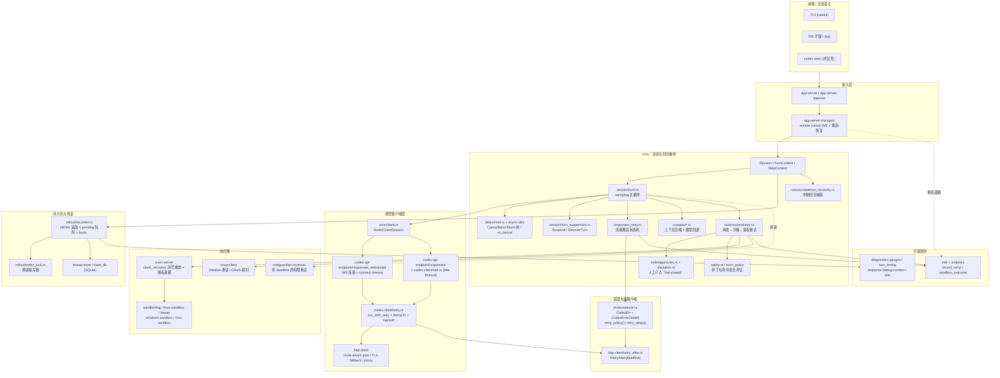

**读图要点**：`protocol/error.rs` 是唯一的"失败语义中枢"，传输层（`codex-client`）、回合层（`responses_retry`）、压缩层（`compact`）、评审层（`guardian-reviewer`）都向它询问"要不要重试、等多久"，而不是各自散落地写 `match status` 判断。这是 Codex 可靠性最重要的结构性决定。

> ⭐ **重点**：可靠性在 Codex 里是**架构属性**而非补丁——失败语义集中在一个类型上，所有层复用同一套策略查询接口。这是本文最值得移植的一条。

---

## 3. 统一错误模型：可靠性的地基

> **重要度**：⭐⭐⭐ 核心｜所有可靠性决策的唯一入口

### 3.1 结构

⭐ **关键代码 1｜错误即策略载体**

```rust
// protocol/src/error.rs
pub struct CodexErr {
    details: CodexErrorDetails,      // 语义类别 + 诊断负载（strum 派生 CodexErrKind 供分析）
    retry_after: Option<RetryAfter>, // 服务端建议的绝对 deadline（不是时长）
    agent_context: Option<AgentErrorContext>,
}

enum RetryPolicy { Never, ServerDirected, Backoff, FallBackToHttp }
```

关键设计：

- `RetryAfter(Instant)` 保存的是**绝对时刻**，`remaining_delay()` 随时间自然衰减，过期后返回 0 而不是回退到本地延迟（`server_retry_delay()` 注释明确："Expired advice stays present as zero"）。这避免了"重试链路多次转手后 deadline 被重新计时"的经典 bug。
- `with_retry_after()` 用于**透传已捕获的 deadline 而不重启它**。
- `CodexErrorDetails` 是带负载的富枚举（如 `ResponseIncomplete(Box<ResponseIncompleteError>)` 保留部分输出与 token 用量用于失败推理追踪），并通过 `EnumDiscriminants` 自动生成**无负载的 `CodexErrKind`** 用于分析埋点——即"可观测性用枚举、诊断用结构体"。
- `to_codex_protocol_error()` / `to_error_event()` 把内部错误翻译成前端协议错误（如 `ContextWindowExceeded`、`ApiKeySpendLimitExceeded`），保证 UI 与内核解耦。
- UI 消息有硬上限 `ERROR_MESSAGE_UI_MAX_BYTES = 2KB`，并用 `truncate_middle_*` 保头尾——防止巨型错误把终端刷爆。

### 3.2 重试策略分类（节选自 `retry_policy()`）

> **重要度**：⭐⭐⭐ 核心｜穷尽 match，无默认分支

**图 3｜3.2 重试策略分类（节选自 `retry_policy()`）** ⭐

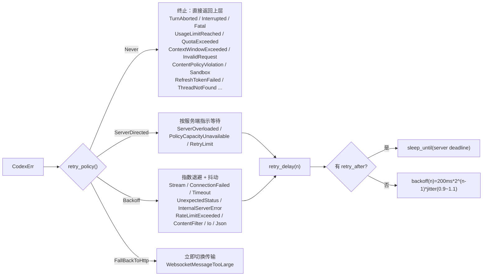

> ⭐ **重点**：`retry_policy()` 用**穷尽 `match`**（无 `_ =>` 兜底）实现——新增任何错误变体都会**编译失败**，逼迫作者显式声明"它可重试吗"。这从根本上杜绝了"默认重试"或"默认放弃"的隐式行为。

值得注意的"反直觉"分类：

- `UnexpectedStatus` 默认是可重试的 `Backoff`，但**若被识别为运行时认证拒绝**（`is_runtime_auth_denial(status, body, identity_error_code)`）则强制 `Never`——避免用 401 反复打服务端。
- `UsageLimitReached`、`ContextWindowExceeded`、`Sandbox(_)`、`InvalidPrompt` 一律 `Never`：这些是**需要人/上层策略介入**的语义失败，重试没有意义，必须由上层做"换模型 / 压缩 / 请求审批"这类**语义级恢复**。
- `ContentFilter` 归为 `Backoff` 可重试，但重试前会先向对话注入模型特定的 `ContentFilterGuidance` 片段（见 §5），即"重试要改变输入，而不是原样重发"。

### 3.3 终止性采样结果：跨重试保留的"账"

> **重要度**：⭐⭐⭐ 核心｜副作用已产生即不可重试

⭐ **关键代码 6｜终止性结果判定**

```rust
// core/src/responses_retry.rs
pub(crate) fn is_terminal_sampling_outcome(error: &CodexErr) -> bool {
    matches!(error.details(),
        ResponseIncomplete(_) | UsageAccountingFailed(_) | SessionBudgetExceeded
        | APISpendLimitExceeded(_) | InferenceHookDenied { .. })
}
```

注释点明了原因："一次新的生成无法修复终止性的 provider 响应，也无法结算上一次尝试的账单"。因此这些结果在**传输重试、同回合 steering、压缩换模型**三条路径上都被一致地视为终止——防止"重试导致重复计费/绕过 hook 拒绝"。

> ⭐ **重点**：**副作用一旦产生即不可重试**。判断依据不是"错误码是否 5xx"，而是"这次尝试是否已经产生了无法回滚的后果（计费、预算扣减、hook 拒绝、部分输出）"。

### 3.4 取消在错误模型中的位置
**取消不是异常，但必须被建模为错误**——这是 Codex 处理 cancellation 的关键选择：

⭐ **关键代码 3｜取消的统一原语**

```rust
// async-utils/src/lib.rs
pub enum CancelErr { Cancelled }

pub trait OrCancelExt: Sized {
    fn or_cancel(self, token: &CancellationToken)
        -> impl Future<Output = Result<Self::Output, CancelErr>> + Send;
}
// 实现：tokio::select! { _ = token.cancelled() => Err(Cancelled), res = self => Ok(res) }

// protocol/src/error.rs
impl From<CancelErr> for CodexErr { /* → TurnAborted 类终止错误 */ }
```

由此得到三条硬规则：

1. **任何 `await` 都可以被"或取消"包裹**：`.or_cancel(&preempt).or_cancel(&cancellation_token)`（可叠加，见 §5），包括重试等待、审批等待、压缩等待。没有"不可取消的阻塞点"。
2. **取消后的错误是 `Never` 重试的**：`TurnAborted`、`Interrupted` 在 `retry_policy()` 中归为 `Never`；`ends_turn_as_interrupted(err)` 仅当 `TurnAborted` 时为真（`tasks/mod.rs:94`），用于决定"任务结束要不要发布为被中断的回合"。
3. **取消会更新会话状态机**：`mark_interrupted()` 把 `AgentStatus` 置为 `Interrupted`（`session/mod.rs:1645`），仅在 `TurnAbortReason::{Interrupted, BudgetLimited}` 时触发；`Replaced`（新回合顶掉旧回合）不算中断。

`TurnAbortReason` 区分四种中止语义，直接影响后续行为（是否清理后台终端、是否自动续跑排队输入）：

| 原因 | 触发场景 | 可靠性含义 |
|------|----------|------------|
| `Interrupted` | 用户 Ctrl-C / `Op::Interrupt` / `Op::InterruptIfNoPendingInput` | `mark_interrupted()`，且中止后调用 `maybe_start_turn_for_pending_work()`——排队输入自动续跑 |
| `Replaced` | `spawn_task` 前自动 `abort_all_tasks(Replaced)` | 旧任务让位，不算用户中断 |
| `ReviewEnded` | review 任务结束 | 专用清理路径 |
| `BudgetLimited` | `work_budget().is_exhausted()` | 与 Interrupted 同样标记，但不再续跑 |

### 3.5 三级错误恢复阶梯

> **重要度**：⭐⭐⭐ 核心｜传输自愈→语义自愈→人工介入

**图 4｜3.5 三级错误恢复阶梯** ⭐

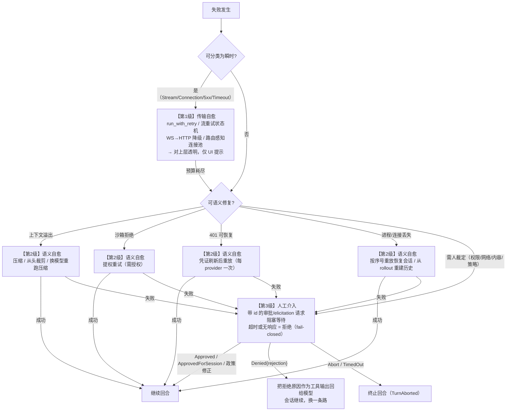

这个阶梯解释了为什么 `Denied { rejection }` 不是错误而是 `ToolError::Rejected(String)`：**人工拒绝是可恢复的语义信号**，它会变成模型可读的工具输出，让模型自己换方案；只有 `Abort` 才升级为 `CodexErr::TurnAborted`（见 §7.4）。

---

## 4. 传输层可靠性（HTTP / WebSocket / SSE）
### 4.1 三层重试栈

> **重要度**：⭐⭐⭐ 核心｜预算分层、互不吞并

Codex 的传输可靠性是**三层嵌套**的，各层职责严格不重叠：

**图 5｜4.1 三层重试栈** ⭐

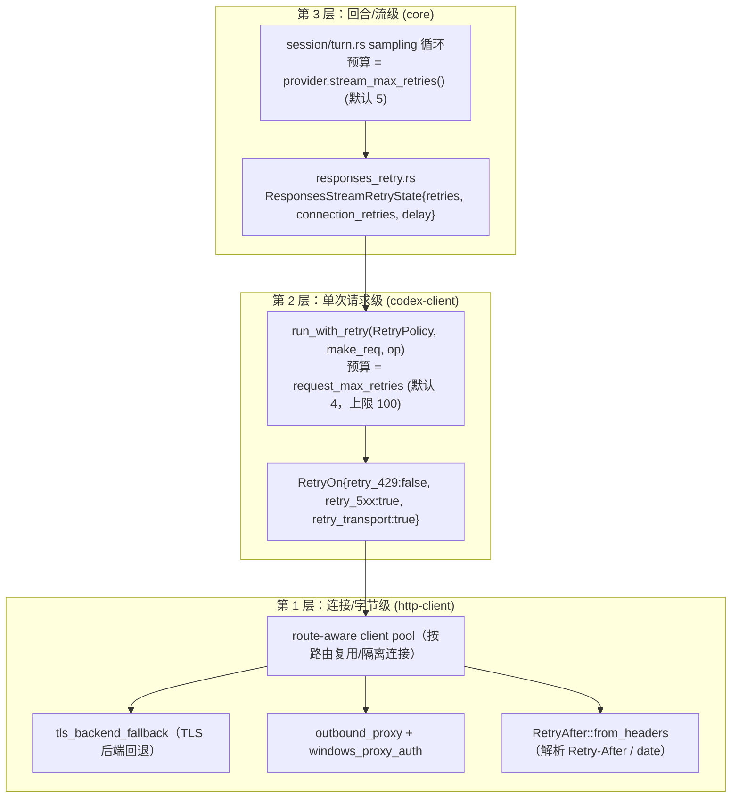

> ⭐ **重点**：三层预算**互不吞并**（连接层不计数到请求层，请求层不计数到流层），且每层都用尽后返回**类型化的上限错误**（`TransportError::RetryLimit` / `ExhaustedResponseRetry`），而不是笼统的"失败"。

第 2 层的关键代码（`codex-client/src/retry.rs`）：

⭐ **关键代码 2｜请求级重试的唯一实现**

```rust
// codex-client/src/retry.rs
for attempt in 0..=policy.max_attempts {
    let req = make_req();                     // 每次重试重建请求（body 可重放）
    match op(req, attempt).await {
        Ok(resp) => return Ok(resp),
        Err(err) if policy.retry_on.should_retry(&err, attempt, policy.max_attempts) => {
            let retry_after = err.retry_after();
            let delay = retry_after.map(RetryAfter::remaining_delay)
                .unwrap_or_else(|| backoff(policy.base_delay, attempt + 1));
            record_retry!(attempt + 1, delay, RetryOperation::HttpRequest);
            match retry_after { Some(ra) => sleep_until(ra.deadline()).await, None => sleep(delay).await }
        }
        Err(err) => return Err(err),          // 不可重试：立即失败
    }
}
Err(TransportError::RetryLimit)               // 预算耗尽：显式的"重试上限"错误
```

要点：

- **`TransportError` 明确区分可重试与不可重试**：`Timeout | Connection | Network` 由 `retry_transport` 控制；`Build | RetryLimit | Policy | ResponseTooLarge` 永不重试（重试也不会变好的错误）。
- **`retry_429: false`**（`model-provider-info/src/lib.rs:502`）：429 交由上层按 `Retry-After` 与用量语义处理，而不是在 HTTP 层盲重试——避免与服务端限流对抗。
- **每次重试重新构造请求**（`make_req()` 闭包），保证 body/签名/时间戳新鲜。
- 预算耗尽返回专用 `TransportError::RetryLimit`，与"真实网络错误"在类型上区分，上层可以给出不同提示。

### 4.2 SSE 流：空闲超时 + "关闭即错误"
⭐ **关键代码 7｜空闲超时与"提前关闭即错误"**

```rust
// codex-client/src/sse.rs
loop {
    match timeout(idle_timeout, stream.next()).await {
        Ok(Some(Ok(ev))) => { /* 转发 data 帧 */ }
        Ok(Some(Err(e))) => { send(Err(StreamError::Stream(..))); return; }
        Ok(None)         => { send(Err(StreamError::Stream("stream closed before completion"))); return; }
        Err(_)           => { send(Err(StreamError::Timeout)); return; }   // 空闲超时
    }
}
```

可靠性含义：**"连接还在但没有数据"被当作故障**（默认 300s 空闲超时），**"流正常结束但没收到 `response.completed`"也被当作故障**（`Stream` 错误 → 上层按可重试处理）。这消除了"UI 看起来在转圈但实际已死"的静默失败。

### 4.3 WebSocket → HTTP 传输降级
`core/src/client.rs` 的 `ModelClientSession` 维护 WS 会话状态，遇到以下情况调用 `try_switch_fallback_transport()`（内部 `force_http_fallback` + 重置 `WebsocketSession::default()`）：

- `WebsocketMessageTooLarge`（对端消息尺寸限制）→ `RetryPolicy::FallBackToHttp`
- WS 流失败且**流重试预算已耗尽**（`retry_state.retries >= max_retries`）
- WS 侧返回 `WebsocketStreamOutcome::FallbackToHttp`

并且降级时坚持一条铁律：

```rust
// 换传输绝不能绕过服务端的 retry deadline
if let Some(retry_after) = retry_after { tokio::time::sleep_until(retry_after.deadline()).await; }
sess.send_event(..., EventMsg::Warning(WarningEvent {
    message: format!("Falling back from WebSockets to HTTPS transport. {err:#}") }));
```

降级后 `retry_state.retries = 0`（新传输获得新的重试预算），同时向 UI 发 `Warning` 事件——**降级是可见的，不是静默的**。另有 `websocket_connect_timeout`（默认 15s）用 `tokio::time::timeout` 包裹连接建立，避免连接阶段无限挂起。

### 4.4 认证失败的传输级恢复

`handle_unauthorized()`（`core/src/client.rs:3354`）在传输报 `Transport(unauthorized)` 且 `provider.is_recoverable_auth_error()` 时：

- 每个 provider **只尝试一次**恢复（`provider_auth_recovery_attempted` 单次开关，防止刷新风暴）；
- 发出 `EventMsg::AuthRecoveryStarted / AuthRecoveryCompleted`（或失败事件），让前端知道"正在自动修复凭证"；
- 返回 `PendingUnauthorizedRetry`，恢复成功后重放请求。

### 4.5 传输层超时体系

> **重要度**：⭐⭐ 重要

**每一个等待都有上限**，而且超时值均为可配置 + 硬顶双保险：

| 等待对象 | 默认值 | 配置项 | 硬顶/备注 |
|----------|--------|--------|-----------|
| WS 建连 | 15s | `websocket_connect_timeout_ms` | `tokio::time::timeout` 包裹，避免建连阶段无限挂起 |
| SSE/WS 流空闲 | 300s (5min) | `stream_idle_timeout_ms` | 空闲即故障，不是"慢" |
| 单次 HTTP 请求 | 无内置超时，靠重试预算 | `request_max_retries`=4 | 上限 100 |
| 流重连 | 靠重试预算 | `stream_max_retries`=5 | 上限 100 |
| 凭证导出 | 30s | — | `DEFAULT_CREDENTIAL_EXPORT_TIMEOUT_MS` |
| AWS 凭证刷新 | 300s | — | `DEFAULT_AWS_AUTH_REFRESH_TIMEOUT_MS` |
| TLS/代理/路由 | 随连接层 | `outbound_proxy`、`windows_proxy_auth` | 失败可回退到另一 TLS 后端 |

超时的**结果类型也是分层的**：`TransportError::Timeout`（HTTP 层，可重试）vs `CodexErrorDetails::{Timeout, RequestTimeout}`（会话层，`Backoff` 可重试）vs `StreamError::Timeout`（SSE 空闲，转为 `Stream` 错误）vs `SandboxErr::Timeout`（子进程超时，永不重试，因为它已经有完整输出）。

### 4.6 传输层幂等：重放安全的前提

> **重要度**：⭐⭐⭐ 核心｜非幂等接口的重试边界

`POST /responses` 本质上是**非幂等**的（会产生计费与生成）。Codex 的幂等策略不是"加请求 ID 去重"，而是三条更实际的约束：

> ⭐ **重点**：对**非幂等**接口，正确做法不是发明幂等键，而是**只重试"确定未生效"的失败**（连接/构建/5xx），把"可能已生效"的失败（429、已计费）一律上抛给有语义的层处理。

1. **只重试"确定未产生效果"的失败**：`RetryOn` 里 `retry_429: false`（429 意味着服务端已受理并计数，交上层按 `Retry-After` 处理）；`Build | Policy | ResponseTooLarge | RetryLimit` 永不重试。
2. **每次重试重新构造请求**：`run_with_retry(policy, make_req, op)` 的 `make_req: FnMut() -> Request` 在**每一次** attempt 前重新调用，因此 body、签名、时间戳、一次性 header（如 `x-codex-ws-stream-request-start-ms`）总是新鲜的；不允许重用已消耗的请求对象。
3. **效果性结果一旦产生即终止**：`is_terminal_sampling_outcome`（§3.3）保证 `UsageAccountingFailed`、`APISpendLimitExceeded`、`ResponseIncomplete` 这类"钱已算/账已记"的结果不会被重试掩盖；`turn_state: Option<Arc<OnceLock<String>>>`（sticky 路由 token）则保证同一回合的重试尽量命中同一后端，降低服务端重复计费与缓存失效风险。

---

## 5. 回合级流重试：`handle_response_stream_error`

> **重要度**：⭐⭐⭐ 核心｜全文信息密度最高的一章

### 5.1 状态机

> **重要度**：⭐⭐⭐ 核心｜配合 §5.2 六条亮点阅读

这是 Codex 可靠性最核心的一段状态机（`core/src/responses_retry.rs`），被 sampling 主循环（`session/turn.rs:2270`）与远程压缩 v2（`compact_remote_v2.rs:423`）共用。

**图 6｜5.1 状态机** ⭐

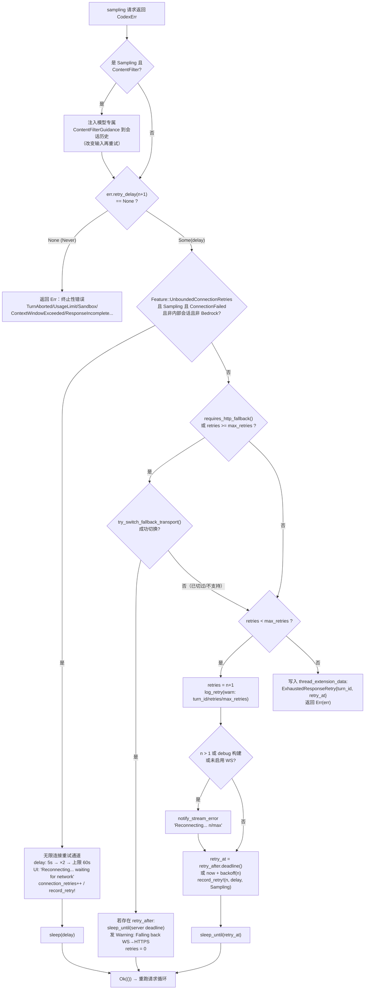

### 5.2 设计亮点逐条说明

> **重要度**：⭐⭐⭐ 核心

1. **两套独立预算**：普通流重试（`stream_max_retries`，默认 5）与"连接失败无限重试"（`UnboundedConnectionRetries` feature 门控，5s→60s 指数封顶）。后者针对**用户网络整体不可用**（笔记本合盖、切 Wi-Fi）场景——此时无限等待比报错终止体验好得多；但明确排除内部会话与 Bedrock（成本与语义不同）。
2. **重试要让用户看见**：`notify_stream_error` 把"Reconnecting... 3/5"推到任何前端，注释直言目的是"让用户理解正在发生什么，而不是盯着看起来卡死的屏幕"。同时对 release 构建隐藏**第一次** WS 重连提示以减少噪音（debug 构建保留全部可见性以便诊断）——**可靠性与噪音控制的折中被显式编码**。
3. **服务端 deadline 优先且不可绕过**：`retry_at = retry_after.map(deadline).unwrap_or(now + delay)`，并用**同一个时钟采样 `now`** 计算遥测 delay，保证埋点与实际等待一致。
4. **预算耗尽不是简单报错**：写入 `ExhaustedResponseRetry { turn_id, retry_at }` 到 `thread_extension_data`，注释说明 turn_id 的存在是为了"防止复用的 Guardian 会话应用来自更早一次评审的建议"——即**重试建议带身份，避免跨回合污染**。
5. **可取消**：调用处用 `.or_cancel(&preempt).or_cancel(&cancellation_token)` 包裹，等待期间用户 Ctrl-C / steering 能立刻打断，取消后返回 `TurnAborted` 而非继续重试。
6. **终止错误在调用侧提前分流**（`session/turn.rs`）：`ContextWindowExceeded` → `set_total_tokens_full()` 后上抛（触发压缩路径）；`UsageLimitReached` → 先 `update_rate_limits()` 更新快照再上抛；`Fatal` / `is_terminal_sampling_outcome` → 直接上抛。

> ⭐ **重点**：这一节（§5.1 状态机 + §5.2 六条亮点）是全文**信息密度最高**的部分：双预算分离、服务端 deadline 不可绕过、重试可见性、耗尽后带身份上抛——四条都可直接照搬到任何 agent harness。

### 5.3 取消（Cancellation）：令牌树与可抢占等待

> **重要度**：⭐⭐⭐ 核心｜两段式中止 + 清理顺序敏感

**图 7｜5.3 取消（Cancellation）：令牌树与可抢占等待** ⭐

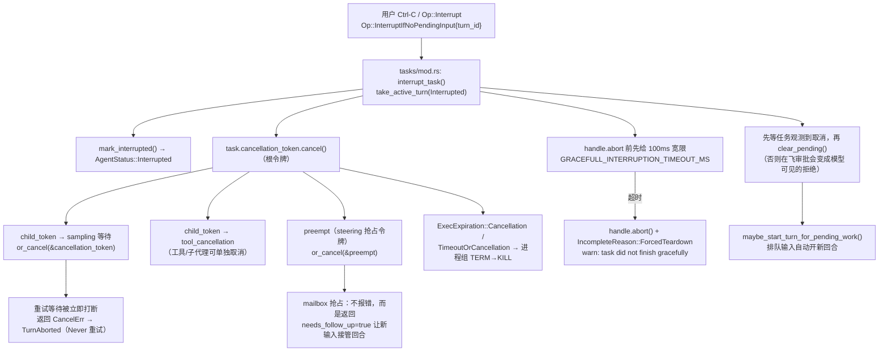

取消设计的四个细节（均直接影响可靠性）：

- **两段式中止**：先 `cancel()` 给任务 **100ms** 自行收尾（写 rollout、发终止事件、释放审批），超时才 `handle.abort()`；注释还提醒"任务可能在 deadline 与 abort 之间正常结束"，因此对 join 错误还要区分 `is_cancelled()` → `IncompleteReason::ForcedTeardown` vs `Unclassified`。
- **取消与清理的顺序敏感**：`abort_taken_tasks` / `finish_turn_abort` 中的注释写明"Let interrupted tasks observe cancellation **before** dropping pending approvals, or an in-flight approval wait can surface as a model-visible rejection before TurnAborted"——**先取消、后清队列**，避免把取消误报为"用户拒绝"写入历史（历史污染是不可逆的）。
- **`InterruptIfNoPendingInput` 是条件式取消**：带 `reply: oneshot::Sender<bool>`，"先告知决定，再执行取消"，避免上层以为已取消而实际还在跑。
- **取消不等于丢弃已得成果**：`sampling_interrupt.rs` 会"取消已 opt-in 子代理的工具，同时保留其已采样项或安装摘要"；mailbox 抢占则返回 `needs_follow_up=true` 而不是错误。

### 5.4 幂等（Idempotency）：重试不重跑已执行的副作用

> **重要度**：⭐⭐⭐ 核心｜retry_cache 与"不确定即作废"

流重试意味着**同一次采样可能被提交多次**。如果上一次尝试里模型已经调用了工具（写了文件、跑了命令），重试后重新提交相同历史会导致**重复执行**。Codex 的解法是在回合循环外持有一个跨尝试存活的证据缓存：

⭐ **关键代码 4｜跨重试存活的幂等账本**

```rust
// core/src/session/turn.rs（循环外声明，循环内复用）
let mut executed_tool_calls_by_output = HashMap::new();
loop {
    let mut prompt_input = history.for_prompt(...).await;
    sess.services.executed_tool_calls
        .attach_to_prompt(&mut prompt_input, &mut executed_tool_calls_by_output); // ← retry_cache
    ...
}
```

`ExecutedToolCallCache = HashMap<(Discriminant<ResponseItem>, call_id), Vec<ExecutedToolCall>>`（`tools/executed_tool_calls.rs:62`）的作用：

- **重放而非重跑**：下一次尝试构造 prompt 时，已执行调用的证据（cell_id、tool_result_id、参数、输出元数据）被重新附着到对应的 `FunctionCallOutput` 上，模型看到"已完成"的结果，而不是重新发起同一调用。
- **幂等校验严格到"宁可作废"**：当存在截断绑定（`Truncated` 参数）时，代码会逐一校验 `output_counts[call_id] == 1`（同一 call_id 只能有一个输出）、输入必须在输出之前且匹配（`code_mode_input_matches_output`）、重试快照与当前记录逐项比对（`cached.name == current.name && cached.arguments() == current.arguments()`）；任一不成立就把整个 cell 标为 `untrusted` 并 `invalidate_binding()/invalidate_output()`——**幂等证据不确定时宁可丢弃，也不带着可疑绑定重试**。
- **新记录覆盖旧快照**：`retry_cache.retain(|key,_| !retained.result_metadata_updated)`——一旦有更新的结果元数据，旧的 retry 快照失效，避免用陈旧证据覆盖新事实。
- **记录器不参与执行**：`executed_tool_calls.rs` 头注释强调"this recorder must never dispatch or await tools"，将幂等账本与执行路径解耦。

> ⭐ **重点**：幂等证据"**不确定就作废**"（`untrusted_cells` → `invalidate_binding/invalidate_output`）。宁可让模型重跑一次工具，也不带着可疑绑定重试——这是幂等设计里最容易被忽略的保守性要求。

- **调用身份统一**：`tool-call-id` crate 的 `ToolCallId`（区分 Responses 可见 ID 与 Code Mode 每-cell ID）与 `ResponseItemId` 构成幂等键的基础；`request_metadata` 只在 wire 层投影元数据，保留原始索引以便迟到的结果归位。

---

## 6. 上下文窗口可靠性：压缩、裁剪与模型回退
上下文溢出是 LLM 代理最典型的"必然发生的故障"。Codex 用**多级递进**处理：

**图 8｜6. 上下文窗口可靠性：压缩、裁剪与模型回退**

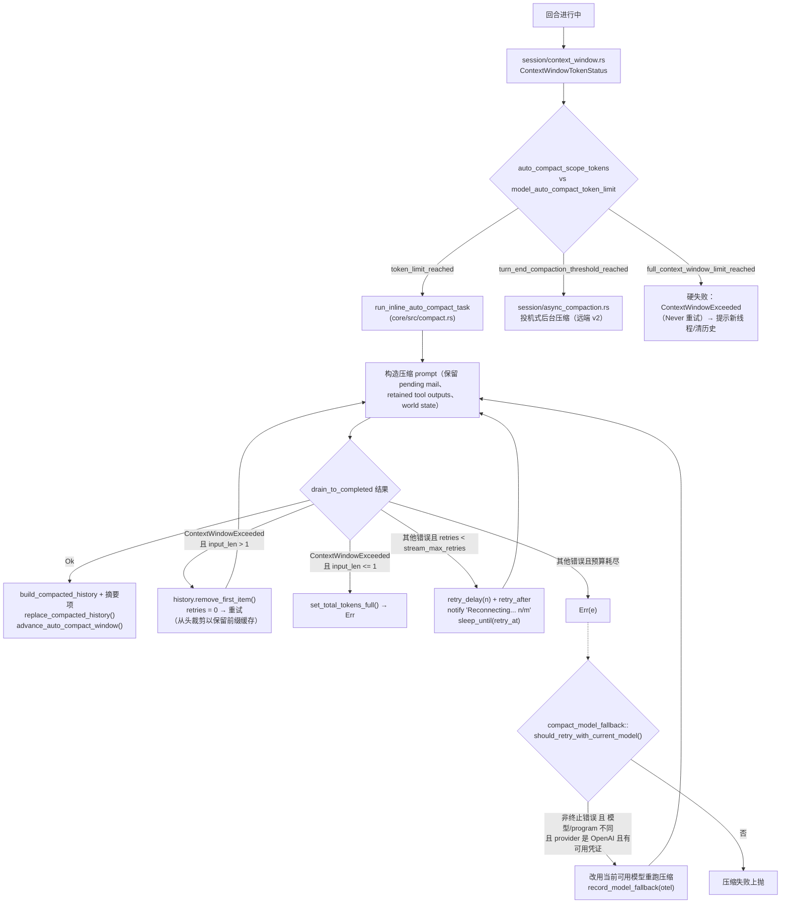

要点：

- **两条压缩触发线**：`auto_compact_scope_limit`（配置的自动压缩阈值，可按 scope 计数）与 `full_context_window_limit`（真实窗口上限）。前者触发压缩，后者才是硬失败——留出缓冲带，避免"刚好撞到墙"。
- **溢出时的裁剪方向被刻意选择**：注释写明"Trim from the beginning to preserve cache (prefix-based) and keep recent messages intact"——从**头部**删，既保住 prompt 前缀缓存命中，也保住最近上下文；且裁剪后 `retries = 0`（裁剪算"改变了输入"，重置重试预算）。
- **压缩自身也走统一重试语义**：复用 `stream_max_retries` + `retry_delay` + `retry_after` + `notify_stream_error`，没有另造一套。
- **压缩换模型是受控的**：`should_retry_with_current_model()` 排除终止性错误、`TurnAborted/Interrupted/WorkspaceAccessDenied/ContentPolicyViolation`，要求模型或 cyber program 确实不同，且 provider 为 OpenAI 且凭证可用——防止"换个模型继续撞同样的墙"。
- **压缩不是丢历史**：`compact_pending_input`（未投递邮件去重保留）、`compact_retained_tool_outputs`、`compact_token_budget`、`compact_remote_v2_media`（媒体预算）、`guardian_history_checkpoint`、`retained_context` 等模块保证压缩后的历史仍可被 resume/fork 正确重放；`COMPACT_USER_MESSAGE_MAX_TOKENS = 20_000` 限制单条保留消息体积。
- **投机压缩有成本意识**：`async_compaction.rs` 头注释直言"Discarded requests still charge completed usage; session shutdown cancels remaining network work"——用 `TaskTracker` + `CancellationToken` 保证关机不留悬挂网络任务。
- **持久层也有截断策略**：`thread_rollout_truncation.rs` 按"user turn 边界"截断 rollout，避免恢复超长历史时再次溢出。

### 6.1 检查点（Checkpoint）：压缩即固化点

> **重要度**：⭐⭐ 重要

压缩不只是"变小"，它同时是 Codex 的**上下文检查点机制**：`RolloutItem::Compacted(Box<CompactedItem>)` 将一整段可重放状态固化到持久化日志里。

**图 9｜6.1 检查点（Checkpoint）：压缩即固化点** ⭐

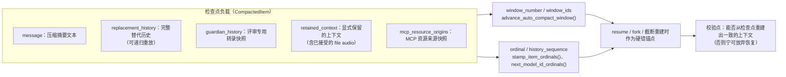

检查点的四种形态与各自的可靠性职责：

| 检查点 | 代码 | 作用 |
|--------|------|------|
| **压缩检查点** | `CompactedItem { message, replacement_history, guardian_history, retained_context, mcp_resource_origins }` | 一次原子地固化"替代历史 + 保留上下文"，使压缩后的会话仍可 resume/fork |
| **Guardian 检查点** | `history.guardian_history_checkpoint()`、`session/guardian_checkpoint.rs`（用 fork replay 格式捕获，**仅在内存**） | 评审上下文与主历史解耦；头注释强调"transcript durability remains part of turn completion"——即评审快照**不**提前声称已持久 |
| **World-state 检查点** | `history.world_state_checkpoint()`、`context_manager/updates` | 环境事实（文件、目录、主机 roster）的可比较基线，压缩后可能只保留摘要 |
| **采样检查点** | `history.checkpoint_sampling(&mut items)` | 将本次采样产出的项固化到历史，供重试/恢复时比对 |

检查点的**兼容性与降级规则**被写得很保守（`context_manager/history.rs` 头注释与实现）：

- "Root checkpoints keep compatibility transcripts while retained instructions are incomplete"；
- "Old text checkpoints can seed that backup from their surviving plaintext instructions"；
- "A previously promoted checkpoint may have discarded the only complete transcript" → 因此 `requires_parent_context` 判定会回溯到父上下文；
- 不透明的（opaque / encrypted）检查点不会被当成明文证据使用（`checkpoint_input_has_no_file_error_sources` 等判定）。

**人工介入入口**：用户可用 `Op::Compact`（TUI 的 `/compact`）主动触发检查点；另有 `Op::SetThreadMemoryMode`、`Op::ReloadUserConfig`、`Op::RefreshMcpServers` 等"不起回合"的变更类 Op，它们走**同一个 submission 队列**（注释："uses the same submission queue as turn starts so app-server can preserve caller order"）——用串行化保证幂等与顺序。

---

## 7. 执行可靠性：沙箱、审批与"降级重试"

> **重要度**：⭐⭐⭐ 核心｜副作用最集中的一层

### 7.1 分层防护

**图 10｜7.1 分层防护**

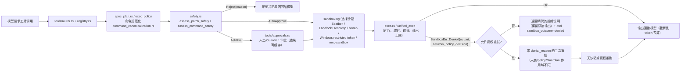

### 7.2 `orchestrator.rs` 的"拒绝—提权—重试"决策
`core/src/tools/orchestrator.rs` 用一条流程处理所有 exec 类工具，重试判定层层收紧：

1. 仅当错误是 `CodexErrorDetails::Sandbox(SandboxErr::Denied { output, network_policy_decision })` 才进入重试通道；其他错误直接返回（并记录 `sandbox_outcome`）。
2. **托管网络场景**：有 `network_policy_decision` 但构造不出 `network_approval_context` → 直接 denied（不给用户看不懂的提示）。
3. `tool.escalate_on_failure()` 为 false 的工具（如只读工具）→ 直接 denied。
4. **审批策略闸门**：`AskForApproval::Never / OnRequest` 下默认**不**无沙箱重试，而是返回保留原始输出的精简拒绝说明；`OnRequest` 下若属于"网络访问被策略阻断"且默认执行审批要求为 `NeedsApproval`，则允许弹出网络审批。
5. `unsandboxed_allowed == false` 且非网络审批 → denied。
6. 生成人类可读的 `retry_reason`（网络类：`Network access to "host" is blocked by policy.`；文件类：`build_denial_reason_from_output(output)`）。
7. **重试授权的作用域被显式区分**：注释 "Human and policy approvals keep their existing retry scope. A Guardian verdict only covers the reviewed action"——即 Guardian 的批准不会外溢到"提权后重跑"，必须重新走授权；`retry_preapproved` 由 `initial_approval_source` 决定。
8. exec-server 侧还有一道能力校验：无法确认 exec-server 支持"带 denied reads 的提权"时，直接返回可操作错误 `this exec-server cannot safely escalate with denied reads; upgrade the exec-server and retry`——**宁可失败并给出修复指引，也不做不安全降级**。

### 7.3 执行侧的其他可靠性细节

- **超时与信号**：`SandboxErr::Timeout{output}`、`SandboxErr::Signal(i32)`；`CodexErr::Timeout`（子进程 10s 未退出）、`RequestTimeout`。`unified_exec` 支持"completion-only 调用在超时或取消时终止"。
- **中断转成模型可读输出**：`CodexErrorDetails::Interrupted` 注释明确 Session 会用它"surface a polite FunctionCallOutput back to the model instead of crashing the CLI"——**Ctrl-C 不杀会话，而是变成一次工具结果**。
- **取消令牌树**：`cancellation_token.child_token()` 分别派生给采样与工具执行（`tool_cancellation`），使"取消工具但保留回合"成为可能（`sampling_interrupt.rs`：取消已 opt-in 子代理的工具，同时保留其已采样项或安装摘要）。
- **沙箱失败也是策略事件**：`LandlockRestrict`（无法完整实施规则）→ `RetryPolicy::Never`，绝不"静默无沙箱继续跑"。
- **进程加固**：`process-hardening/src/lib.rs` 在 `pre-main`（`#[ctor]`）阶段禁用 core dump、禁用 ptrace attach、清除 `LD_PRELOAD`/`DYLD_*` 等危险环境变量——降低凭证泄露与被注入的风险。
- **输出有界**：`truncate_middle_with_token_budget` 统一用于命令输出/错误体，防止单次工具输出撑爆上下文（这也是上下文可靠性的一部分）。

### 7.4 人工介入（Human-in-the-loop）：审批是最后的可靠性手段

> **重要度**：⭐⭐⭐ 核心｜fail-closed 三条铁律

当机器无法安全裁定时，Codex 把失败**升级为带 id 的阻塞请求**，而不是自己猜。

**图 11｜7.4 人工介入（Human-in-the-loop）：审批是最后的可靠性手段** ⭐

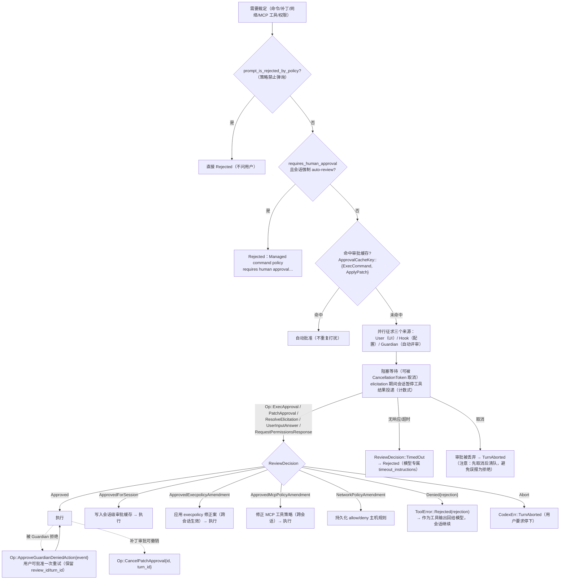

关键可靠性含义：

- **决策类型带作用域**：`Approved`（仅此次）/ `ApprovedForSession`（会话级缓存）/ `ApprovedExecpolicyAmendment`、`ApprovedMcpPolicyAmendment`、`NetworkPolicyAmendment`（**跨会话持久化的策略修正**）。人工介入不只是"放行一次"，而是**把人的裁定固化为机器下次能自动处理的规则**——这是降低未来失败率的根本手段。
- **默认值是拒绝**：`impl Default for ReviewDecision { fn default() -> Self { Denied { rejection: "denied" } } }`；超时也是拒绝。**所有人工介入路径 fail-closed**。

> ⭐ **重点**：人工介入的三条铁律——**① 默认拒绝（fail-closed）② 拒绝原因回给模型而非终止会话（`Denied` 是 `ToolError::Rejected`，只有 `Abort` 才终止）③ 人的裁定可固化为策略修正案（`ApprovedForSession` / `ApprovedExecpolicyAmendment` / `NetworkPolicyAmendment`），从而减少下一次介入**。

- **人工介入本身可取消、可撤销**：`Op::CancelPatchApproval { id, turn_id }`、`Op::Interrupt`；`ApprovalResolution.cancellation_reason` 区分"用户拒绝"与"被取消"（`McpApprovalCancellationReason`）。
- **审批来源可追溯**：`ApprovalResolutionSource::{User, Hook, Guardian}` 决定拒绝文案（"rejected by user" / "rejected by configuration" / "automatic approval review denied the action"），模型能据此选择不同补救策略。
- **重试不重复弹询**：提权重试依赖审批缓存（`unified_exec` 注释："on sandbox denial, retries without sandbox when policy allows (**no re-prompt thanks to caching**)"）；但 Guardian 裁决的作用域**不**外溢到提权后的动作（§7.2）。
- **阻塞式追问也是人工介入**：`request_user_input`（`Op::UserInputAnswer`）、`request_permissions`（`Op::RequestPermissionsResponse`）、MCP elicitation（`Op::ResolveElicitation`，`elicitation.rs` 用计数式注册让**并发 elicitation 全部完成前会话保持暂停**，且可订阅暂停超时进度）、动态工具（`Op::DynamicToolResponse`）。
- **用户还能主动接管执行**：`Op::RunUserShellCommand`（`!cmd`，默认超时 1 小时）、`Op::CleanBackgroundTerminals`（清理后台终端）、`Op::Review`（人工发起代码评审）。

### 7.5 超时与取消的进程级实现

> **重要度**：⭐⭐⭐ 核心｜进程组 TERM→KILL 与管道排空超时

命令执行的终止语义集中在 `core/src/exec.rs`，用 `tokio::select!` 把三个终止源合并：

⭐ **关键代码 5｜超时与取消同源建模**

```rust
pub enum ExecExpiration {                    // 为什么终止
    Timeout(Duration), DefaultTimeout,       // 超时（默认 10s）
    Cancellation(CancellationToken),         // 取消
    TimeoutOrCancellation { timeout, cancellation }, // 两者任一
}
pub enum ExecExpirationOutcome { TimedOut, Cancelled }

const SIGKILL_CODE: i32 = 9;
const TIMEOUT_CODE: i32 = 64;
const EXIT_CODE_SIGNAL_BASE: i32 = 128;      // 惯例：128 + signal
const EXEC_TIMEOUT_EXIT_CODE: i32 = 124;     // 惯例 timeout 退出码
const CANCELLATION_TERMINATION_GRACE_PERIOD: Duration = Duration::from_millis(50);
pub const IO_DRAIN_TIMEOUT_MS: u64 = 2_000;  // 子进程被杀后管道可能被孙进程持有
```

**图 12｜7.5 超时与取消的进程级实现** ⭐

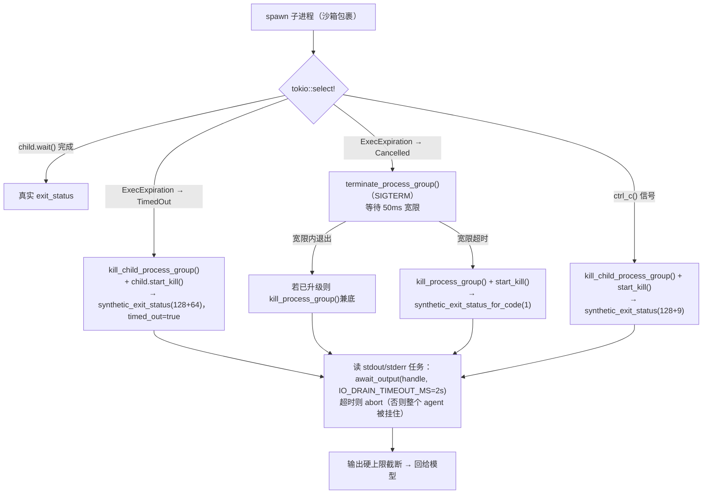

要点：

- **超时/取消/信号 三路合一**，但**退出码语义不同**：超时 = `128+64`（并置 `timed_out=true`，上层映射为 `SandboxErr::Timeout{output}`），取消 = 合成 `1`，Ctrl-C = `128+9`。模型能从退出码区分"命令失败"与"被宿主终止"。
- **杀的是进程组**：`kill_child_process_group` / `terminate_process_group` / `kill_process_group` 避免子进程派生的后台进程泄漏；取消路径先 TERM 给 **50ms** 清理机会，再 KILL。
- **管道排空也有超时**：注释直言"those pipes may stay open after we `kill` the direct child on timeout. That would cause the `read_capped` tasks to block on `read()` indefinitely, **effectively hanging the whole agent**"——所以 `IO_DRAIN_TIMEOUT_MS = 2s` 后直接 `abort()` 读取任务。这是典型的"隐藏的可靠性陷阱"，靠有界等待而非假设解决。
- **长运行会话另有预算**：`Op::RunUserShellCommand` 默认 `USER_SHELL_TIMEOUT_MS = 1 小时`；后台终端默认 `DEFAULT_MAX_BACKGROUND_TERMINAL_TIMEOUT_MS = 300s`；多代理 `wait_agent` 工具带 `min/default/max` 三重限制（默认 30s，下限 10s，上限硬性限制）并提示模型"prefer longer waits to avoid busy polling"。
- **启动类探测也有短超时**：`shell_snapshot.rs` `SNAPSHOT_TIMEOUT = 10s`、`executor_discovery.rs` `DISCOVERY_PREWARM_TIMEOUT = 5s`、`sandboxing/bwrap.rs` `SYSTEM_BWRAP_PROBE_TIMEOUT = 500ms`、`turn_diff_tracker.rs` `DIFF_TIMEOUT = 100ms`、`turn_metadata.rs` git 元数据 `1s`——**辅助能力失败不能拖死主流程**，均采取"超时则降级为无该能力"。

---

## 8. 状态持久化与崩溃恢复

> **重要度**：⭐⭐⭐ 核心｜不丢不重的持久化契约

### 8.1 Rollout 写入器：写失败不丢数据

> **重要度**：⭐⭐⭐ 核心｜"写成功才出队"

`rollout/src/recorder.rs` 的 `RolloutWriterState` 注释就是可靠性契约：

> "Items are first appended to `pending_items`; persist/flush/shutdown remove each item from that queue only after it is written successfully. I/O failures drop the file handle but keep the unwritten suffix so the next barrier can reopen the file and retry."

> ⭐ **重点**：这一句注释就是整个持久层的可靠性契约——**"写成功才出队"** 同时保证了不丢（失败保留）与不重（整批重写），是幂等写入的最小充分实现。

**图 13｜8.1 Rollout 写入器：写失败不丢数据** ⭐

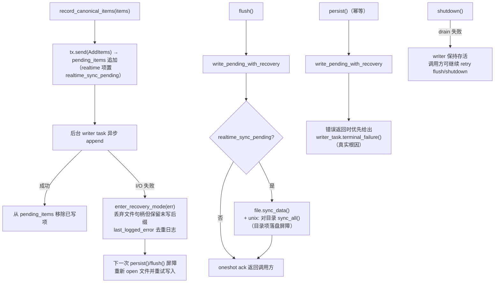

可靠性要点：

- **写队列 + 显式屏障**：常态下异步追加（不阻塞回合），关键节点（回合完成、daemon 恢复捕获、realtime 封存）通过 `flush()` 等待 ack。
- **失败可重试且不静默**：句柄被丢弃但数据留在内存；`terminal_failure()` 优先作为错误返回，避免把"channel closed"当根因。
- **fsync 屏障覆盖目录项**：realtime 封存时不仅 `sync_data()`，还对相关目录 `sync_all()`——保证**文件存在性**本身也落盘（新建文件后崩溃的常见坑）。
- **跨进程写锁**：`writer_lock.rs` 用锁文件 + `.coordination.lock` 协调同一 codex home 内的写者，打开锁文件用**有界等待**，清理时"仅在能立即获得独占协调时才删除文件"——避免误删活跃写者的锁。
- **延迟创建 + 压缩**：`deferred_creation`（首个 rollout 才物化文件，避免空会话垃圾）、`compression::materialize_rollout_for_append`（压缩格式对追加透明）。
- **持久化指标**：`persistence_metrics.rs`、`sqlite_metrics.rs` 让持久层健康度可观测。

### 8.2 会话恢复路径

> **重要度**：⭐⭐ 重要｜恢复宁缺勿错

**图 14｜8.2 会话恢复路径** ⭐

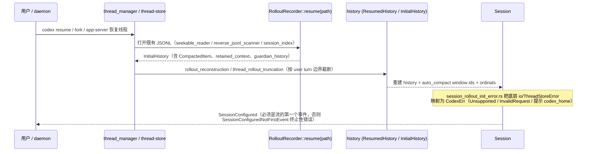

- **daemon 重启后的中断回合恢复**：`session/daemon_recovery.rs` 只在**回合输入已进入 rollout writer**（`RecordedTurnInput` 扩展数据存在）且**调用方已 flush** 之后，才通过 `interrupted_turn()` 捕获 `(turn_id, TurnStartOptions, environment)`。并且刻意保守：
  - 任务必须是 `TaskKind::Regular` 且未被取消；
  - **多环境或远端身份/配置不跨 daemon 重启持久化**，因此 `environments.len() != 1` 或非本地单环境直接放弃恢复；
  - 环境配置必须为 `EnvironmentConfigState::FromThread`。
  这套"宁可不恢复也不错误恢复"的约束，是可靠性设计中很重要的一类：**恢复的正确性优先于恢复的成功率**。
- **顺序性契约**：`SessionConfiguredNotFirstEvent` 被归类为 `Never` 重试——协议顺序错乱视为实现缺陷而非瞬时故障。
- **可重试的存储错误**：`ThreadStoreError::Retryable / OutcomeUnknown` 与 `Conflict / Unsupported` 区分对待，前者可重试，后者直接语义化报错。

### 8.3 暂停与恢复（Pause / Resume）：worker 交接协议

> **重要度**：⭐⭐⭐ 核心｜三条顺序约束

Codex 支持把一个正在跑的根回合**暂停并关机**（例如 IDE/daemon 重启、云端 worker 漂移），由另一个 worker 用**同一个 turn_id** 恢复。这是整个仓库里对"顺序与幂等"要求最高的一段代码（`session/turn_suspension.rs` + `Op::SuspendTurnAndShutdown` / `Op::RecoverTurn`）。

**图 15｜8.3 暂停与恢复（Pause / Resume）：worker 交接协议** ⭐

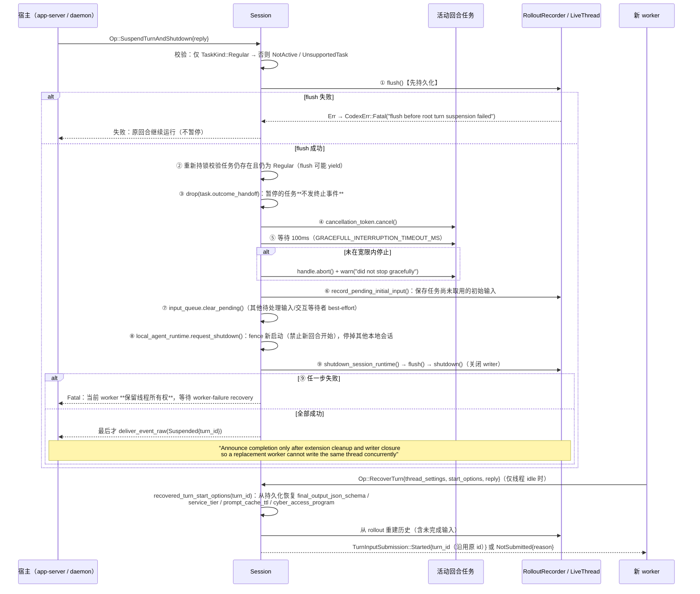

这段流程里的可靠性约束逐条对应一个关注点：

| 顺序 | 关注点 | 为何必须是这个顺序 |
|------|--------|------------------|
| ① flush 在 cancel 之前 | **检查点 / 幂等** | 注释："Flush before canceling execution so **a persistence failure leaves the original turn running**"——宁可不暂停，不可暂停后丢数据 |
| ② flush 后重查任务 | **幂等（TOCTOU）** | flush 会 yield，期间回合可能已完成/变更；必须在"与移除时同一把锁"下重查 kind |
| ③ 不发终止事件 | **恢复幂等** | "Normal shutdown records a terminal turn event, **preventing another worker from recovering this turn under its original ID**"——故意不写终止事件，才能用原 ID 恢复 |
| ④⑤ 取消 + 100ms 宽限 | **取消** | 与 §5.3 一致的两段式中止 |
| ⑥⑦ 先存未完成输入再清队 | **检查点 / 人工介入** | 未取用的初始输入必须能让新 worker 接着跑；已挂起的审批等待者只能 best-effort（跳 worker 不保留交互态） |
| ⑧ fence 新启动（禁止新回合开始） | **幂等** | 防止暂停过程中又有新回合并发写同一线程 |
| ⑨ 先停生产者再 flush+close | **检查点** | "Stop all producers before flushing their final history and closing its writer" |
| 最后才发事件 | **幂等 / 并发** | 写完才能宣告，否则替代 worker 可能与当前 worker 并发写同一 thread（另有 `writer_lock` 跨进程保护） |

> ⭐ **重点**：暂停/恢复的正确性来自三条顺序约束——**① flush 先于 cancel（持久化失败则不暂停）② 暂停不写终止事件（否则无法用原 ID 恢复）③ 宣告完成只在 writer 关闭之后（防并发写）**。任何一条颠倒都会造成数据丢失或双写。

`SuspendTurnOutcome::{Suspended{turn_id}, NotActive, UnsupportedTask}` 三值返回使宿主能区分"已暂停"与"本来就没事可暂停"，避免宿主误以为需要恢复；恢复侧 `recover_turn_if_idle` 的头注释明确："Resumes an interrupted regular turn **only when the thread is idle**. Recovery starts no new user input and **preserves the turn ID** that was already recorded"；若未能提交则返回 `NotSubmitted { reason }` 而不是错误。

### 8.4 持久层的幂等与锁
- **`persist()` 显式幂等**：文档注释 "This is idempotent. If materialization fails, the recorder keeps all pending items in memory and a later `persist()` or `flush()` can retry opening and writing the rollout file"。
- **写入幂等靠"写成功才出队"**：`pending_items` 只在写成功后移除，因此重试不会产生重复行（失败那一批整体重写）。
- **ordinal 幂等**：`stamp_item_ordinals` / `next_model_id_ordinals` 给历史项打全局序号，重放与截断（`thread_rollout_truncation`）均以此为准，避免 resume 后重复或错序。
- **跨进程幂等**：`writer_lock.rs` 保证同一 thread 只有一个写者（`thread-writer-locks/` + `.coordination.lock`，打开锁文件用有界等待，清理时"仅在能立即获得独占协调时才删除"）。
- **SQLite 侧的忙等**：`state/src/sqlite.rs` `DEFAULT_BUSY_TIMEOUT = 5s`；`rollout/src/state_db.rs` 启动回填等待 `STARTUP_BACKFILL_WAIT_TIMEOUT`（release 30s / 其他 2s）——JSONL 与 state_db 双轨时，回填慢不阻断启动。

---

## 9. 远程/分布式会话可靠性（exec-server、remote control、MCP）
### 9.1 exec-server：断连后按序号重放，不丢输出

> **重要度**：⭐⭐⭐ 核心｜序号化幂等重放

`exec-server/src/client_recovery.rs`（979 行，专责恢复）：

```rust
const SESSION_RECOVERY_TIMEOUT: Duration = Duration::from_secs(50);   // 测试下 500ms
const SESSION_REPLAY_RESERVE: Duration = Duration::from_secs(5);      // 重放预留时间
const SESSION_RECOVERY_RETRY_INTERVAL: Duration = Duration::from_millis(100);
const REGISTRY_RECOVERY_INITIAL_RETRY_INTERVAL: Duration = Duration::from_millis(500);
const REGISTRY_RECOVERY_MAX_RETRY_INTERVAL: Duration = Duration::from_secs(5);
```

**图 16｜9.1 exec-server：断连后按序号重放，不丢输出** ⭐

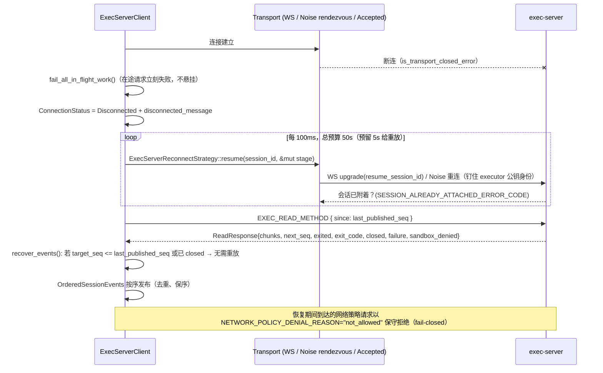

可靠性亮点：

- **事件序号化 + 幂等重放**：`last_published_seq` 保证断连期间的进程输出**不丢也不重复**，`OrderedSessionEvents` 保证顺序；已发布 closed/failure 后不再重放。
- **在途请求立即失败**：`fail_all_in_flight_work()` 避免调用方永久等待一个已经死掉的请求（快速失败优于静默挂起）。
- **恢复窗口有硬上限**（50s，且预留 5s 给重放），注册表恢复用 500ms→5s 的独立退避。
- **fail-closed 的安全默认**：恢复期间无法裁定的网络策略请求一律拒绝。

> ⭐ **重点**：**事件序号化 + 幂等重放**（`last_published_seq` / `next_seq` / `closed_published`）是分布式会话恢复的通用解法；配套的 `fail_all_in_flight_work()` 体现另一条原则——**快失败优于静默挂起**。

- **重连退避带"稳定性记忆"**（`remote/reconnect_backoff.rs`）：

⭐ **关键代码 8｜带稳定性记忆的重连退避**

```rust
// exec-server/src/remote/reconnect_backoff.rs
const INITIAL_BACKOFF: Duration = Duration::from_secs(1);
const MAX_BACKOFF: Duration = Duration::from_secs(30);
// 长于首个 keepalive 间隔 + pong 超时（30s + 60s）
const STABLE_CONNECTION_DURATION: Duration = Duration::from_secs(120);

fn next_delay(&mut self, random_sample: u64) -> Duration {
    let delay = reconnect_delay(self.delay, random_sample); // [delay/2, delay] 区间抖动
    self.delay = (self.delay * 2).min(MAX_BACKOFF);
    delay
}
fn connection_closed(&mut self, connected_for: Duration) {
    if connected_for >= STABLE_CONNECTION_DURATION { self.delay = INITIAL_BACKOFF; } // 稳定过就重置
}
```

三处细节体现工程成熟度：**区间抖动**（避免同一 executor 的多个客户端同步重连造成惊群）、**"稳定连接后重置退避"**（否则长期会话会永远停留在 30s 退避）、**注释解释 120s 的来历**（与 keepalive/pong 超时对齐，防止把"刚连上就断"误判为稳定）。

### 9.2 远程控制通道与 MCP

- `app-server-transport/src/transport/remote_control/websocket.rs`：含 `RemoteControlRecovery`、`desired_state_from_persisted_enrollment`（掉线后按持久化 enrollment 恢复期望状态）、`ClientSegmentReassembler` + `REMOTE_CONTROL_SEGMENT_MAX_BYTES`（大消息分片重组，避免超限失败）；配套 `websocket_retry_tests.rs`、`tests/retry_tests.rs` 专门验证重连。
- `rmcp-client/src/streamable_http_retry.rs`：`STREAMABLE_HTTP_RETRY_DELAYS_MS: [u64; 2] = [250, 1_000]`——**MCP initialize 只重试两次、延迟固定且很短**，因为 MCP 服务器故障通常是配置问题，长退避只会拖慢启动；配合 `startup_error.rs`、`service_error.rs` 把失败原因结构化上报，`bounded_stdio_transport.rs` / `ordered_byte_transport.rs` 保证 stdio 通道有界且有序。
- OAuth 侧有 `OAuthDiscoveryTimeout::{默认, Capped(max)}`，避免发现阶段无限等待。

### 9.3 Guardian 评审：共享 deadline 下的有限重试
`ext/guardian-reviewer/src/retry.rs`：

- `GuardianReviewSessionLimits { max_attempts, deadline }`，`assert!(max_attempts > 0)`；
- 只重试"可恢复"的评审失败（`should_retry_guardian_review`），会话级错误可携带 `retry_at`；
- **所有尝试共享一个 deadline**（`deadline.cap(local_deadline)`），等待被 `external_cancel` 与 deadline 双向打断，结果区分 `retry / cancelled / deadline`；
- `analytics_result.attempt_count` 与 `context_changed` 跨尝试累积（"本地证据变化"走协作式重试、不做服务端退避），并把 `failure_reason`/`outcome` 作为 tag 上报 duration 指标；
- 头注释强调"Resubmissions are independent; this layer keeps no state between approval requests"——**重试层无状态**，避免跨请求的状态污染（与 §5 的 `ExhaustedResponseRetry.turn_id` 同理）。

### 9.4 远端会话上的八个关注点

> **重要度**：⭐⭐ 重要

| 关注点 | 远端层的具体做法 |
|--------|------------------|
| **错误恢复** | `is_transport_closed_error` 区分"传输死了"与"业务错了"；仅前者进入恢复流程；Noise 重连钉住 executor 公钥身份（`executor_public_key`）避免恢复到错误主机 |
| **超时** | 会话恢复 50s（测试 500ms）+ 重放预留 5s；注册表恢复 500ms→5s；Noise `connect_timeout`；WS keepalive 30s + pong 60s（`STABLE_CONNECTION_DURATION=120s` 的取值依据） |
| **取消** | `NetworkRequestCancellation` + `NetworkRequestCancellationReason`；断连时 `fail_all_in_flight_work()` 把所有在途请求立即失败（**快失败优于静默挂起**）；恢复期间到达的网络策略请求以 `"not_allowed"` 保守拒绝（fail-closed） |
| **重试** | 100ms 轮询重试 attach；`SESSION_ALREADY_ATTACHED_ERROR_CODE` 作为可识别的"已被占用"信号；`registration_retry_tests.rs` 专测注册重试 |
| **幂等** | `last_published_seq` + `recover_events()`：`target_seq <= last_published_seq` 或已 `closed_published` 则不重放；`OrderedSessionEvents` 保证不重复、不乱序；`resume_session_id` 使重连幂等 |
| **检查点** | 服务端保留进程输出供 `EXEC_READ_METHOD{since}` 拉取；`shell_snapshot`（含 `shell_snapshot_tests.rs`）与 `capability_discovery_v2_cache` 作为环境检查点，避免重连后能力不一致 |
| **暂停/恢复** | `ExecServerReconnectStrategy::{Accepted, WebSocket, NoiseRendezvous}::resume(session_id, &mut stage)`，`stage` 用于标记卡在哪个阶段（`websocket_upgrade` / `registry_connect`）以便诊断 |
| **人工介入** | `NETWORK_POLICY_REQUEST_METHOD` 把远端的网络访问裁定上抛到宿主审批（§7.4 的 `NetworkPolicyAmendment` 可持久化为 allow/deny 规则）；MCP elicitation 同样跨进程上抛（`guardian_mcp_elicitation.rs`、`mcp_subagent_elicitation.rs`） |

---

## 10. 认证与配额可靠性
| 机制 | 说明 | 代码 |
|------|------|------|
| **Token 刷新失败的语义化** | `RefreshTokenFailed(RefreshTokenFailedError/Reason)` → `RetryPolicy::Never`，直接提示重新登录，不做无意义重试；`oauth_session_login.rs` 注释："If saving fails, the next request can retry without asking the user to sign in again" | `login/`, `protocol/src/error.rs` |
| **认证缓存与并发** | `auth_cached()` / `AuthOwner`，"Leave the cache available to inference and concurrent login/refresh work"——刷新与推理并发不互斥 | `login/src/oauth_session_login.rs` |
| **凭证存储韧性** | `keyring-store`、`otel/src/auth_storage`（含 `AuthStorageOriginator`）、`aws-auth`（凭证导出超时 30s、刷新超时 300s） | `keyring-store/`, `aws-auth/` |
| **限流快照** | `parse_all_rate_limits(headers)` 解析多族限流头（按 limit_id keyed），`RateLimitSnapshot/Window/RateLimitReachedType` 广播给 UI；`UsageLimitReached` 上抛前先 `update_rate_limits()` | `codex-api/src/rate_limits.rs` |
| **Retry-After 单一实现** | 只有 `http-client/src/retry_after.rs` 一处解析 `Retry-After`（秒数或 HTTP date），并以 `Instant` 形式向上传递 | `http-client/` |
| **预算与配额终止** | `SessionBudgetExceeded`、`APISpendLimitExceeded(ApiKey/Project/Organization)`、`QuotaExceeded`、`UsageAccountingFailed` 均为终止性，且被 `is_terminal_sampling_outcome` 跨重试保留 | `protocol/src/error.rs`, `core/src/responses_retry.rs` |
| **限流文案人性化** | `format_retry_timestamp` / `day_suffix` / `retry_suffix(resets_at)` 把重置时间渲染为"1st/2nd/3rd..."等本地化表达 | `protocol/src/error.rs:989-1058` |

补充三个横切关注点在认证/配额路径上的体现：

- **超时**：OAuth 刷新锁 `REFRESH_LOCK_ACQUIRE_TIMEOUT = 60s`、刷新请求 `REFRESH_REQUEST_TIMEOUT = 45s`、store 锁 60s、OAuth 发现 5s（EMA 资源发现 30s）、MCP 事件流响应 30s、daemon 控制套接字 `CONTROL_SOCKET_RESPONSE_TIMEOUT = 2s`、cloud-client `REQUEST_TIMEOUT = 150s` + HTTP/2 keepalive 60s。**锁等待也有超时**是这里的关键：刷新风暴下宁可失败重登，也不永久阻塞推理。
- **幂等**：刷新锁 + `oauth_refresh_mode.rs` + `AuthStorageOriginator` 保证"多方并发刷新只生效一次"；`RefreshTokenFailed` 为 `Never` 重试，避免用失效 refresh_token 反复打认证端点。
- **人工介入**：认证不可自愈时不重试而是**升级到人**：`GatewayLoginRequired`、`RefreshTokenFailed`、`WorkspaceAccessDenied`、`AccessProgramNotEnabled` 均为终止错误，直接提示重新登录/切换工作区；`Op::ReloadUserConfig` 允许不重启线程就修正配置；配额类（`SessionBudgetExceeded`、`APISpendLimitExceeded{ApiKey,Project,Organization}`）则必须等待**人调整额度**，因此不可重试且会渲染重置时间。

---

## 11. 可观测性：让重试可被度量
⭐ **关键代码 9｜重试遥测宏**

```rust
// codex-client/src/retry.rs
macro_rules! record_retry {
    ($attempt:expr, $delay:expr, $operation:expr) => {{
        let (layer, operation) = match $operation {
            RetryOperation::HttpRequest        => ("http",   "request"),
            RetryOperation::Sampling           => ("stream", "sampling"),
            RetryOperation::RemoteCompactionV2 => ("stream", "remote_compaction_v2"),
        };
        tracing::event!(target: "codex_otel.trace_safe", Level::TRACE,
            event.name = "codex.retry",
            retry.attempt = $attempt, retry.delay_ms = ($delay).as_millis() as u64,
            retry.layer = layer, retry.operation = operation)
    }};
}
```

- **分层标签**（`http` vs `stream`）让"哪一层在重试"可直接聚合；宏在**调用方源码位置**发事件，且不进入常规 OTEL 日志（`trace_safe` target）。
- 其他可靠性相关埋点：`otel.sandbox_outcome(tool, ci, "denied"|"escalated"..., initial_duration, escalated_duration)`（提权重试的**双段耗时**都被记录）、`record_model_fallback`（压缩换模型）、`record_registration_metrics`、`turn_timing`（含 `record_sampling_retry()`）、`direct-tool-timing`、`rollout/persistence_metrics`、`diagnostics::Gauge`（进程级自注册 gauge，`AtomicU64` + `Once`）、`response-debug-context`（失败请求的可回放上下文）、`otel-trace-websocket`。
- 日志级别纪律：重试用 `warn!` 且带结构化字段（`turn_id`、`retries`、`max_retries`），压缩溢出用 `error!`，正常降级用 `Warning` 事件——**日志本身就是可靠性契约的一部分**。

### 11.1 取消、超时、幂等与人工介入的可观测信号

| 关注点 | 可观测信号 | 位置 |
|--------|-------------|------|
| 取消/超时 | `IncompleteReason::{ForcedTeardown, Unclassified}`（区分"强制拆除"与"未归类"）+ `warn!("task {sub_id} did not finish gracefully")` | `core/src/tasks/mod.rs:1234-1242` |
| 取消/中止原因 | `TurnAbortReason::{Interrupted, Replaced, ReviewEnded, BudgetLimited}` 随 `TurnAborted` 事件上报 | `protocol/src/protocol.rs:4764` |
| 活跃回合数 | `static ACTIVE_TURNS: Gauge = Gauge::new("core.turns.active")` + `diagnostics::GaugeGuard`（泄漏可检测） | `core/src/tasks/mod.rs:89`、`diagnostics/` |
| 暂停/恢复 | `agent::turn_metrics::record_suspension(&turn_context)`；`ThreadIdleCause` 说明为何空闲 | `session/turn_suspension.rs`、`codex_extension_api` |
| 提权重试 | `otel.sandbox_outcome(outcome, initial_duration, escalated_duration)`——**两段耗时分开记** | `tools/orchestrator.rs` |
| 幂等/重试快照 | `retry.attempt / retry.delay_ms / retry.layer / retry.operation`（`codex.retry`） | `codex-client/src/retry.rs` |
| 持久化健康 | `rollout/src/persistence_metrics.rs`、`sqlite_metrics.rs`、`last_logged_error`（错误日志去重） | `rollout/` |
| 评审介入 | Guardian `attempt_count`、`context_changed`、`failure_reason`/`outcome` tag 与 duration | `ext/guardian-reviewer/src/retry.rs` |
| 阶段卡点 | exec-server 重连的 `stage`（`websocket_upgrade` / `registry_connect`） | `exec-server/src/client_transport.rs` |

---

## 12. 测试策略：可靠性是被测出来的
- 工作空间内约 **1750 个 `*_tests.rs`** 文件（与源码同目录、`#[path]` 挂载），**35 个 crate 依赖 `wiremock`** 做 HTTP 层故障注入。
- 针对性可靠性测试举例：
  - `core/tests/suite/retry_after.rs`：用 wiremock 返回 429/5xx + `Retry-After`，断言首次重试延迟落在 **180–220ms**、第二次 **360–440ms**（即验证 `200ms × 2^(n-1)` 与 ±10% 抖动区间），并通过自定义 `tracing` Layer 捕获 `codex.retry` 事件验证遥测；还包含真实 `TcpSocket` 场景。
  - `responses_retry_tests.rs`：直接构造 `ResponsesStreamRetryState` 验证状态机分支。
  - `exec-server/src/remote/reconnect_backoff_tests.rs`、`registration_retry_tests.rs`、`client_recovery` 相关测试（`SESSION_RECOVERY_TIMEOUT` 在 `cfg(test)` 下降到 500ms 以便快速验证）。
  - `app-server-transport/.../websocket_retry_tests.rs`、`tests/retry_tests.rs`。
  - `rmcp-client/src/streamable_http_retry_tests.rs`、`codex-api/src/files_retry_tests.rs`、`ext/guardian-reviewer/src/retry_tests.rs`。
  - `http-client`：`transport_limit_tests.rs`、`tls_backend_fallback_tests.rs`、`route_aware_redirect_integration_tests.rs`、`outbound_proxy_redirect_coverage_tests.rs`、`windows_tls_tests.rs`。
  - `core/tests/suite/`：`abort_lifecycle.rs`、`abort_tasks.rs`、`auth_recovery_policy.rs`、`client_websockets.rs`、`pending_input.rs`、`code_mode_host_recovery_tests.rs`、`agent_eviction_tests.rs` 等，覆盖取消、中断、恢复、驱逐等"非快乐路径"。
- **按八个关注点分类的代表测试**（`core/tests/suite/`）：

| 关注点 | 测试文件 |
|--------|----------|
| 取消 | `abort_lifecycle.rs`、`abort_tasks.rs`、`startup_cancellation.rs`、`dynamic_tool_cancellation.rs`、`guardian_review_cancellation.rs`、`interrupt_hooks.rs` |
| 暂停/恢复 | `resume.rs`、`resume_warning.rs`、`multi_agent_resume.rs`、`compact_resume_fork.rs`、`fork_thread.rs`、`scenarios_incremental_tools_resume.rs`、`code_mode_host_recovery_tests.rs` |
| 检查点 | `guardian_checkpoint_migration_tests.rs`、`compact_resume_fork.rs`、`rollout/src/{recorder_tests,writer_lock_tests,policy_tests,session_index_tests}.rs` |
| 人工介入 | `approvals.rs`、`network_approval.rs`、`network_approval_completion.rs`、`unified_exec_stdin_approval.rs`、`scenarios_managed_human_approval_tests.rs`、`scenarios_catalog_approval_instructions_tests.rs`、`code_mode_elicitation.rs`、`mcp_auth_elicitation.rs`、`guardian_mcp_elicitation.rs`、`mcp_subagent_elicitation.rs` |
| 幂等 | `retry_after.rs`（延迟区间断言）、`executed_tool_calls/request_metadata_tests.rs`（retry_cache 与冲突作废）、`exec-server` 恢复/重放测试 |
| 超时 | `retry_after.rs`、`pending_input.rs`、`http-client/transport_limit_tests.rs`、`exec-server/tests/exec_process.rs` |

- **测试专用常量降级**（如 500ms 恢复超时、10ms idle timeout）体现"可靠性路径必须在 CI 中被真实走到"的取向。

---

## 13. 关键常量与默认值速查
| 常量 | 值 | 位置 | 含义 |
|------|-----|------|------|
| ⭐ `INITIAL_DELAY_MS` / `BACKOFF_FACTOR` | 200ms / 2.0 | `async-utils/src/backoff.rs` | 全局退避基线，抖动 `0.9..1.1`；attempt 0 与 1 同延迟 |
| `DEFAULT_REQUEST_MAX_RETRIES` | 4 | `model-provider-info/src/lib.rs` | 单请求 HTTP 重试次数（可配置） |
| ⭐ `DEFAULT_STREAM_MAX_RETRIES` | 5 | 同上 | 流/回合级重连次数（可配置） |
| `MAX_REQUEST_MAX_RETRIES` / `MAX_STREAM_MAX_RETRIES` | 100 / 100 | 同上 | 用户配置的硬上限（防误配置打死服务端） |
| ⭐ `DEFAULT_STREAM_IDLE_TIMEOUT_MS` | 300_000 (5min) | 同上 | SSE/WS 空闲超时 |
| `DEFAULT_WEBSOCKET_CONNECT_TIMEOUT_MS` | 15_000 | 同上 | WS 建连超时 |
| `DEFAULT_CREDENTIAL_EXPORT_TIMEOUT_MS` | 30_000 | 同上 | 凭证导出超时 |
| `DEFAULT_AWS_AUTH_REFRESH_TIMEOUT_MS` | 300_000 | 同上 | AWS 凭证刷新超时 |
| `INITIAL_/MAX_CONNECTION_RETRY_DELAY` | 5s / 60s | `core/src/responses_retry.rs` | 无限连接重试通道 |
| `ERROR_MESSAGE_UI_MAX_BYTES` | 2KB | `protocol/src/error.rs` | UI 错误消息上限 |
| ⭐ `INITIAL_/MAX_BACKOFF`, `STABLE_CONNECTION_DURATION` | 1s / 30s / 120s | `exec-server/src/remote/reconnect_backoff.rs` | executor 重连退避与稳定判定 |
| ⭐ `SESSION_RECOVERY_TIMEOUT` / `SESSION_REPLAY_RESERVE` | 50s / 5s | `exec-server/src/client_recovery.rs` | 会话恢复窗口与重放预留 |
| `SESSION_RECOVERY_RETRY_INTERVAL` | 100ms | 同上 | 恢复轮询间隔 |
| `REGISTRY_RECOVERY_*_INTERVAL` | 500ms → 5s | 同上 | 注册表恢复退避 |
| `STREAMABLE_HTTP_RETRY_DELAYS_MS` | `[250, 1000]` | `rmcp-client/src/streamable_http_retry.rs` | MCP initialize 重试 |
| `COMPACT_USER_MESSAGE_MAX_TOKENS` | 20_000 | `core/src/compact.rs` | 压缩保留消息上限 |
| 子进程退出等待 | 10s | `CodexErrorDetails::Timeout` 文档注释 | exec 超时 |

### 13.1 超时（Timeout）常量全谱

> **重要度**：⭐⭐ 重要｜速查

| 常量 | 值 | 位置 | 超时后的行为 |
|------|-----|------|--------------|
| ⭐ `DEFAULT_EXEC_COMMAND_TIMEOUT_MS` | 10s | `core/src/exec.rs:67` | 杀进程组，合成退出码 `128+64`，`SandboxErr::Timeout{output}` |
| `EXEC_TIMEOUT_EXIT_CODE` | 124 | 同上 | 惯例 timeout 退出码（外部工具） |
| ⭐ `CANCELLATION_TERMINATION_GRACE_PERIOD` | 50ms | 同上 | TERM 宽限期，过期则 KILL 进程组 |
| ⭐ `IO_DRAIN_TIMEOUT_MS` | 2s | `core/src/exec.rs:98` | `abort()` 读取任务，防止 agent 整体挂死 |
| ⭐ `GRACEFULL_INTERRUPTION_TIMEOUT_MS` | 100ms | `core/src/tasks/mod.rs:87` | 任务未优雅结束 → `handle.abort()` + `ForcedTeardown` |
| `USER_SHELL_TIMEOUT_MS` | 1h | `core/src/tasks/user_shell.rs:47` | `!cmd` 用户命令上限 |
| `DEFAULT_MAX_BACKGROUND_TERMINAL_TIMEOUT_MS` | 300s | `core/src/unified_exec/mod.rs:73` | 后台终端上限（`Op::CleanBackgroundTerminals` 可手动清） |
| `DEFAULT_MULTI_AGENT_V2_{MIN,DEFAULT,MAX}_WAIT_TIMEOUT_MS` | 10s / 30s / 1h | `core/src/config/mod.rs:281-287` | `wait_agent` 工具超时（返回 timeout summary 而非错误） |
| `SNAPSHOT_TIMEOUT` | 10s | `core/src/shell_snapshot.rs:108` | shell 快照失败则降级为无快照 |
| `DISCOVERY_PREWARM_TIMEOUT` | 5s | `core/src/session/executor_discovery.rs:20` | 预热失败不阻断启动 |
| `ATTACHMENT_READ_TIMEOUT` | 5s | `core/src/session/approved_plan.rs:20` | 附件读失败则跳过 |
| `DIFF_TIMEOUT` | 100ms | `core/src/turn_diff_tracker.rs:17` | diff 追踪降级 |
| `MEMORY_GIT_METADATA_TIMEOUT` | 1s | `core/src/turn_metadata.rs:51` | git 元数据缺失（可取消：`cancel_git_enrichment_task()`） |
| `CONNECTORS_READY_TIMEOUT_ON_EMPTY_TOOLS` | 30s | `core/src/connectors.rs:47` | 空工具集时等待连接器就绪 |
| `GUARDIAN_PLUGIN_ATTRIBUTION_TIMEOUT` | 5s | `core/src/guardian/review.rs:53` | 归因信息缺失 |
| `REALTIME_HANGUP_TIMEOUT` / `TRANSPORT_CLOSE_TIMEOUT` | 30s / 5s | `core/src/realtime_conversation*.rs` | 强制关闭实时会话 |
| `SESSION_END_{DEFAULT,MAX}_TIMEOUT_SEC` | 1s / 3s | `hooks/src/events/session_end.rs` | 关机 hook 上限（硬顶 3s） |
| hook `timeout_sec` | 可配 | `hooks/src/engine/discovery.rs` | 归一化（`normalize_command_hook`）+ 上限约束 |
| `DEFAULT_BUSY_TIMEOUT` | 5s | `state/src/sqlite.rs:47` | SQLite 忙等上限 |
| `STARTUP_BACKFILL_WAIT_TIMEOUT` | 30s / 2s | `rollout/src/state_db.rs:36-38` | state_db 回填等待（release / 其他） |
| `REFRESH_LOCK_ACQUIRE_TIMEOUT` / `REFRESH_REQUEST_TIMEOUT` | 60s / 45s | `rmcp-client/src/oauth/` | 刷新锁/请求上限，防止刷新风暴阻塞推理 |
| `DISCOVERY_TIMEOUT` / `EMA_DISCOVERY_TIMEOUT` | 5s / 30s | `rmcp-client/src/{auth_status,ema_resource}.rs` | OAuth 发现上限（可被请求方覆盖） |
| `EVENT_STREAM_RESPONSE_TIMEOUT` | 30s | `rmcp-client/src/http_client_adapter.rs:73` | MCP 事件流响应 |
| `REQUEST_TIMEOUT` / `HTTP2_KEEP_ALIVE_TIMEOUT` / `MODEL_CATALOG_TIMEOUT` | 150s / 60s / 10s | `cloud-client/src/lib.rs:111-115` | 云端接口 |
| `OPENAI_FILE_{REQUEST,BLOB_UPLOAD,FINALIZE}_TIMEOUT` | 60s / 5min / 30s | `codex-api/src/files.rs:23-26` | 文件上传分阶段超时 |
| `UPLOAD_TIMEOUT` / `REPORT_PART_UPLOAD_TIMEOUT` / `PERSIST_TIMEOUT` | 300s / 300s / 250ms | `feedback/src/` | 反馈上传与持久化 |
| `CONTROL_SOCKET_RESPONSE_TIMEOUT` | 2s | `app-server-daemon/src/client.rs:25` | daemon 控制套接字探活 |
| `PROXY_CONNECT_TIMEOUT` / `DNS_LOOKUP_TIMEOUT` / `ATTRIBUTION_FRAME_TIMEOUT` | 10s / 2s / 3s | `tcp-tunnel/`、`network-proxy/` | 隧道与网络代理 |
| `SYSTEM_BWRAP_PROBE_TIMEOUT` | 500ms | `sandboxing/src/bwrap.rs:43` | bwrap 可用性探测 |
| `LMSTUDIO_/OLLAMA_CONNECTION_TIMEOUT` | 5s | `lmstudio/`、`ollama/` | 本地推理服务探活 |
| `AGENT_{TASK_REGISTRATION,REGISTRATION,IDENTITY_JWKS}_TIMEOUT` | 30s / 15s / 10s | `agent-identity/src/lib.rs:38-42` | 代理身份注册 |
| `OTEL_SHUTDOWN_TIMEOUT` | 5s | `code-mode-host/src/main.rs:17` | 退出前刷埋点 |

**超时的三个设计规律**：① 主流程超时**长**（流 5min、用户 shell 1h），辅助能力超时**短**（快照 10s、diff 100ms、探测 500ms）；② 几乎所有辅助超时都是"**超时则降级为无该能力**"而不是失败；③ 可配置项均有**硬顶**（hooks 3s、重试 100 次、stream_max_retries 100）。

### 13.2 取消（Cancellation）与幂等（Idempotency）关键点

> **重要度**：⭐⭐ 重要｜速查

| 主题 | 机制 | 位置 |
|------|------|------|
| ⭐ 取消原语 | `CancellationToken` 树 + `OrCancelExt::or_cancel()`（`tokio::select!`） | `async-utils/src/lib.rs` |
| 取消结果类型 | `CancelErr::Cancelled` → `CodexErr`（`Never` 重试） | `protocol/src/error.rs:332,376` |
| 中止原因分类 | `TurnAbortReason::{Interrupted, Replaced, ReviewEnded, BudgetLimited}` | `protocol/src/protocol.rs:4764` |
| ⭐ 两段式中止 | `cancel()` → 100ms 宽限 → `handle.abort()` | `core/src/tasks/mod.rs:1225`、`turn_suspension.rs` |
| ⭐ 清理顺序 | 先让任务观测取消，再 `input_queue.clear_pending()` | `core/src/tasks/mod.rs:717,771` |
| 部分取消 | `SamplingInterrupt{tools, finished}`：取消工具但保留已采样项/摘要 | `core/src/session/sampling_interrupt.rs` |
| 抢占式取消 | `preempt` 令牌 → mailbox steering，返回 `needs_follow_up=true` | `core/src/session/turn.rs` |
| 进程级取消 | `ExecExpiration::{Cancellation, TimeoutOrCancellation}` + 进程组 TERM→KILL | `core/src/exec.rs:133-176` |
| 远端取消 | `fail_all_in_flight_work()`、`NetworkRequestCancellation{Reason}` | `exec-server/src/client_recovery.rs` |
| 幂等：请求 | `make_req: FnMut() -> Request` 每次重建；`retry_429=false` | `codex-client/src/retry.rs` |
| ⭐ 幂等：工具证据 | `ExecutedToolCallCache`（retry_cache）+ 冲突则 `invalidate_binding/output` | `core/src/tools/executed_tool_calls*` |
| ⭐ 幂等：事件重放 | `last_published_seq` / `next_seq` / `closed_published` 去重 | `exec-server/src/client_recovery.rs` |
| ⭐ 幂等：写入 | `persist()` 幂等 + "写成功才出队" + writer lock | `rollout/src/{recorder,writer_lock}.rs` |
| 幂等：审批 | `ApprovalCacheKey::{ExecCommand, ApplyPatch}`；`ApprovedForSession` 会话级缓存 | `core/src/tools/approvals.rs:171` |
| 幂等：身份 | `ToolCallId`、`ResponseItemId`、`turn_id`、`thread_id`、`ordinal` | `tool-call-id/`、`rollout/src/ordinal.rs` |

---

## 14. 设计原则总结与可借鉴点

> **重要度**：⭐⭐⭐ 核心｜可直接移植的结论

### 14.1 Codex 可靠性设计的十四条原则

> **重要度**：⭐⭐⭐ 核心

1. ⭐ **失败语义集中化**：所有"能不能重试、等多久"收敛到 `CodexErr::retry_policy()` / `retry_delay()`。任何新错误变体都必须显式归类（`match` 穷尽 + 编译期保证），杜绝"默认重试"或"默认放弃"的隐式行为。
2. **重试分层、预算分离**：连接层（route-aware pool / TLS fallback）、请求层（`run_with_retry`，4 次）、流层（`ResponsesStreamRetryState`，5 次）、连接失败无限通道（feature 门控）、评审层（Guardian `max_attempts` + deadline）各有独立预算，互不吞并；换传输时**只重置流层预算**且仍尊重服务端 deadline。
3. ⭐ **服务端建议至上**：`Retry-After` 以绝对 `Instant` 贯穿全链路，过期归零而非回退本地延迟，透传时不重新计时。
4. **降级必须可见**：WS→HTTP 发 `Warning` 事件，重连发 `Reconnecting... n/m`，提权重试走审批并记录 `sandbox_outcome`。用户永远知道系统在自救。
5. ⭐ **终止性错误不可被重试绕过**：计费、预算、hook 拒绝、策略违规、内容策略等一次定型，跨"传输重试 / steering / 换模型压缩"一致保留。
6. **重试要改变输入**：内容过滤 → 注入 guidance；上下文溢出 → 从头裁剪并重置预算；压缩失败 → 换模型。原样重发只用于纯瞬时故障。
7. ⭐ **持久化以"不丢"为第一目标**：内存 pending 队列 + 写成功才移除 + 失败重开句柄重试 + fsync（含目录项）+ 跨进程写锁 + `terminal_failure()` 优先暴露根因。
8. ⭐ **恢复宁缺勿错**：daemon 中断回合恢复设多重前置条件；exec-server 恢复期网络策略 fail-closed；协议顺序错乱视为致命错误。**正确性 > 恢复率**。
9. **可靠性可度量、可测试**：`record_retry!` 分层埋点、双段耗时（initial/escalated）、退避区间被测试精确断言、故障路径常量在测试构建中降级以便 CI 真实走到。
10. ⭐ **一切等待均可取消且有上限**：`or_cancel()` 包裹所有阻塞点；`ExecExpiration` 把"超时"与"取消"建模为同一枚举的两个变体；取消后还有宽限期（50ms/100ms）再强制终止。**没有不可取消的阻塞点，也没有无上限的等待**。
11. **取消也要有序清理**：先 `cancel()` → 给任务时间观测取消 → 再 `clear_pending()` → 超时才 `abort()`。顺序错了就会把"用户取消"误写为"用户拒绝"，污染不可逆的历史。
12. ⭐ **重试必须幂等**：请求每次重建（`make_req`）；已执行工具的证据用 `retry_cache` 重放而非重跑；事件用序号去重；写入"成功才出队"；审批结果可缓存。幂等证据不确定时**宁可作废**。
13. ⭐ **检查点先于不可逆操作**：暂停前先 flush（flush 失败则不暂停）；压缩同时固化 `replacement_history`/`guardian_history`/`retained_context`；宣告完成只在 writer 关闭之后。检查点是幂等恢复的前提。
14. ⭐ **人工介入是正式的恢复层级**：审批不是 UX 附加物，而是恢复阶梯的第三级（§3.5）：带 id、可取消、可撤销、有超时（超时=拒绝）、默认拒绝（fail-closed），并且人的裁定可以固化为策略修正案，从而**减少下一次的人工介入**。

### 14.2 八个关注点的落地准则速查

> **重要度**：⭐⭐⭐ 核心

| 关注点 | Codex 的准则（可直接移植） |
|--------|--------------------------|
| 错误恢复 ⭐ | 三级阶梯：传输自愈 → 语义自愈 → 人工介入；每级入口前先问"这个错误分类上可恢复吗" |
| 超时 | 每个等待配一个常量（可配 + 硬顶）；辅助能力短超时且降级；超时结果是枚举而非异常 |
| 取消 ⭐ | 令牌树 + `or_cancel`；两段式（宽限→强制）；清理有顺序；取消 ≠ 丢弃已得成果 |
| 重试 ⭐ | 分层预算 + 退避抖动 + 服务端 deadline 优先 + 重试要改变输入 + 耗尽后带身份上抛 |
| 幂等 ⭐ | 幂等键（call_id/seq/ordinal/turn_id）+ 写成功才出队 + 重放而非重执行 + 不确定则作废 |
| 检查点 | 不可逆操作前先固化；检查点带兼容/降级规则；"仅内存"的检查点不得声称已持久 |
| 暂停/恢复 ⭐ | flush 失败则不暂停；暂停不写终止事件；恢复沿用原 ID 且仅 idle 时；最后才宣告完成 |
| 人工介入 ⭐ | 带 id 阻塞请求 + fail-closed 默认 + 可缓存/可修政策/可撤销 + 拒绝原因回给模型而非终止 |

### 14.3 对其他 harness 的可借鉴清单

> **重要度**：⭐⭐⭐ 核心｜六份 checklist

- 定义一个**带负载 + 可派生无负载 kind** 的统一错误类型，把重试策略作为错误类型的方法而非调用方的 `if`。
- 把 `Retry-After` 建模为**绝对 deadline 类型**，全链路透传，禁止各处 `now + delay` 重新计时。
- 为"用户网络整体不可用"单列一条**长退避/无限重试通道**，与"服务端 5xx"的短预算通道分开，并用 feature flag 控制。
- 流式接口必须同时定义**空闲超时**与**"提前正常关闭"错误**，否则会出现静默挂死。
- 传输降级（如 WS→HTTP、gRPC→REST）应：保留服务端 deadline、重置本层预算、发出用户可见 Warning。
- 上下文溢出处理：**从头裁剪保前缀缓存 + 裁剪后重置重试预算 + 压缩失败可换模型（但严格前置条件）**。
- 工具执行失败重试要区分**授权作用域**：机器策略批准可复用，第三方评审（Guardian/人工）批准不外溢到提权后的动作。
- 持久化写者：pending 队列 + 幂等 persist + 失败重开句柄 + fsync 目录项 + 跨进程写锁 + shutdown 失败仍保活以便重试。
- 断连恢复：事件**序号化 + 幂等重放**、在途请求**立即失败**、恢复窗口**有硬上限**、退避**带稳定性记忆与区间抖动**。
- 每一次重试都发一条结构化遥测事件（attempt、delay_ms、layer、operation），否则线上无法区分"偶发抖动"与"系统性劣化"。
- **取消设计清单**：用令牌树而不是共享 bool；用 `select!`/`or_cancel` 包裹每一个 `await`（尤其是重试等待与审批等待）；中止分"优雅宽限 + 强制 abort"两段；**先让任务观测到取消，再清理待处理审批/输入队列**；区分 `Interrupted / Replaced / BudgetLimited` 三类中止原因，因为它们对应不同的后续行为（是否续跑排队输入）。
- **幂等设计清单**：为每一类可重放实体定义幂等键（`ToolCallId` / 事件 `seq` / 历史 `ordinal` / `turn_id`）；重放前校验"同一键只能有一个输出"，**冲突时作废而不是猜**；重试时重建请求而非复用已消耗的请求对象；写操作"成功才出队"以保证重写不重复。
- **暂停/恢复清单**：暂停前必须先持久化（flush 失败则**不**暂停）；暂停时不写终止事件（否则无法用原 ID 恢复）；宣告完成只在 writer 关闭之后（防并发写）；恢复仅在线程 idle 时生效且沿用原 turn_id。
- **人工介入清单**：所有裁定请求带 id 且可被取消/撤销；超时与默认值都是**拒绝**（fail-closed）；拒绝原因要**回给模型**（让它换方案）而不是终止会话；把人的裁定固化为可持久策略修正（execpolicy / MCP policy / network policy）；区分审批来源（用户 / 配置 hook / 自动评审）并影响重试作用域。

---

## 15. 八大关注点 × 层级 交叉矩阵
下表把八个关注点在六个层级上的具体落点一次性展开，可作为审阅/移植时的 checklist（✅ = 有专门实现，• = 复用上层机制，— = 不适用）：

| 层级 \ 关注点 | 错误恢复 | 超时 | 取消 | 重试 | 幂等 | 检查点 | 暂停/恢复 | 人工介入 |
|----------------|----------|------|------|------|------|--------|-----------|----------|
| **传输层**<br/>`http-client`/`codex-client` | ✅ TLS 后端回退、路由感知连接池、401 恢复 | ✅ 建连 15s、流空闲 5min | • 上层 `or_cancel` 包住整个请求 | ✅ `run_with_retry`（4 次、429 不重试） | ✅ `make_req()` 重建、sticky `turn_state` | — | • WS→HTTP 会话级降级状态 | — |
| **回合层**<br/>`turn.rs`/`responses_retry.rs` | ✅ 三级阶梯入口、终止错误分流 | ✅ 重试等待受 deadline 约束 | ✅ `or_cancel(preempt)` + `or_cancel(token)` | ✅ 5 次 / 无限连接通道 | ✅ `retry_cache` 工具证据重放 | ✅ `checkpoint_sampling` | ✅ steering/mailbox 抢占 | • 错误事件上报 UI |
| **上下文层**<br/>`compact*` | ✅ 裁剪重试 + 换模型回退 | ✅ 复用流重试预算 | ✅ `TaskTracker`+token（关机取消网络） | ✅ 裁剪后 `retries = 0` | • 摘要项打 `turn_id` | ✅ `CompactedItem` 四件负载 | ✅ 压缩窗口 id/ordinal | ✅ `Op::Compact` |
| **执行层**<br/>`orchestrator`/`exec`/sandbox | ✅ 沙箱拒绝→提权重试 | ✅ exec 10s、drain 2s、后台 300s、`!cmd` 1h | ✅ `ExecExpiration::Cancellation`、TERM→50ms→KILL | ✅ 提权重试（审批缓存免重问） | ✅ `ApprovalCacheKey`、`ToolCallId` | • shell snapshot、turn diff | • `Op::CleanBackgroundTerminals` | ✅ 审批/elicitation/权限请求 |
| **持久层**<br/>`rollout`/`thread-store` | ✅ 写失败重开句柄、`terminal_failure()` | ✅ SQLite busy 5s、回填 30s/2s、锁有界等待 | ✅ shutdown 取消写入任务 | ✅ `persist()` 幂等重试 | ✅ 写成功才出队 + writer lock | ✅ flush/fsync 屏障（含目录项） | ✅ `resume(path)`、fork、截断重建 | — |
| **远端层**<br/>`exec-server`/remote control/MCP | ✅ 会话恢复、注册表恢复、MCP initialize 重试 | ✅ 恢复 50s、重放预留 5s、keepalive 30+60s | ✅ `fail_all_in_flight_work`、网络请求取消 | ✅ 100ms 轮询、1s→30s 退避 | ✅ `last_published_seq` 重放去重 | ✅ 服务端输出缓存供 `read{since}` | ✅ `resume(session_id)`、分片重组 | ✅ 网络策略审批上抛 |
| **认证/配额** | ✅ 刷新后重放（每 provider 一次） | ✅ 刷新锁 60s、请求 45s、发现 5s | • 登录可取消（`Interrupted`） | ❌ `RefreshTokenFailed` = Never | ✅ 刷新锁 + `AuthStorageOriginator` | • 凭证持久化 | • `ReloadUserConfig` | ✅ 重新登录/调额提示 |

### 15.1 一个端到端例子：八个关注点如何协同

> **重要度**：⭐⭐ 重要｜八机制协同示例

以"模型调用 `shell` 跑一个需要联网的测试命令，中途用户合上笔记本"为例：

**图 17｜15.1 一个端到端例子：八个关注点如何协同** ⭐

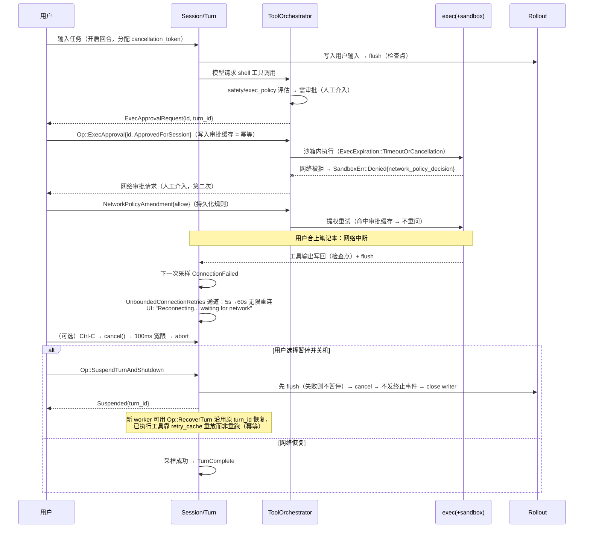

这一个场景里：**超时**（exec 10s / 建连 15s）、**取消**（Ctrl-C 两段式）、**重试**（连接无限通道）、**幂等**（审批缓存 + retry_cache + 序号）、**检查点**（输入/工具输出 flush）、**暂停恢复**（Suspend→Recover 沿用 turn_id）、**人工介入**（执行审批 + 网络审批）、**错误恢复**（沙箱拒绝→提权、断网→重连）全部同时生效且互不干扰——这就是"可靠性作为架构属性"而非"作为补丁"的含义。

---

## 附：可靠性相关文件索引
| 主题 | 路径 |
|------|------|
| 错误模型与重试策略 | `protocol/src/error.rs`、`protocol/src/agent_error.rs` |
| 全局退避 | `async-utils/src/backoff.rs` |
| 请求级重试 | `codex-client/src/retry.rs`、`codex-client/src/sse.rs`、`codex-client/src/provider.rs` |
| HTTP 传输 | `http-client/src/{transport,retry_after,route_aware_client_pool,tls_backend_fallback,outbound_proxy,error}.rs` |
| 流级重试状态机 | `core/src/responses_retry.rs`（+ `_tests.rs`） |
| 模型客户端 / WS 降级 / 认证恢复 | `core/src/client.rs`、`core/src/client/response_delivery.rs` |
| Provider 重试配置 | `model-provider-info/src/lib.rs` |
| 上下文压缩 | `core/src/compact.rs`、`compact_remote_v2*.rs`、`compact_model_fallback.rs`、`compact_retained_tool_outputs.rs`、`compact_token_budget.rs`、`session/async_compaction.rs`、`session/context_window.rs`、`session/token_budget.rs` |
| 执行安全与提权重试 | `core/src/safety.rs`、`core/src/tools/orchestrator.rs`、`core/src/exec.rs`、`core/src/exec_policy.rs`、`core/src/unified_exec/`、`sandboxing/`、`linux-sandbox/`、`bwrap/`、`windows-sandbox-rs/`、`mxc-sandbox/`、`execpolicy/` |
| 进程加固 | `process-hardening/src/lib.rs` |
| 持久化与恢复 | `rollout/src/{recorder,writer_lock,policy,compression,persistence_metrics,state_db}.rs`、`thread-store/`、`core/src/session/daemon_recovery.rs`、`core/src/session/rollout_reconstruction.rs`、`core/src/thread_rollout_truncation.rs`、`core/src/session_rollout_init_error.rs` |
| 远程执行恢复 | `exec-server/src/client_recovery.rs`、`exec-server/src/remote{.rs,/reconnect_backoff.rs,/registration_retry_tests.rs}`、`exec-server/src/client_transport.rs` |
| 远程控制通道 | `app-server-transport/src/transport/remote_control/{websocket.rs,websocket_retry_tests.rs,auth.rs,desired_state.rs,segment.rs}` |
| MCP 可靠性 | `rmcp-client/src/{streamable_http_retry,startup_error,service_error,bounded_stdio_transport,ordered_byte_transport,auth_status}.rs` |
| Guardian 评审重试 | `ext/guardian-reviewer/src/{retry,deadline}.rs` |
| 限流与配额 | `codex-api/src/rate_limits.rs`、`protocol/src/protocol.rs`（`RateLimitSnapshot`） |
| 可观测性 | `otel/`、`analytics/`、`diagnostics/src/lib.rs`、`core/src/turn_timing/`、`response-debug-context/`、`rollout/src/persistence_metrics.rs` |
| 可靠性测试 | `core/tests/suite/{retry_after,abort_lifecycle,abort_tasks,auth_recovery_policy,client_websockets,pending_input}.rs` 等 |
| 取消与中止 | `async-utils/src/lib.rs`（`OrCancelExt`/`CancelErr`）、`core/src/tasks/mod.rs`（`abort_taken_tasks`、`GRACEFULL_INTERRUPTION_TIMEOUT_MS`）、`core/src/session/sampling_interrupt.rs`、`core/src/exec.rs`（`ExecExpiration`） |
| 超时体系 | `core/src/exec.rs`、`core/src/tasks/user_shell.rs`、`core/src/unified_exec/mod.rs`、`core/src/shell_snapshot.rs`、`hooks/src/events/session_end.rs`、`rmcp-client/src/oauth/*`、`cloud-client/src/lib.rs`、`codex-api/src/files.rs` |
| 幂等（工具证据/审批） | `core/src/tools/executed_tool_calls{.rs,/request_metadata.rs}`、`tool-call-id/src/lib.rs`、`core/src/tools/approvals.rs`（`ApprovalCacheKey`）、`rollout/src/ordinal.rs` |
| 检查点 | `core/src/context_manager/history.rs`（`checkpoint_sampling`、`guardian_history_checkpoint`、`world_state_checkpoint`）、`core/src/session/guardian_checkpoint.rs`、`history/`（`CompactedItem`） |
| 暂停/恢复 | `core/src/session/turn_suspension.rs`、`core/src/session/handlers.rs`（`Op::SuspendTurnAndShutdown`/`Op::RecoverTurn`）、`core/src/codex_thread.rs`（`recover_turn_if_idle`）、`core/src/session/daemon_recovery.rs` |
| 人工介入 | `core/src/tools/{approvals,network_approval,native_tool_review}.rs`、`core/src/elicitation.rs`、`core/src/session/review.rs`、`protocol/src/protocol.rs`（`Op::*Approval*`、`ReviewDecision`）、`user-verification/`、`feedback/` |
