# Codex Tools 与 MCP 实现分析

> **分析对象**: `codex/codex-rs`（Rust workspace，133 个 crate）
> **基线版本**: v0.155.1（workspace `version = "0.0.0"`，版本串见 `tui/src/update_versions.rs` 与 `harness-ext/codex-ext/rust-v0.155.1.txt`）
> **许可证**: Apache-2.0
> **分析日期**: 2026-09-21

---

## 目录

1. [总览：Tool 与 MCP 的分层关系](#1-总览tool-与-mcp-的分层关系)
2. [关键 crate 与职责边界](#2-关键-crate-与职责边界)
3. [Tool 系统实现](#3-tool-系统实现)
   - 3.1 [数据模型：ToolSpec 与 Responses API 映射](#31-数据模型toolspec-与-responses-api-映射)
   - 3.2 [ToolExecutor / ToolExposure 抽象](#32-toolexecutor--toolexposure-抽象)
   - 3.3 [注册与构建：build_tool_router 流程](#33-注册与构建build_tool_router-流程)
   - 3.4 [内建工具清单](#34-内建工具清单)
   - 3.5 [工具暴露策略（Direct / Deferred / CodeMode）](#35-工具暴露策略direct--deferred--codemode)
   - 3.6 [Namespace 合并与名字规范化](#36-namespace-合并与名字规范化)
   - 3.7 [调度链路与并发模型](#37-调度链路与并发模型)
   - 3.8 [审批、沙箱与 Orchestrator](#38-审批沙箱与-orchestrator)
4. [MCP 系统实现](#4-mcp-系统实现)
   - 4.1 [配置模型](#41-配置模型)
   - 4.2 [分层架构与依赖](#42-分层架构与依赖)
   - 4.3 [Catalog 解析与 Server 注册](#43-catalog-解析与-server-注册)
   - 4.4 [McpRuntime：publish 与 binding 捕获](#44-mcpruntimepublish-与-binding-捕获)
   - 4.5 [启动策略与连接池](#45-启动策略与连接池)
   - 4.6 [工具目录获取、缓存与分页](#46-工具目录获取缓存与分页)
   - 4.7 [工具调用链路](#47-工具调用链路)
   - 4.8 [审批与 Elicitation](#48-审批与-elicitation)
   - 4.9 [Resources 与 OAuth](#49-resources-与-oauth)
   - 4.10 [Codex 作为 MCP Server](#410-codex-作为-mcp-server)
5. [Tool 与 MCP 的耦合点](#5-tool-与-mcp-的耦合点)
6. [设计取舍与工程约束](#6-设计取舍与工程约束)
7. [附录：常量与文件索引](#7-附录常量与文件索引)

> 接入实践已拆为独立文档：[company-api-integration.md](./company-api-integration.md)

---

## 1. 总览：Tool 与 MCP 的分层关系

Codex 的扩展模型可以用一句话概括：**所有能力都是 Tool，MCP 只是一种 Tool 来源**。

模型侧永远只看到一份扁平的 `tools` 数组（Responses API 的 `Function` / `Namespace` / `Custom` / `ToolSearch`），而这份数组背后由三类来源合成：

| 来源 | 实现位置 | 说明 |
|------|----------|------|
| **内建工具** | `core/src/tools/handlers/*` | shell、apply_patch、unified_exec、web_search、tool_search、multi-agent 等 |
| **MCP 工具** | `core/src/tools/handlers/mcp.rs` + `codex-mcp` | 从外部 MCP server 拉取，动态注册 |
| **扩展工具** | `core/src/tools/handlers/extension_tools.rs` + `ext/extension-api` | 第三方 crate 通过 `ToolContributor` 注入 |

反过来，Codex 自己也可以作为 MCP server 被别的 agent/进程调用（`message-board-mcp`、`tui/src/dynamic_tools_mcp.rs`），形成双向对称。

### 1.1 全景分层架构

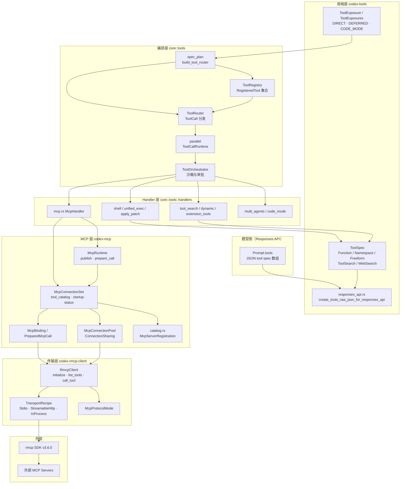

### 1.2 三个正交维度

理解 Codex 工具系统要抓住三个互相独立的维度，这也是阅读源码时最容易混淆的地方：

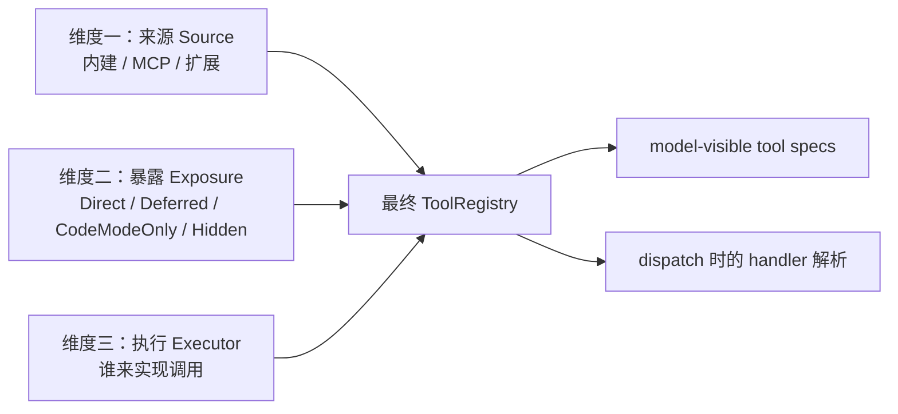

- **Source** 决定工具怎么进入 registry（`add_core_tool_sources` / `append_mcp_tools` / `append_source_tools`）。
- **Exposure** 决定工具是否出现在模型上下文里、以及以什么形态出现（`apply_mcp_tool_exposure_policy`）。
- **Executor** 决定 `ToolCall` 最终落到哪个 handler（`ToolExecutor<Invocation>`）。

---

## 2. 关键 crate 与职责边界

| Crate | 路径 | 职责 | 关键类型 |
|-------|------|------|----------|
| `codex-tools` | `tools/` | 与模型无关的 tool 规格、序列化、执行器抽象 | `ToolSpec`、`ToolExecutor`、`ToolExposure`、`ResponsesApiTool` |
| `codex-core` | `core/` | 工具注册表、路由、handler、审批、沙箱、会话 | `ToolRegistry`、`ToolRouter`、`McpHandler`、`McpManager` |
| `codex-mcp` | `codex-mcp/` | MCP 领域逻辑：catalog、runtime、binding、连接池、elicit | `McpRuntime`、`McpConnectionSet`、`McpBinding` |
| `codex-rmcp-client` | `rmcp-client/` | 官方 rmcp SDK 的封装与进程/HTTP 传输 | `RmcpClient`、`TransportRecipe` |
| `codex-protocol` | `protocol/` | 事件与审批协议 | `EventMsg`、`ElicitationRequest`、`ReviewDecision` |
| `codex-config` | `config/` | `config.toml` 的 MCP 段解析 | `McpServerConfig`、`McpServerTransportConfig` |
| `codex-app-server-protocol` | `app-server-protocol/` | 对外 JSON-RPC 方法定义 | `mcpServer/*` 系列方法 |
| `codex-extension-api` | `ext/extension-api/` | 第三方扩展注入点 | `ToolContributor` |
| `codex-code-mode-protocol` | `code-mode-protocol/` | Code Mode 的 `exec`/`wait` 协议 | `PUBLIC_TOOL_NAME` |

值得注意的是 **`codex-tools` 不依赖 `codex-core`，也不依赖 `codex-mcp`**。这是刻意的分层：工具规格是纯数据 + trait，任何 crate（包括 app-server、SDK 桥接层）都能复用，避免 `core` 变成一个什么都往里塞的巨石。

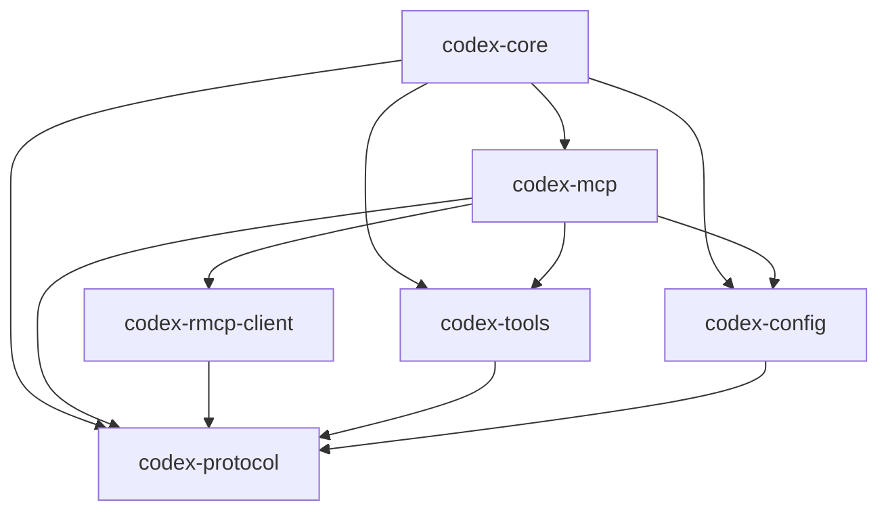

依赖方向自上而下单向，`codex-tools` 位于底层，保证规格定义不会被上层业务污染。

---

## 3. Tool 系统实现

### 3.1 数据模型：ToolSpec 与 Responses API 映射

`tools/src/tool_spec.rs:21` 定义了 5 种规格变体，这 5 种正好对应模型 API 能接受的几种形态：

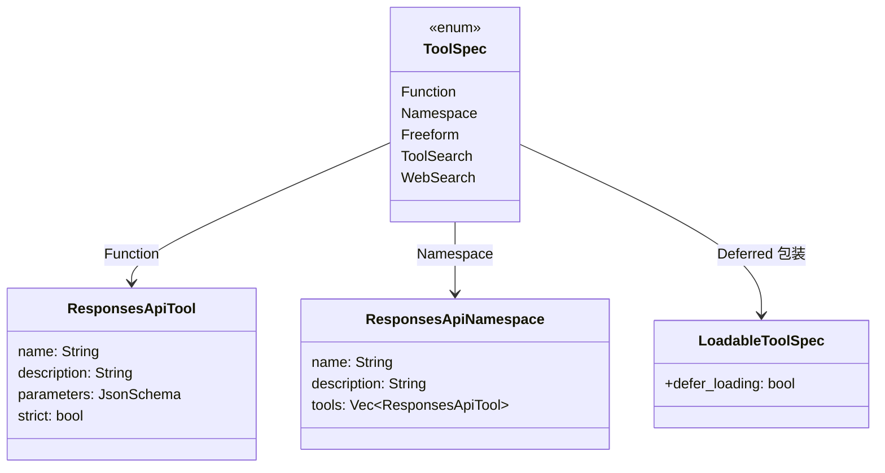

四种形态的语义差异：

| 形态 | wire tag | 用途 | 典型例子 |
|------|----------|------|----------|
| `Function` | `function` | 标准 JSON-schema 函数调用 | `shell`、`unified_exec` |
| `Namespace` | `namespace` | 一组子工具的命名空间（Responses API 原生支持） | `multi_agent_v1.*`、`clock.*`、MCP server 分组 |
| `Freeform` | `custom` | 无 JSON schema，模型输出自由文本（由 grammar 约束） | `apply_patch` 的 patch 文本、`exec` 的脚本 |
| `ToolSearch` | `tool_search` | 元工具：让模型「搜索并加载」被延迟的工具 | 延迟 MCP 工具的检索入口 |
| `WebSearch` | `web_search` | 服务端内置能力，非本地执行 | `web_search` |

两个容易记错的点：

- `Freeform` 在 wire 上的 tag 是 **`custom`**（`#[serde(rename = "custom")]`），不是 `freeform`。对接 Responses API 时看到的 `type: "custom"` 就是它。
- `apply_patch` **不是** `Function` 而是 `Freeform`。它的入参是一整块 patch 文本，用 JSON schema 描述反而会限制模型发挥；`exec` 同理（`code_mode/execute_spec.rs:16`）。

序列化入口是 `responses_api.rs:142 create_tools_raw_json_for_responses_api`，另有一条精简通道 `create_tools_json_for_responses_lite`。两条通道的存在是为了适配不同模型端点对 tool 描述的格式/体积要求。

> **工程细节**：`responses_api.rs:14` 的 `MAX_SERIALIZED_MCP_TOOL_BYTES = 8_000` 会在序列化时丢弃超大的 MCP 工具（`if serde_json::to_vec(&tool)?.len() > MAX_SERIALIZED_MCP_TOOL_BYTES`），防止某个 MCP server 用巨型 schema 撑爆上下文。另有 `tools/src/json_schema/compaction.rs:17 DEFAULT_COMPACT_TOOL_SCHEMA_BYTES = 5_000`，配合 `Config::tool_input_schema_max_bytes`（`core/src/config/mod.rs:1290`）做 schema 压缩。

### 3.2 ToolExecutor / ToolExposure 抽象

`tools/src/tool_executor.rs` 是整个工具系统的「接口契约」：

```rust
// tools/src/tool_executor.rs:106
pub trait ToolExecutor<Invocation>: Send + Sync {
    /// The concrete tool name handled by this runtime instance.
    fn tool_name(&self) -> ToolName;

    fn spec(&self) -> ToolSpec;

    /// The preferred exposure before the host applies step-specific policy.
    fn exposure(&self) -> ToolExposure { ToolExposure::Direct }

    fn search_info(&self) -> Option<ToolSearchInfo> {
        let spec = self.spec();
        ToolSearchInfo::from_tool_spec(spec, /*source_info*/ None)
    }

    fn supports_parallel_tool_calls(&self) -> bool { false }

    /// Handles one invocation without retaining capabilities borrowed by the host.
    fn handle<'a>(&'a self, invocation: Invocation) -> ToolExecutorFuture<'a>
    where
        Invocation: 'a;
}

// tools/src/tool_executor.rs:11
pub type ToolExecutorFuture<'a> =
    Pin<Box<dyn Future<Output = Result<Box<dyn ToolOutput>, FunctionCallError>> + Send + 'a>>;
```

`exposure()` 的注释点出了关键设计：它只是「首选值」（preferred），真正生效的暴露方式由 host 在 `apply_mcp_tool_exposure_policy` 里结合 step 级策略再计算一次。`search_info()` 有默认实现，因此只有需要参与 Tool Search 的工具才需覆盖。`supports_parallel_tool_calls()` 默认 `false`，是**保守默认**——未声明的工具不允许并行，避免有状态 server 被并发打乱。

`ToolExposure`（`tool_executor.rs:51`）是**单值枚举**，描述一个工具「首选的」暴露方式；`ToolExposures`（`tool_executor.rs:17`）是 **bitflags**，描述「允许的」暴露方式集合：

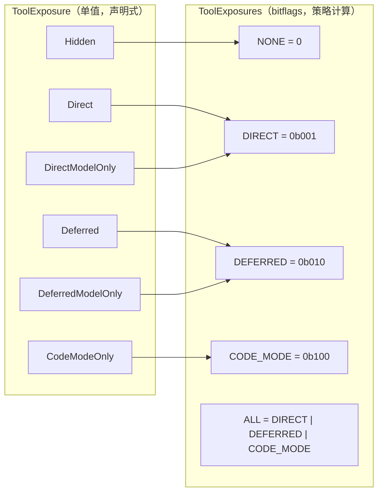

为什么需要 `*ModelOnly` 变体？因为存在「可以让模型看到并调用，但不纳入 Code Mode 的嵌套工具空间」的场景——比如某些工具在 code mode 下语义不安全，或会与 code mode 的执行沙箱冲突。`ModelOnly` 后缀就是用来表达这种「只对模型可见」的限制。

### 3.3 注册与构建：build_tool_router 流程

工具注册的主路径是 `core/src/tools/spec_plan.rs:122 build_tool_router`。它分两个阶段：**收集阶段**在 `build_tool_router` 内完成（把各来源塞进 `ToolRegistry`），**收敛阶段**在 `finalize_tool_router`（`:371`）内完成（裁剪、碰撞检查、生成模型可见规格）。

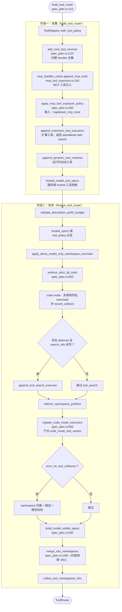

这条链路里有几个**硬性顺序依赖**，改动时若颠倒会静默出错：

1. **`append_mcp_tools` 必须紧邻 `apply_mcp_tool_exposure_policy`**。后者以 `registered_mcp_tools` 作为输入，只对本次真正注册成功的 MCP 工具计算暴露方式。
2. **`append_extension_tool_executors` 在 exposure policy 之后**。它返回 `standalone_web_search_tool`，后者参与 `hosted_model_tool_specs` 的计算；若提前执行，hosted 规格会看不到扩展提供的 web search。
3. **`enforce_strict_3p_tools` 必须先于 `register_code_mode_executors`**。前者会移除不合规的第三方工具，后者据此生成 `exec` 的嵌套工具清单；顺序颠倒会让 code mode 引用到已被删除的工具。
4. **`exec` / `wait` 的同名冲突清理先于注册**。若 registry 里已有同名工具，先 `remove` 再 `record_collision`，避免出现两个 `exec`。
5. **`tool_search` 是条件注册的**。只有「存在 exposure 为 deferred 且 `search_info()` 非空的工具」时才注入，否则不占用上下文——这避免了空索引的浪费。
6. **`register_code_mode_executors` 先于 `build_model_visible_specs`**，因为产出的 `code_mode_tool_names` 是后者的入参（用于在 `exec` 描述里列出可嵌套工具）。
7. **`merge_into_namespaces` 在 `build_model_visible_specs` 内部完成**（`:661`），不是独立阶段——它只处理已经通过可见性过滤的 specs。

> **一个容易踩的坑**：`build_core_tool_registry`（`:296`）与 `append_source_tools`（`:324`）并不在 `build_tool_router` 的调用链上，它们只被测试（`session/tests.rs:1039`、`spec_plan_tests.rs:229`、`router_tests.rs:192`）用来构造最小 registry。读代码时若从这两个函数入手，会得到与实际运行路径不同的顺序结论。

注册 API 有两类，区别在于是否走「可信路径 + 原生 review」：

| API | 位置 | 用途 |
|-----|------|------|
| `register_external_with_exposure` | `registry.rs:627` | 外部来源（MCP、扩展），显式指定 exposure |
| `register_trusted_with_native_review` | `registry.rs:582` | 内建可信工具，带 `NativeReview` 判定 |

`NativeReview`（`registry.rs:436`）表示该工具自带审批语义，不需要外层再套一层通用 review 流程——这是内建 shell/apply_patch 与外部 MCP 工具在审批行为上分叉的根源。

### 3.4 内建工具清单

按 handler 文件归纳（`core/src/tools/handlers/`）：

| Handler 文件 | 工具名 / Namespace | 说明 |
|--------------|-------------------|------|
| `shell.rs` | `shell` | 传统 shell 调用，走沙箱 |
| `unified_exec.rs` | `unified_exec` | 统一执行入口，PTY / 长任务 |
| `apply_patch.rs` | `apply_patch` | Freeform 形态的 patch 应用 |
| `mcp.rs` | 动态，见 3.6 | MCP 工具代理 |
| `mcp_resource.rs` | `list_mcp_resources` / `list_mcp_resource_templates` / `read_mcp_resource` | MCP 资源访问 |
| `tool_search.rs` | `tool_search` | 延迟工具的检索入口 |
| `dynamic.rs` | 动态 | 运行时注入的工具 |
| `extension_tools.rs` | 动态 | `ToolContributor` 注入 |
| `multi_agents_spec.rs` | `multi_agent_v1.*` | 子 agent 编排 |
| `current_time.rs` | `clock.curr_time` | 时间查询 |
| `sleep.rs` | `clock.sleep` | 等待 |
| `code_mode/` | `exec` / `wait` | Code Mode 入口（见 `code-mode-protocol/src/lib.rs:63-64`） |

`clock` namespace 是个小巧但典型的例子：两个独立 handler 通过 `NAMESPACE = "clock"` 共享一个 namespace，最终由 `merge_into_namespaces` 合并成一个 `ResponsesApiNamespace`，模型看到的是 `clock` 下的两个子工具而不是两个平铺函数。

### 3.5 工具暴露策略（Direct / Deferred / CodeMode）

这是 Codex 相对其他 agent 框架最有特色的设计。核心问题是：**当 MCP server 提供 200 个工具时，不可能全部塞进上下文**。

四种策略的取舍：

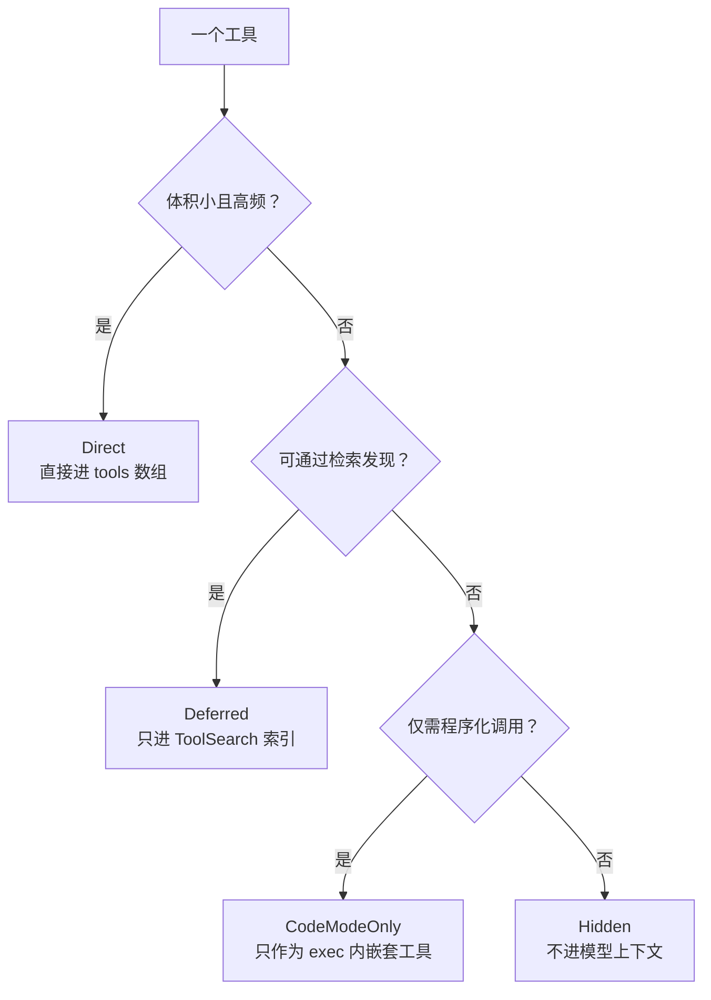

对应的运行时行为：

| Exposure | 初始工具列表 | Tool Search 可发现 | Code Mode 可嵌套 | 典型用途 |
|----------|--------------|--------------------|------------------|----------|
| `Direct` | 是（完整 schema） | 否 | 是 | 默认，高频工具 |
| `Deferred` | 否 | 是 | 是 | 大量低频工具 |
| `DirectModelOnly` | 是 | 否 | 否 | 需要直接调用但 code mode 下不安全 |
| `DeferredModelOnly` | 否 | 是 | 否 | 可检索但不可嵌套 |
| `CodeModeOnly` | 否 | 否 | 是 | 只靠脚本驱动的工具 |
| `Hidden` | 否 | 否 | 否 | 仅 dispatch，模型不可见 |

这张表直接把三个谓词方法（`tool_executor.rs`）翻译成了矩阵，它们是整个暴露策略的**唯一真相源**：

```rust
pub fn is_direct(self) -> bool            // Direct | DirectModelOnly
pub fn is_deferred(self) -> bool          // Deferred | DeferredModelOnly
pub fn is_available_in_code_mode(self)    // Direct | Deferred | CodeModeOnly
```

注意 `Direct` 同时满足 `is_direct` 与 `is_available_in_code_mode`——**直接暴露的工具默认也能在 Code Mode 里嵌套调用**，这是容易误解的一点。`*ModelOnly` 变体的存在意义正在于「只想要其中一个面」。

**Deferred 的实现细节**：`tools/src/tool_search.rs` 定义 `ToolSearchEntry` / `ToolSearchInfo`，只保存名字、简短描述、参数摘要。模型先调 `tool_search` 拿到完整 schema，Codex 再把该工具「提升」为可调用状态。这本质是一个**两阶段懒加载**，用一次额外 round-trip 换取上下文常驻体积的下降。

**CodeMode 的实现细节**：`exec` 工具让模型写一小段代码，在受限运行时里按名字调用其他工具（`ToolCallSource::CodeMode`）。这样 N 个工具只需要 1 个工具描述 + 一份运行时 API 说明，压缩比比 Deferred 更高，代价是需要一个代码执行沙箱与类型桥接层（`code-mode-protocol`）。

`ToolCallSource`（`core/src/tools/context.rs`）枚举 `Direct` / `CodeMode`，让 handler 能感知自己是被直接调用还是被 code mode 间接调用——这对审批提示文案、错误信息、以及是否允许再嵌套调用都很关键。

### 3.6 Namespace 合并与名字规范化

MCP 工具的命名是一套「先规范化、再合并、冲突加哈希、超长截断」的流水线，实现在 `codex-mcp/src/tools.rs`。

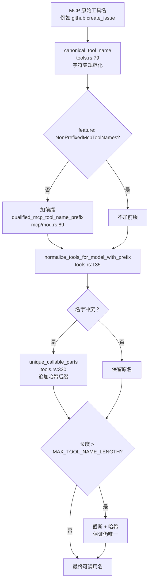

关键常量与约定：

| 项 | 值 / 位置 | 含义 |
|----|-----------|------|
| `MCP_TOOL_NAME_DELIMITER` | `"__"` | namespace 与 tool 之间的分隔符 |
| `LEGACY_MCP_TOOL_NAME_PREFIX` | `"mcp__"` | 旧版前缀，兼容历史会话 |
| `MAX_TOOL_NAME_LENGTH` | 128 字节 | 工具名上限（受 API 限制） |
| `sanitize_responses_api_tool_name` | `mcp/mod.rs:654` | 最终兜底清洗，去掉 API 不接受的字符 |

为什么需要哈希后缀而不是序号？因为**序号不稳定**：MCP server 重启后工具顺序可能变化，序号会让历史会话里的工具名失配；哈希基于「server + 原始工具名」计算，跨进程稳定。

两条前缀路径（`LEGACY_MCP_TOOL_NAME_PREFIX` vs `MCP_TOOL_NAME_DELIMITER`）反映了一次迁移：早期所有 MCP 工具都是 `mcp__server__tool` 的平铺形式，新版改用真正的 `Namespace` 规格（`McpHandler::create_tool_spec` 在 `handlers/mcp.rs:604` 返回 `ToolSpec::Namespace`），`mcp__` 前缀仅用于读取旧 transcript。

### 3.7 调度链路与并发模型

模型输出 → 实际执行的完整链路：

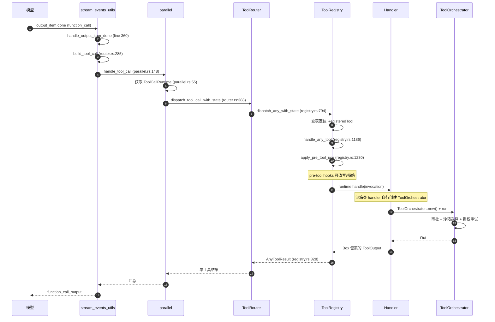

这张图用时序图而非流程图，因为要表达的核心是**调用顺序**与**返回路径**，而不是分支决策。它固定了 7 个参与者：

| 参与者 | 角色 | 关键位置 |
|--------|------|----------|
| `模型` | 发起 `function_call` | Responses API |
| `stream_events_utils` | 把流式事件转成内部 `ToolCall` | `handle_output_item_done:360` |
| `parallel` | 并发准入与结果汇总 | `ToolCallRuntime:55`、`handle_tool_call:148` |
| `ToolRouter` | 按工具名路由到 registry | `dispatch_tool_call_with_state:388` |
| `ToolRegistry` | 持有 `RegisteredTool`，跑 pre-tool hooks | `dispatch_any_with_state:794`、`handle_any_tool:1186` |
| `Handler` | 具体工具实现 | `runtime.handle(invocation)` |
| `ToolOrchestrator` | 审批 + 沙箱编排（仅沙箱类工具） | `orchestrator.rs:43` |

19 个编号步骤按职责分为六个阶段：

| 阶段 | 步骤 | 做了什么 |
|------|------|----------|
| **A. 事件解析** | 1–3 | 模型返回 `output_item.done`（携带 `function_call`）→ `handle_output_item_done` → `build_tool_call`（`router.rs:285`）把它转成内部 `ToolCall` |
| **B. 并发准入** | 4–5 | `handle_tool_call` 取出 `ToolCallRuntime`——并发许可 + 取消令牌在这里获得，**这是全链路唯一的并发管控点** |
| **C. 路由与查表** | 6–9 | `dispatch_tool_call_with_state` → `dispatch_any_with_state` → 查表定位 `RegisteredTool` → `handle_any_tool` |
| **D. 前置钩子** | 10 | `apply_pre_tool_use`，见下方 Note |
| **E. 执行** | 11–13 | `runtime.handle(invocation)` 进入 handler；沙箱类 handler 自己 `ToolOrchestrator::new()` 并 `run`，完成审批 + 沙箱选择 + 提权重试 |
| **F. 回传** | 14–19 | `Out` → `Box` 包裹的 `ToolOutput` → `AnyToolResult`（`registry.rs:328`）→ 单工具结果 → 汇总 → `function_call_output` |

按阶段看，链路是一条几乎线性的管道，只有 D 与 E 两处可能提前退出：

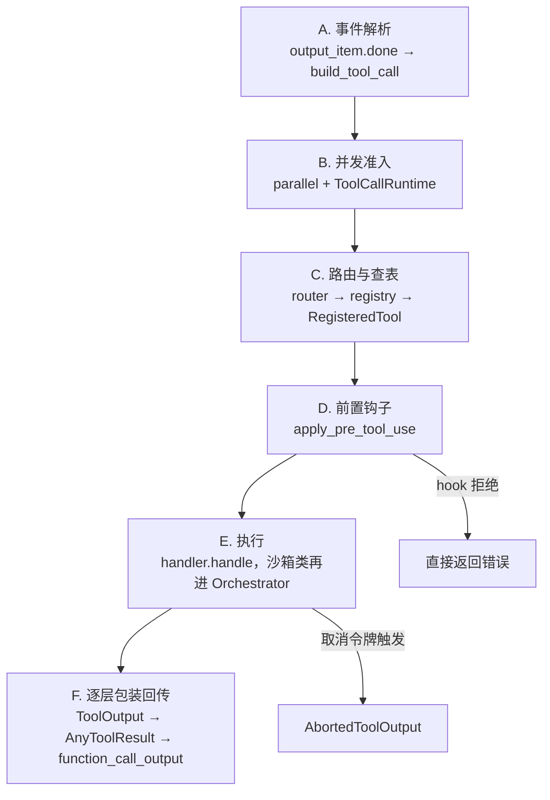

图上的两个 `Note` 是这张图最重要的两条断言：

1. **`Note over G: pre-tool hooks 可改写/拒绝`** —— hook 位于**查表之后、执行之前**。因此它能改写参数、也能直接拒绝，但无法改变「调用哪个工具」：工具选择在阶段 C 就已经确定了。
2. **`Note over H: 沙箱类 handler 自行创建 ToolOrchestrator`** —— orchestrator **不在** registry 与 handler 之间，而在 handler 内部（`apply_patch.rs:606`、`unified_exec/process_manager.rs:1508`）。这直接解释了为什么 MCP handler 不经过它，而走 `mcp_tool_call` 的独立审批链（见 4.7/4.8）。

线型区分了方向语义：

- **实线 `->>`**：调用/下发，逐层深入直到 handler。
- **虚线 `-->>`**：返回，沿原栈**逐层包装**。

返回路径不是简单透传，每层都加自己的语义：handler 返回 `ToolOutput` trait object → registry 包成 `AnyToolResult`（带工具身份与结果类型）→ parallel 汇总多个结果 → stream 层转成模型可消费的 `function_call_output`。

这张图刻意省略了四条分支（分别在别处覆盖）：

- **多工具并行**：同一轮的多个 `function_call` 会在 `parallel` 层并发展开，图上只画一条。
- **Code Mode 分支**：嵌套调用走 `handle_tool_call_with_source` 与 `dispatch_tool_call_with_code_mode_result_inner`，并发记账语义与顶层不同。
- **MCP 分支**：`McpHandler` 不经过 `ToolOrchestrator`。
- **错误与取消**：`FunctionCallError` 沿同一路径回传；`CancellationToken` 触发时返回 `AbortedToolOutput`（`context.rs`），这两个出口在图上没有画出。

并发模型要点：

- `ToolCallRuntime`（`parallel.rs:55`）持有会话级并发许可与取消令牌。同一轮模型输出里的多个 `function_call` 可以并行，但受全局并发上限与「独占型工具」约束。
- `handle_tool_call_with_source`（`parallel.rs:201`）是带来源信息的变体，code mode 内部调用走这条路径，避免与顶层直接调用混淆并发记账。
- `dispatch_tool_call_with_code_mode_result_inner`（`router.rs:411`）是 code mode 结果的专用通道：它把嵌套调用的结果包装成 code mode 能消费的形态，而不是直接作为 `function_call_output` 返回。

### 3.8 审批、沙箱与 Orchestrator

`ToolOrchestrator`（`core/src/tools/orchestrator.rs:43`）是审批与沙箱的编排器，但它**不是全局阶段**——由需要沙箱的 handler 在内部实例化，配合 `ToolRuntime` trait（`sandboxing.rs:389`）：

```rust
// core/src/tools/sandboxing.rs:389
pub(crate) trait ToolRuntime<Req, Out>: Approvable<Req> + Sandboxable {
    fn turn_environment<'a>(&self, req: &'a Req) -> &'a TurnEnvironment;
    fn network_approval_spec(&self, _req: &Req, _ctx: &ToolCtx) -> Option<NetworkApprovalSpec> { None }
    async fn run(&mut self, req: &Req, attempt: &SandboxAttempt<'_>, ctx: &ToolCtx)
        -> Result<Out, ToolError>;
}
```

注意 `Approvable + Sandboxable` 这两个 supertrait 约束：**审批与沙箱是编译期强制的**，任何 `ToolRuntime` 实现都必须回答「这个请求需要什么审批」和「能否在沙箱里跑」，不能绕过。这比运行时 `if needs_approval` 分支要可靠得多。

`SandboxAttempt`（`sandboxing.rs:412`）携带 `sandbox_override` 与 `local_selection`，支持「先沙箱跑、失败后申请提权重试」的经典模式。

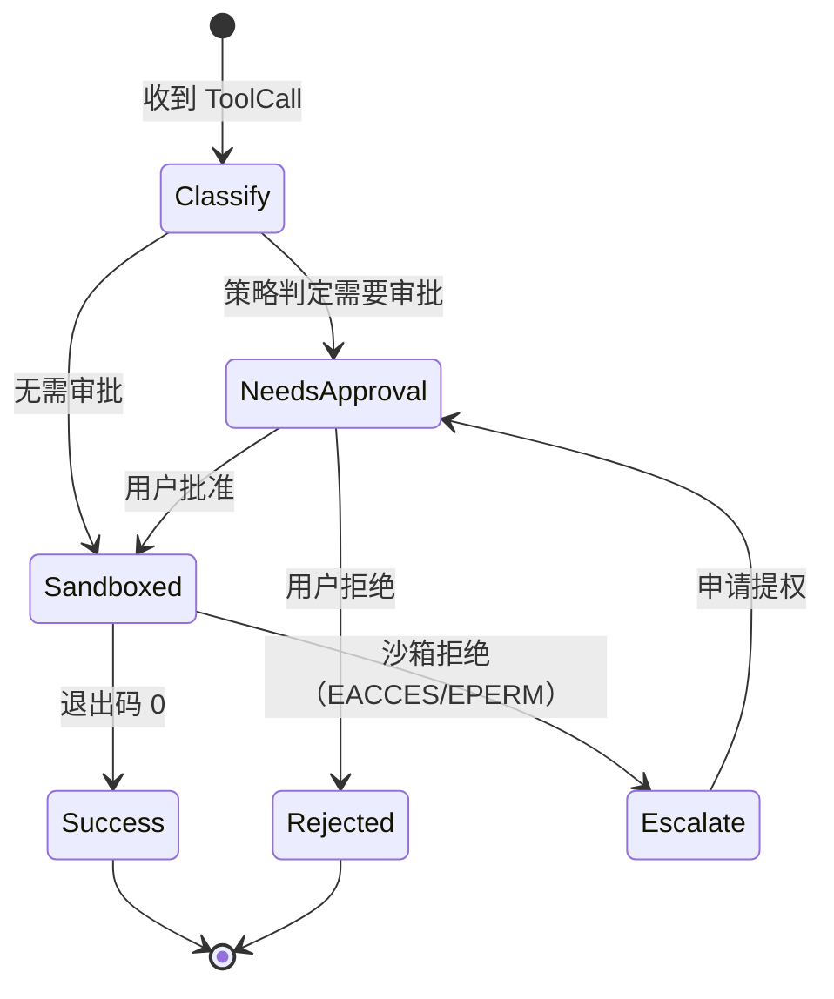

---

## 4. MCP 系统实现

### 4.1 配置模型

MCP 配置来自三层合并：全局 `~/.codex/config.toml`、项目级配置、以及 plugin/extension 注册。加载入口 `core/src/config/mod.rs:2571 load_global_mcp_servers`。

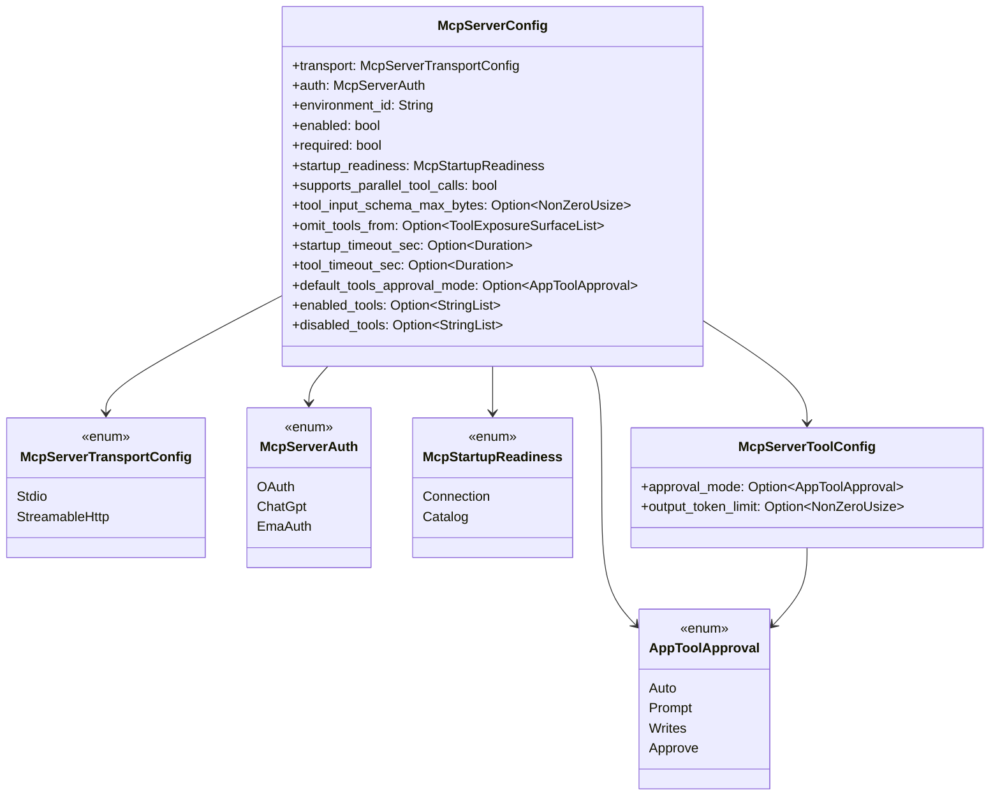

注意 `transport` 字段带 `#[serde(flatten)]`——`Stdio` 与 `StreamableHttp` 的字段直接平铺在 `[mcp_servers.X]` 表里，所以配置文件写的是 `command = "..."` 或 `url = "..."`，而不是嵌套的 `transport = { ... }`。

`enabled_tools` / `disabled_tools`（类型为 `Option<Vec<String>>`）是**先允许后拒绝**的两段式过滤：先按 allow-list 收窄，再按 deny-list 剔除。两个字段都为 `None` 时不做任何过滤，全部暴露。

`McpStartupReadiness`（`config/src/mcp_types.rs:218`）区分两种「就绪」语义，这一点很重要：

- `Connection`：TCP/进程握手完成即可用，工具列表可以稍后懒加载。
- `Catalog`：必须拿到工具目录才算就绪，适用于「工具目录决定后续行为」的场景（如 codex_apps）。

`McpServerAuth`（同文件 `:198`）的三种变体对应三种鉴权来源：标准 OAuth 流程、ChatGPT 账号体系、以及 EmaAuth（内部/企业通道）。

### 4.2 分层架构与依赖

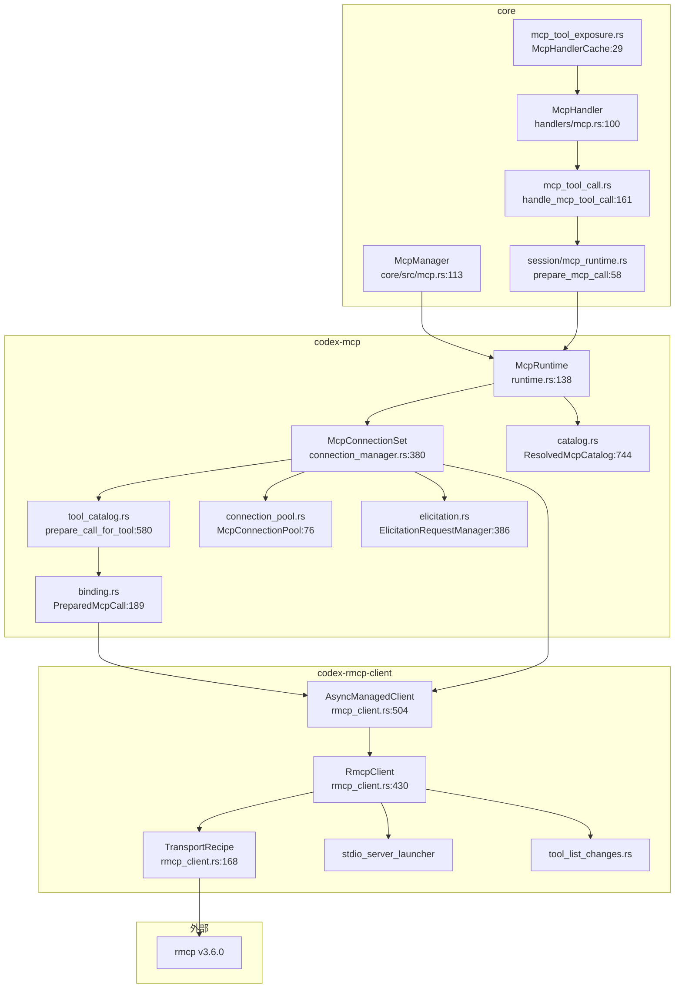

### 4.3 Catalog 解析与 Server 注册

`catalog.rs` 把「配置里的 server」与「运行时实际可用的 server」解耦，中间层是 `McpServerRegistration`（`catalog.rs:163`）与 `ResolvedMcpCatalog`（`catalog.rs:744`）。

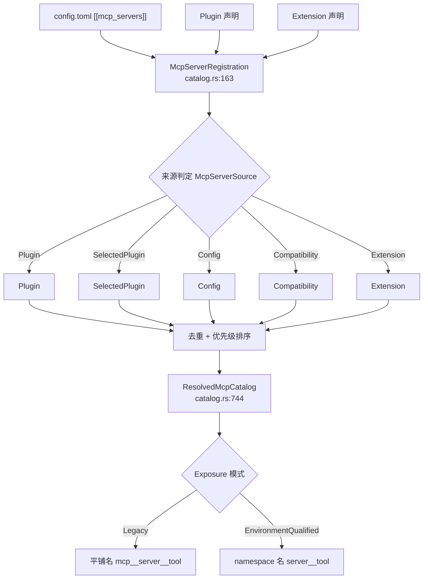

`McpServerSource` 的五种来源带优先级语义：显式 `Config` 覆盖 plugin 默认值，`Compatibility` 用于兼容预置 server，`SelectedPlugin` 表示用户在 UI 里主动勾选的 plugin。这个优先级在去重时决定谁胜出。

`McpServerExposure{Legacy, EnvironmentQualified}` 决定工具名的拼装方式，与 3.6 的前缀逻辑联动。

### 4.4 McpRuntime：publish 与 binding 捕获

`McpRuntime`（`runtime.rs:138`）是 MCP 状态的单一真相源，核心是「发布-订阅 + 绑定快照」模型。

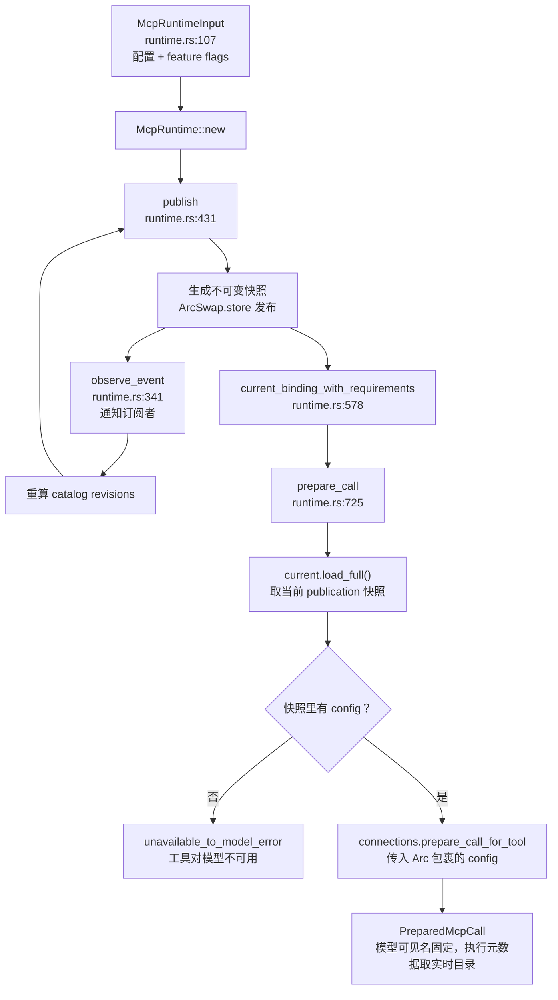

为什么要「绑定快照」而不是每次调用都查当前配置？因为一次工具调用跨越多层 async await，中途 MCP server 可能被重启、配置可能被 reload。**捕获 binding 相当于给这次调用一个稳定的一致性视图**，避免出现「用旧 server 的连接、新 server 的工具名」这种撕裂状态。`McpHandler::handle_call` 里的注释把这个意图写得很直白：

```rust
// Use the executed call's binding; a later catalog refresh must not change eligibility.
```

`McpRuntime` 用 `ArcSwap<PublishedMcpRuntime>` 做无锁快照读写（而不是 `watch` channel）：`prepare_call` 只需一次 `load_full()` 拿到整个一致性视图。发布新快照时，旧连接集不会被立即销毁，而是以 `Weak` 形式进入 `superseded_connections`：

```rust
// Old bindings keep leases alive after publication; cancellation alone does not release them.
superseded_connections: Mutex<Vec<Weak<McpConnectionSet>>>,
```

这是**优雅停机**的关键：在飞的调用持有 lease，旧连接集因此保持存活，直到最后一个 lease 释放才真正关闭。仅靠 cancellation token 做不到这一点——取消会打断在飞请求，而这里需要的是「让已完成的工作自然结束」。

`McpRuntimeContext`（`runtime.rs:1204`）承载跨调用的共享上下文（连接集、elicitation manager、network policy 等），通过 `Arc` 传递，避免每层重复构造。

### 4.5 启动策略与连接池

`McpStartupPolicy` 有三档，选择逻辑在 `core/src/session/mcp_runtime.rs`：

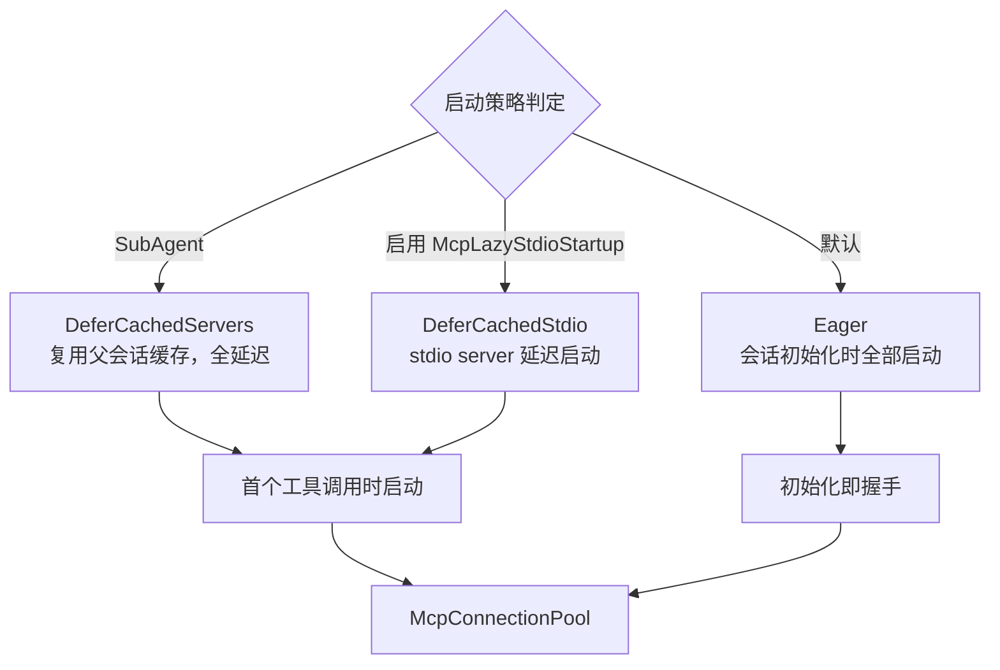

设计动机：

- **`Eager`** 适合交互式主会话——用户随时可能触发任意 MCP 工具，提前握手摊薄延迟。
- **`DeferCachedStdio`** 解决「配置了 20 个 stdio MCP server，但一轮对话只用 1 个」的冷启动开销。stdio server 的启动成本（进程 fork + 协议握手）远高于 HTTP，因此优先延迟。
- **`DeferCachedServers`** 用于 sub-agent：子 agent 继承父会话已建立的连接缓存，几乎零启动成本；未缓存的则延迟到首次使用。

连接池 `McpConnectionPool`（`connection_pool.rs:76`）用 `ConnectionSharing` 表达四种共享级别：

| 变体 | 语义 |
|------|------|
| `Private` | 独占，不共享（有状态或有副作用的 server） |
| `Negotiated` | 与 server 协商后决定是否共享 |
| `Owned` | 由当前会话拥有，可借出 |
| `Shared` | 全局共享（无状态只读 server） |

`lease` 机制保证借出的连接在归还前不会被回收，同时允许 `Owned` 连接在借用期间被多个调用复用。

### 4.6 工具目录获取、缓存与分页

工具目录是 MCP 里最贵的一次 RPC（可能返回数百 KB JSON），因此在到达传输层之前有两级进程内缓存，传输层自身再持有一份目录快照：

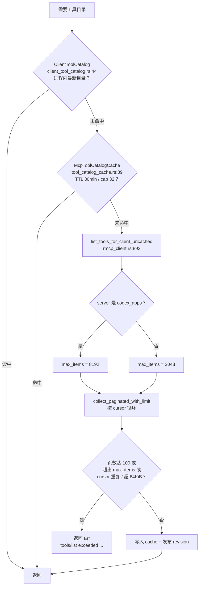

关键参数（均在 `codex-mcp/src/pagination.rs`）：

| 参数 | 值 | 位置 |
|------|-----|------|
| `MAX_MCP_CATALOG_ITEMS` | 2048 | `:10` |
| `MAX_CODEX_APPS_TOOL_CATALOG_ITEMS` | 8192 | `:11` |
| `MAX_MCP_CATALOG_PAGES` | 100 | `:9` |
| `MAX_MCP_PAGINATION_CURSOR_BYTES` | 64 KiB | `:12` |
| `DEFAULT_MCP_PAGINATION_TIMEOUT` | 30 s | `:13` |
| Catalog cache TTL | 30 min | `tool_catalog_cache.rs:35` |
| Catalog cache capacity | 32 servers | `tool_catalog_cache.rs:34` |
| 通知合并冷却 | 5 s | `client_tool_catalog.rs` |

**超限是硬错误，不是截断**。`collect_paginated_with_limit` 一旦发现累计条目超过 `max_items`、页数达到 100、或 cursor 重复/超长，直接返回 `Err`（错误文案形如 `tools/list exceeded the catalog limit of 2048 items`），整个 server 的目录获取失败，而不是给模型一个残缺的工具集。

这个选择值得推敲：截断看起来「更可用」，但会让模型误以为工具不存在，进而放弃本该走 MCP 的任务；而硬错至少能在 status 与日志里暴露问题。考虑到 2048 个工具早已超出任何模型的上下文容量，报错确实是更诚实的行为。

`max_items` 的来源是分支选择（`connection_manager.rs:556`）：codex_apps 用 8192，其余用 2048——前者作为官方聚合应用市场，工具数量天然更大。

**`tool_list_changes` 的增量更新**：`rmcp-client/src/tool_list_changes.rs:20 ToolListRevision` 用 `Arc<AtomicU64>` 做版本号。当 server 发 `notifications/tools/list_changed` 时，不是立刻重新拉全量目录，而是：
1. 递增 revision；
2. 按**传输顺序**标记失效（stdio 与 HTTP 的失效语义不同）；
3. 由 `ClientToolCatalog` 的 5 秒冷却窗口合并连续通知，避免 server 抖动导致 RPC 风暴。

`stable_catalog_revisions`（`tool_catalog.rs:124`）保证在工具列表变化时，已捕获的 binding 不会静默指向不存在的工具——`tool_is_model_visible`（`tool_catalog.rs:49`）在调用前做最终可见性校验。

### 4.7 工具调用链路

这是整个系统最深的一条调用栈，共 10 层：

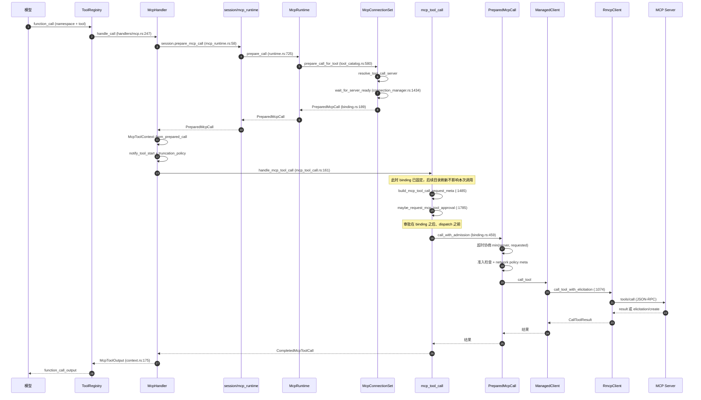

每一层都有明确职责，没有「透传层」：

| 层 | 职责 | 若缺失会怎样 |
|----|------|--------------|
| `McpHandler` | namespace → server/tool 反解、spec 生成、binding 准备、结果包装 | 模型看到的 namespace 无法映射回真实工具 |
| `session/mcp_runtime` | 会话级策略（启动策略、缓存、等待就绪） | 无法按会话类型差异化 |
| `McpRuntime` | publication 快照、catalog 一致性、事件发布 | 配置 reload 时出现撕裂状态 |
| `McpConnectionSet` | 连接生命周期、server 解析、就绪等待 | 调用可能打到未就绪的 server |
| `mcp_tool_call` | 审批、request meta 注入、dispatch 编排 | 审批逻辑会散落到各 handler |
| `PreparedMcpCall` | 超时协商、准入控制、网络策略 | 无法限流，可能打爆 server |
| `ManagedClient` | 重连、退避、tool catalog 快照 | 重试逻辑重复实现 |
| `RmcpClient` | 协议编解码、elicitation 处理 | 与 rmcp SDK 强耦合扩散到上层 |

**超时与重连**（`rmcp-client/src/rmcp_client.rs`）：

| 常量 | 值 | 用途 |
|------|-----|------|
| `DEFAULT_STARTUP_TIMEOUT` | 30 s | 进程启动 + initialize 握手 |
| `DEFAULT_TOOL_TIMEOUT` | 300 s | 单次 `tools/call` |
| Apps 重连退避 | 1 s → 30 s | 指数退避，针对 codex_apps |

### 4.8 审批与 Elicitation

MCP 工具的审批比内建工具复杂，因为要同时处理「本地策略」和「server 主动提问」两条路径。

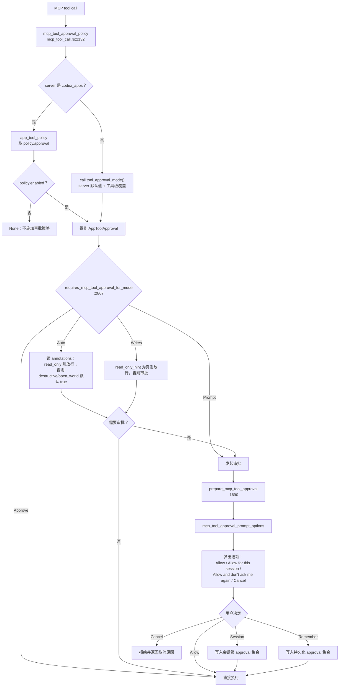

四种 `AppToolApproval` 的语义（`mcp_tool_call.rs:2867`）：

| 模式 | 行为 |
|------|------|
| `Auto` | 依赖 MCP `ToolAnnotations`：`read_only_hint` 为真直接放行；否则看 `destructive_hint` / `open_world_hint`（缺省视为 `true`，即**未知即危险**） |
| `Prompt` | 一律审批 |
| `Writes` | 只读工具放行，其余审批 |
| `Approve` | 一律放行 |

`Auto` 与 `Writes` 的取舍很微妙：`Auto` 信任 `destructive_hint`，`Writes` 只信任 `read_only_hint`。两者**互不可比**（各自可能对另一个放行的工具要求审批），因此 `AppToolApproval::restrict_to` 在两者交叉时退化为 `Prompt`——取保守交集，宁可多问。

四个选项的可用性由 `mcp_tool_approval_prompt_options(allow_session_remember, allow_persistent_approval, tool_call_mcp_elicitation_enabled)` 决定——**`allow_persistent_approval` 需要 `tool_call_mcp_elicitation_enabled` 为真**，也就是说持久记忆依赖 elicitation 通道可用。

审批记忆的 key 是 `McpToolApprovalKey`：

```rust
// core/src/mcp_tool_call.rs
struct McpToolApprovalKey {
    server: McpServerKey,
    plugin_id: Option<String>,
    connector_id: Option<String>,
    link_id: Option<String>,
    tool_name: String,
}
```

注意 key 里包含 `connector_id` / `link_id`：**同名工具在不同连接器下是不同权限主体**。这个设计避免了「批准了 A 工作区的 create_issue，结果 B 工作区也被放行」的越权。

### 4.9 Resources 与 OAuth

MCP 除了 tools 还有 resources。Codex 用 `McpResourceClient`（`codex-mcp/src/resource_client.rs:188`）单独管理，并带缓存键：

```rust
pub struct McpResourceClientCacheKey(Weak<McpConnectionSet>);   // :194
pub struct McpResourceClientAuthKey { /* ... */ }               // :225
```

用 `Weak` 而非 `Arc` 做缓存键，是为了**避免 resource client 反向持有 connection set 导致生命周期泄漏**。当连接集被回收，弱引用失效，缓存项可被清理。

对外暴露的是三个工具：`list_mcp_resources`、`list_mcp_resource_templates`、`read_mcp_resource`（`handlers/mcp_resource/`）。

与 tool call 不同，**资源读取不经过 MCP 工具审批链**——`mcp_resource/` 下没有任何 approval 逻辑。这是一个有意的不对称：resource 通常只读，而 tools 可能产生副作用；如果把 resource 也拉进审批，每次读文件都要弹窗。资源访问的约束完全依赖工具策略与可见性（即这三个工具能否被模型看到）。

OAuth 流程由 `rmcp-client/src/perform_oauth_login.rs:111` 实现，触发入口是 app-server 的 `mcpServer/oauth/login` 方法与 CLI 的 `codex mcp login`。

### 4.10 Codex 作为 MCP Server

对称性设计：Codex 不仅消费 MCP，也生产 MCP。

| 实现 | 位置 | 用途 |
|------|------|------|
| `MessageBoardMcpServer` | `message-board-mcp/src/lib.rs:51` | 实现 `rmcp::ServerHandler`，暴露消息板能力给其他 agent |
| `DynamicToolMcpHandler` | `tui/src/dynamic_tools_mcp.rs:210` | 用 `StreamableHttpService` + `LocalSessionManager` 把 TUI 动态工具暴露出去 |

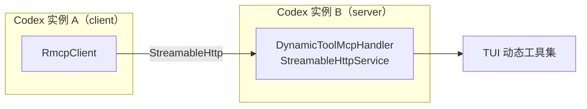

这条路径的实际意义：**多 Codex 实例协作**。一个实例可以把另一个实例的工具当作 MCP 工具挂载，形成 agent 网络而无需共享进程状态。

---

## 5. Tool 与 MCP 的耦合点

Tool 系统与 MCP 系统在四个位置强耦合，修改任一侧都需要同步考虑另一侧：

```mermaid
flowchart TB
    subgraph C1["耦合点 1：暴露策略"]
        A1["apply_mcp_tool_exposure_policy<br/>spec_plan.rs:200"]
        A2["ToolExposures bitflags"]
        A1 --> A2
    end
    subgraph C2["耦合点 2：Namespace"]
        B1["McpHandler::create_tool_spec<br/>handlers/mcp.rs:604"]
        B2["merge_into_namespaces<br/>spec_plan.rs:1060"]
        B1 --> B2
    end
    subgraph C3["耦合点 3：Code Mode 嵌套"]
        D1["register_code_mode_executors<br/>spec_plan.rs:956"]
        D2["ToolCallSource::CodeMode"]
        D1 --> D2
    end
    subgraph C4["耦合点 4：审批"]
        E1["NativeReview (内建)"]
        E2["mcp_tool_approval_policy (MCP)"]
        E1 --> E3["统一 ReviewDecision"]
        E2 --> E3
    end
```

**耦合点 1** 最容易出错：`apply_mcp_tool_exposure_policy` 依据 feature flags（`ToolSearchAlwaysDeferMcpTools`、`CodeMode`、`CodeModeOnly` 等）与 per-server 配置（`McpServerToolConfig.approval_mode`、`McpServerConfig.enabled_tools` / `disabled_tools` / `omit_tools_from`）计算 `ToolExposures`。

另一道兜底容易被忽略：`enforce_strict_3p_tools`（`spec_plan.rs:605`）并不报错，而是在启用 `CodeModeOnlyStrictThirdPartyTools` 时，把所有第三方工具的 `exposure` **强制改成 `Deferred`**（已经是 `Hidden` 的保持不变），并打一条 `tracing::warn!`。这个设计意味着开启严格模式不会让任务直接失败，而是默默把工具从上下文里挤出去——排查「工具消失」时如果不看 warn 日志，很难定位。

**耦合点 3** 的隐藏复杂度：code mode 下的嵌套工具调用不经过 `parallel.rs` 的顶层并发记账，而是走 `dispatch_tool_call_with_code_mode_result_inner`。这意味着**并发上限的语义在两种调用方式下不同**，排查限流问题时要区分来源。

**耦合点 4** 的差异：内建工具靠 `NativeReview` 自述审批需求，MCP 工具靠 `mcp_tool_approval_policy` 集中判定。两者最终都收敛到 `ReviewDecision`，但配置入口完全不同（前者在代码里，后者在 `config.toml` 的 `[mcp_servers.X.tools.Y]`）。

### 5.1 Feature flags 影响面

| Feature | 影响 |
|---------|------|
| `Mcp20260728` | 启用新版 MCP 协议模式 `V20260728` |
| `CodexAppsMcp20260728` | codex_apps 走新协议 |
| `McpToolListChanged` | 启用 `notifications/tools/list_changed` 增量更新 |
| `McpConnectionSharing` | 启用 `ConnectionSharing` 连接复用 |
| `McpLazyStdioStartup` | 启用 `DeferCachedStdio` 启动策略 |
| `MultiEnvironmentMcp` | 工具名带环境限定（`EnvironmentQualified`） |
| `NonPrefixedMcpToolNames` | 去掉 `mcp__` 前缀 |
| `CodeMode` / `CodeModeOnly` | 启用 code mode 通道 |
| `ToolSearchAlwaysDeferMcpTools` | 所有 MCP 工具强制 `Deferred` |

这些 flag 的组合决定了同一份 `config.toml` 在不同版本/环境下产生**不同的模型可见工具集**——这是排查「工具明明配了但模型看不到」问题的第一检查点。

---

## 6. 设计取舍与工程约束

### 6.1 为什么用 Namespace 而不是平铺

平铺方案下 200 个 MCP 工具 = 200 个顶层函数，模型容易混淆同名工具（`github.create_issue` vs `jira.create_issue`）。Namespace 让模型先选 server 再选工具，同时让名字冲突的解决局部化到 namespace 内部。

代价是**多一层解析**：`McpHandler` 必须把 `namespace + tool` 反解回 `server + original_tool_name`，且要处理 namespace 合并（多个 server 归入同一 namespace）后的歧义。`stable_catalog_revisions` 就是为保证这层反解的一致性而存在的。

### 6.2 为什么缓存要分三层

| 层 | 失效粒度 | 存在理由 |
|----|----------|----------|
| `ClientToolCatalog` | 通知驱动（5s 冷却） | 进程内最快路径，吸收连续调用 |
| `McpToolCatalogCache` | TTL 30min + LRU 32 | 跨会话复用，避免重复握手拉目录 |
| `RmcpClient` 内部 | 连接级 | 同一连接上的 `list_tools` 幂等缓存 |

三层各有独立失效条件，看起来冗余，但对应三种不同的「变化源」：server 主动通知、时间衰减、连接重建。合层会导致「一个 server 通知就清空所有 server 缓存」的放大效应。

### 6.3 已知的复杂度热点

按代码复杂度排序，这几个文件是维护风险最高的：

| 文件 | 行数 | 复杂度来源 |
|------|------|-----------|
| `core/src/mcp_tool_call.rs` | 2924 | 审批策略矩阵 × 记忆 × 取消原因 |
| `codex-mcp/src/rmcp_client.rs` | 1903 | 三种传输 × 重连退避 × 协议模式 |
| `core/src/tools/spec_plan.rs` | 1678 | 注册顺序 × 暴露策略 × namespace 合并 |
| `codex-mcp/src/connection_manager.rs` | 1664 | 连接生命周期 × 就绪等待 × 多环境 |

`mcp_tool_call.rs` 里 `requires_mcp_tool_approval` 在 2853 行、`mcp_tool_approval_policy` 在 2132 行——两个语义相关但相距 700 行的函数，是重构时的首要目标。

### 6.4 可观测性缺口

从代码看，MCP 调用的可观测性主要依赖：
- app-server 的 `mcpServer/event/stream/start` 事件流；
- `McpServerView`（`connection_manager.rs:254`）暴露的 server 状态快照；
- tracing span（跨层传递 `McpRuntimeContext`）。

缺口在于：**没有统一的「工具调用决策追踪」**——即「为什么这个工具对模型不可见」（是 feature flag？exposure policy？还是 catalog 未就绪？）需要人工逐层排查。这是 `apply_mcp_tool_exposure_policy` 缺少诊断输出的直接后果。

---

---

## 7. 附录：常量与文件索引

### 7.1 关键常量

| 常量 | 值 | 位置 |
|------|-----|------|
| `MCP_TOOL_NAME_DELIMITER` | `"__"` | `codex-mcp/src/tools.rs:266`（私有） |
| `LEGACY_MCP_TOOL_NAME_PREFIX` | `"mcp__"` | `codex-mcp/src/tools.rs:24`（私有） |
| `MAX_TOOL_NAME_LENGTH` | 128 | `codex-mcp/src/tools.rs:267`（私有） |
| `MAX_SERIALIZED_MCP_TOOL_BYTES` | 8000 | `tools/src/responses_api.rs:14` |
| `DEFAULT_COMPACT_TOOL_SCHEMA_BYTES` | 5000 | `tools/src/json_schema/compaction.rs:17` |
| `MAX_MCP_CATALOG_ITEMS` | 2048 | `codex-mcp/src/pagination.rs:10` |
| `MAX_CODEX_APPS_TOOL_CATALOG_ITEMS` | 8192 | `codex-mcp/src/pagination.rs:11` |
| `DEFAULT_STARTUP_TIMEOUT` | 30 s | `codex-mcp/src/rmcp_client.rs:124` |
| `DEFAULT_TOOL_TIMEOUT` | 300 s | `codex-mcp/src/rmcp_client.rs:125` |
| `DEFAULT_OPTIONAL_MCP_STARTUP_GRACE` | 1 s | `codex-mcp/src/mcp/mod.rs:235` |
| `CODEX_APPS_MCP_SERVER_NAME` | `"codex_apps"` | `codex-mcp/src/mcp/mod.rs` |
| `MULTI_AGENT_V1_NAMESPACE` | `"multi_agent_v1"` | `core/src/tools/handlers/multi_agents_spec.rs:14` |
| `PUBLIC_TOOL_NAME` / `WAIT_TOOL_NAME` | `"exec"` / `"wait"` | `code-mode-protocol/src/lib.rs:63-64` |

### 7.2 核心文件索引

**Tool 系统**

| 文件 | 关键符号 |
|------|----------|
| `core/src/tools/registry.rs` | `ToolRegistry:470`、`RegisteredTool:443`、`dispatch_any_with_state:794`、`handle_any_tool:1186`、`apply_pre_tool_use:1230` |
| `core/src/tools/router.rs` | `ToolRouter:100`、`ToolCall:50`、`build_tool_call:285`、`dispatch_tool_call_with_state:388` |
| `core/src/tools/spec_plan.rs` | `build_tool_router:122`、`build_model_visible_specs:630`、`merge_into_namespaces:1060` |
| `core/src/tools/parallel.rs` | `ToolCallRuntime:55`、`handle_tool_call:148`、`handle_tool_call_with_source:201` |
| `core/src/tools/orchestrator.rs` | `ToolOrchestrator:43` |
| `core/src/tools/sandboxing.rs` | `ToolRuntime:389`、`SandboxAttempt:412` |
| `core/src/tools/context.rs` | `ToolInvocation:115`、`McpToolOutput:175`、`ToolCallSource` |
| `core/src/tools/handlers/mcp.rs` | `McpHandler:100`、`McpHandlerDefinition:57`、`handle_call:247`、`create_tool_spec:604` |
| `tools/src/tool_spec.rs` | `ToolSpec:21` |
| `tools/src/tool_executor.rs` | `ToolExposures:17`、`ToolExposure:51`、`ToolExecutor:106` |
| `tools/src/responses_api.rs` | `ResponsesApiTool:33`、`ResponsesApiNamespace:59`、`LoadableToolSpec:50` |

**MCP 系统**

| 文件 | 关键符号 |
|------|----------|
| `codex-mcp/src/runtime.rs` | `McpRuntime:138`、`publish:431`、`prepare_call:725`、`current_binding_with_requirements:578` |
| `codex-mcp/src/connection_manager.rs` | `McpConnectionSet:380`、`McpServerView:254`、`call_tool:1515`、`wait_for_server_ready:1434` |
| `codex-mcp/src/connection_manager/tool_catalog.rs` | `capture_binding_with_metadata:295`、`prepare_call_for_tool:580`、`stable_catalog_revisions:124` |
| `codex-mcp/src/binding.rs` | `McpBinding:38`、`PreparedMcpCall:189`、`call_with_admission:459` |
| `codex-mcp/src/tools.rs` | `ToolInfo:27`、`canonical_tool_name:79`、`normalize_tools_for_model_with_prefix:135`、`unique_callable_parts:330` |
| `codex-mcp/src/catalog.rs` | `McpServerSource`、`McpServerRegistration:163`、`ResolvedMcpCatalog:744` |
| `codex-mcp/src/connection_pool.rs` | `McpConnectionPool:76`、`ConnectionSharing` |
| `codex-mcp/src/client_tool_catalog.rs` | `ClientToolCatalog:44` |
| `codex-mcp/src/tool_catalog_cache.rs` | `McpToolCatalogCache:39` |
| `codex-mcp/src/elicitation.rs` | `ElicitationRequestManager:386` |
| `codex-mcp/src/resource_client.rs` | `McpResourceClient:188` |
| `rmcp-client/src/rmcp_client.rs` | `TransportRecipe:168`、`RmcpClient:430`、`call_tool_with_elicitation:1074` |
| `rmcp-client/src/tool_list_changes.rs` | `ToolListRevision:20` |
| `rmcp-client/src/protocol_mode.rs` | `McpProtocolMode` |

**Core MCP 集成**

| 文件 | 关键符号 |
|------|----------|
| `core/src/mcp.rs` | `McpManager:113`、`runtime_config_for_step:221` |
| `core/src/mcp_tool_call.rs` | `handle_mcp_tool_call:161`、`prepare_mcp_tool_approval:1690`、`maybe_request_mcp_tool_approval:1785`、`mcp_tool_approval_policy:2132` |
| `core/src/mcp_tool_exposure.rs` | `McpHandlerCache:29`、`append_mcp_tools:104` |
| `core/src/session/mcp_runtime.rs` | `wait_for_mcp_server:49`、`prepare_mcp_call:58` |
| `core/src/session/mcp.rs` | `runtime_mcp_config:83`、`resolve_elicitation:867` |
| `core/src/hook_mcp_executor.rs` | `CoreHookMcpExecutor:28` |

### 7.3 app-server 对外方法

| 方法 | 用途 |
|------|------|
| `mcpServer/oauth/login` | 触发 OAuth 登录流程 |
| `config/mcpServer/reload` | 重新加载 MCP 配置 |
| `mcpServerStatus/list` | 查询 server 状态快照 |
| `mcpServer/resource/read` | 读取 MCP resource |
| `mcpServer/event/stream/start` / `stop` | 订阅/取消事件流 |
| `mcpServer/tool/call` | 直接调用 MCP 工具（绕过模型） |
| `mcpServer/elicitation/request` | server 主动向用户提问 |

### 7.4 CLI 子命令

`cli/src/mcp_cmd.rs`：`McpCli:66`、`McpSubcommand{List, Get, Add, Remove, Login, Logout}`、`run:242`。

---

*本文档基于静态代码阅读，行号对应 v0.155.1 快照。协议行为以 `rmcp` v3.6.0（git rev `b11a40d889e022087d7f2b8cd23aa28e19ceaf5b`）为准。*