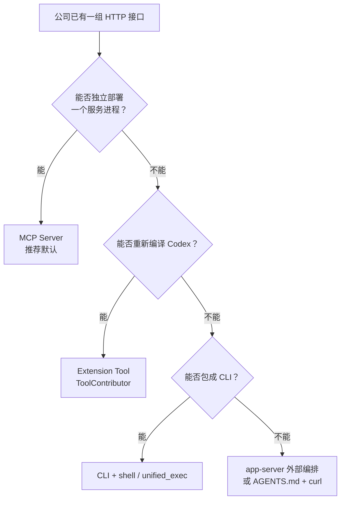
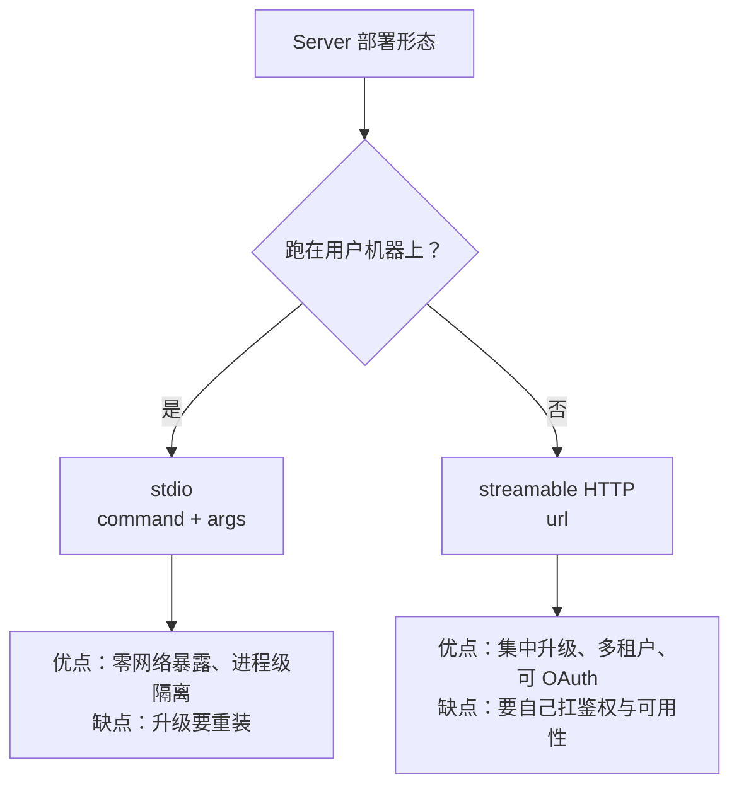
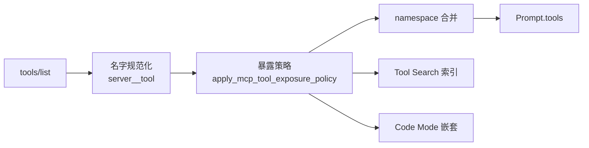
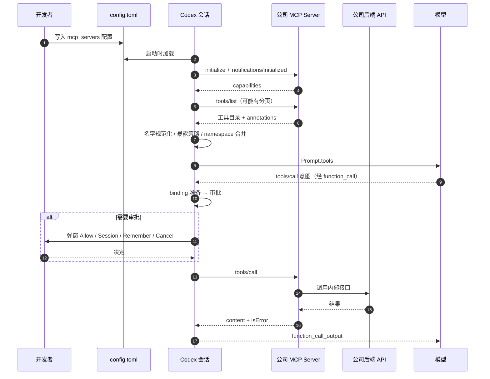
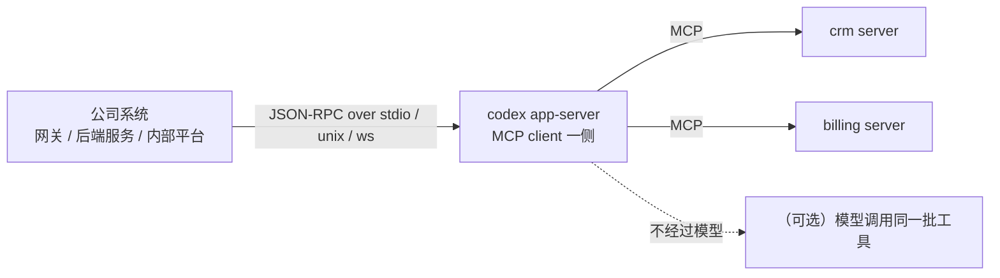

# 接入公司 API：完整流程与其他路径

> 本文是《[codex-tools-mcp-analysis.md](./codex-tools-mcp-analysis.md)》第 7 章的独立版，可单独分发。
> 文中「分析文档 §x.y」均指该文件的小节；实现细节、行号与数据结构以那里为准。

---

## 目录

1. [先选路线](#1-先选路线)
2. [MCP 接入的七个阶段](#2-mcp-接入的七个阶段)
3. [阶段 0：契约设计](#3-阶段-0契约设计)
4. [阶段 1：实现 MCP Server](#4-阶段-1实现-mcp-server)
5. [阶段 2：注册到 Codex](#5-阶段-2注册到-codex)
6. [阶段 3：启动与握手](#6-阶段-3启动与握手)
7. [阶段 4：工具如何进入模型上下文](#7-阶段-4工具如何进入模型上下文)
8. [阶段 5：审批策略](#8-阶段-5审批策略)
9. [阶段 6：验证与运维](#9-阶段-6验证与运维)
10. [接入后，一次调用实际发生什么](#10-接入后一次调用实际发生什么)
11. [其他六种接入方式](#11-其他六种接入方式)
   - [A. Extension Tool（进程内扩展）](#a-extension-tool进程内扩展)
   - [B. app-server 外部编排（把 Codex 当 MCP client）](#b-app-server-外部编排把-codex-当-mcp-client)
   - [C. Dynamic tools 注入](#c-dynamic-tools-注入)
   - [D. CLI 包装 + shell / unified_exec](#d-cli-包装--shell--unified_exec)
   - [E. 自定义 core handler（fork）](#e-自定义-core-handlerfork)
   - [F. Prompt 约定（AGENTS.md + curl）](#f-prompt-约定agentsmd--curl)
12. [常见反模式](#12-常见反模式)
13. [一页 Checklist](#13-一页-checklist)

---

> 本文回答两个问题：把公司已有 API 变成 Codex 可调用的能力，**通过 MCP 的完整流程是什么**；**除了 MCP 还有哪些办法**，各自代价如何。

## 1. 先选路线



一句话判据：

| 路线 | 一句话适用 |
|------|------------|
| MCP Server | 接口稳定、多人共用、要跨团队治理 |
| Extension Tool | 已在 Rust 生态内，要零 IPC 开销与细粒度控制 |
| app-server | 你只是想让自己的系统驱动 Codex，而非给 Codex 加工具 |
| CLI 包装 | 一天内要跑通 PoC |
| core handler | 需要工具与 Codex 内部状态深度耦合（fork） |

## 2. MCP 接入的七个阶段


| 阶段 | 产出物 | 验收标准 |
|------|--------|----------|
| 0 契约设计 | 工具清单 + annotations + schema | 每个工具单一职责；schema < 5 KB |
| 1 实现 | 可独立运行的 MCP server | `tools/list` 与 `tools/call` 自测通过 |
| 2 注册 | config.toml / CLI 条目 | `codex mcp get <name>` 能读出配置 |
| 3 启动 | 握手成功 | 30 s 内完成 `initialize` |
| 4 暴露 | 模型可见工具集 | 会话里能看到期望的工具，数量符合预算 |
| 5 审批 | `approval_mode` 配置 | 读操作不弹窗，写操作按预期弹窗 |
| 6 运维 | 监控与变更流程 | 工具清单变更能在 1 个会话内生效 |

## 3. 阶段 0：契约设计

这一步决定后面 80% 的体验，且**改造成本最低**。

**粒度**：一个 tool 对一个动作。不要设计 `execute(action, params)` 这种万能工具——模型无法从 schema 推断 `action` 的合法值，而 Codex 的审批、暴露策略、tool search 都按「工具」粒度工作，万能工具会让它们全部失效。

**命名**：server 名会成为 namespace 前缀（`<server>__<tool>`，见[分析文档 §3.6](./codex-tools-mcp-analysis.md#36-namespace-合并与名字规范化)）。因此：

- server 名用稳定的英文标识（`crm`、`billing`），不要带环境后缀（环境用 `environment_id` 区分）。
- 工具名 ≤ 128 字节，且不要包含 `__`（会被当成分隔符）。
- 名字要能自解释：`search_tickets` 优于 `query`。

**annotations 必须如实**——这直接决定 `approval_mode = "auto"` 时的行为（见[分析文档 §4.8](./codex-tools-mcp-analysis.md#48-审批与-elicitation)）：

| annotation | 设为 true 的含义 | 撒谎的后果 |
|------------|------------------|------------|
| `readOnlyHint` | 无副作用 | 写操作被静默放行 |
| `destructiveHint` | 可能删除/覆盖 | 危险操作不再弹窗 |
| `openWorldHint` | 访问外部不可控资源 | 网络副作用被低估 |

Codex 的缺省判定是**未知即危险**：`destructiveHint` / `openWorldHint` 缺省按 `true` 处理。所以不写 annotations 是安全的，但会导致读操作也弹窗——正确做法是**如实标注只读工具**，而不是把一切都标成只读。

**体积预算**：

| 限制 | 值 | 位置 |
|------|-----|------|
| 单个工具序列化上限 | 8000 字节（超限直接丢弃该工具） | `tools/src/responses_api.rs:14` |
| 普通工具 schema 压缩阈值 | 5000 字节（默认，可配 `tool_input_schema_max_bytes`） | `json_schema/compaction.rs:17` |
| 单 server 目录条目上限 | 2048（codex_apps 为 8192，超限报错） | `codex-mcp/src/pagination.rs` |

**输出预算**：用 `tools.<name>.output_token_limit` 限制单次返回 token，避免一个工具把上下文打满。

## 4. 阶段 1：实现 MCP Server

**传输方式二选一**：



对公司的内部 API，**默认选 streamable HTTP**：集中部署、统一鉴权、改一次全体生效。stdio 适合「必须访问本机资源」或「安全上不允许开端口」的场景。

**必须实现的三个方法**（协议版本 2025-06-18，与本仓库 `rmcp` 一致）：

```
→ initialize            {"protocolVersion":"2025-06-18","capabilities":{...},"clientInfo":{...}}
← result                {"protocolVersion":"2025-06-18","capabilities":{"tools":{}},"serverInfo":{...}}
→ notifications/initialized
→ tools/list            {}
← result                {"tools":[{"name":"search_tickets","description":"...","inputSchema":{...},
                          "annotations":{"readOnlyHint":true}}]}
→ tools/call            {"name":"search_tickets","arguments":{"query":"..."}}
← result                {"content":[{"type":"text","text":"..."}],"isError":false}
```

`tools/list` 需要支持 `cursor` 分页（Codex 会循环拉取，直到没有 `nextCursor`）。

**鉴权映射**（对应[分析文档 §4.1](./codex-tools-mcp-analysis.md#41-配置模型) 的配置字段）：

| 公司侧的鉴权方式 | Codex 侧配置 |
|------------------|--------------|
| 静态 Bearer Token | `bearer_token_env_var = "COMPANY_TOKEN"` |
| 自定义 Header（值来自环境变量） | `env_http_headers = { "X-Api-Key" = "COMPANY_KEY" }` |
| 固定 Header | `http_headers = { "X-Client" = "codex" }` |
| 短时票据 / 动态签名 | `http_headers_helper = "<打印 JSON header 的本地命令>"` |
| OAuth 2.1 | `auth = "oauth"` + `scopes` + `oauth_resource`，首次 `codex mcp login` |

`http_headers_helper` 会在每次请求前执行并读取其 stdout 的 JSON 对象作为 header，适合对接内部 STS 换票；注意命令本身可能被本机进程看到，不要把密钥写进命令行。

## 5. 阶段 2：注册到 Codex

**CLI 三种写法**：

```sh
# 1) stdio
codex mcp add company_crm \
  --env COMPANY_API_TOKEN=xxx \
  -- /usr/local/bin/company-mcp --profile crm

# 2) streamable HTTP + bearer
codex mcp add company_crm \
  --url https://mcp.corp.example.com/mcp \
  --bearer-token-env-var COMPANY_API_TOKEN

# 3) streamable HTTP + OAuth（预注册客户端）
codex mcp add company_crm \
  --url https://mcp.corp.example.com/mcp \
  --oauth-client-id codex-cli \
  --oauth-client-secret "$CLIENT_SECRET" \
  --oauth-client-registration dcr \
  --oauth-resource https://api.corp.example.com
codex mcp login company_crm
```

`--oauth-client-registration` 可取 `auto` / `cimd` / `dcr`，对应三种客户端注册策略；不确定时用 `auto`。

**等价的 config.toml**（`~/.codex/config.toml`）：

```toml
# —— stdio ——
[mcp_servers.company_crm]
command = "/usr/local/bin/company-mcp"
args = ["--profile", "crm"]
env_vars = ["COMPANY_API_TOKEN"]     # 从父进程环境透传，避免明文写进配置
startup_timeout_sec = 60
tool_timeout_sec = 120
required = true

# —— streamable HTTP ——
[mcp_servers.company_billing]
url = "https://mcp.corp.example.com/mcp"
auth = "oauth"                          # 与下面一行二选一：OAuth 流程 vs 静态 token
# bearer_token_env_var = "COMPANY_API_TOKEN"
env_http_headers = { "X-Tenant-Id" = "COMPANY_TENANT_ID" }
scopes = ["billing.read", "billing.write"]
oauth_resource = "https://api.corp.example.com"
startup_readiness = "catalog"
supports_parallel_tool_calls = true
default_tools_approval_mode = "writes"
enabled_tools = ["search_invoices", "get_invoice", "create_invoice"]
disabled_tools = ["delete_invoice"]
tool_input_schema_max_bytes = 4096

[mcp_servers.company_billing.tools.create_invoice]
approval_mode = "prompt"
output_token_limit = 8000
```

关键字段速查：

| 字段 | 默认 | 说明 |
|------|------|------|
| `auth` | `oauth` | `oauth` / `chatgpt` / `ema_auth` |
| `enabled` | `true` | 关掉即完全不启动 |
| `required` | `false` | 启动失败是否让 `codex exec` 直接失败 |
| `startup_readiness` | `connection` | `catalog` 允许用缓存目录先就绪 |
| `startup_timeout_sec` | 30 | 进程启动 + `initialize` |
| `tool_timeout_sec` | 300 | 单次 `tools/call` |
| `supports_parallel_tool_calls` | `false` | 为 `true` 时该 server 全部工具允许并行 |
| `default_tools_approval_mode` | `auto` | 可被 per-tool 覆盖 |
| `enabled_tools` / `disabled_tools` | 无 | 先允许后拒绝，两段式过滤 |
| `omit_tools_from` | 无 | 在 `direct` / `deferred` / `code_mode` 某个面上隐藏 |
| `tool_input_schema_max_bytes` | 5000 | 单工具 schema 压缩阈值 |

> `env` 是**明文**写值，`env_vars` 是**从环境透传**。密钥一律走后者或 `bearer_token_env_var`。

## 6. 阶段 3：启动与握手

Codex 有三档启动策略（[分析文档 §4.5](./codex-tools-mcp-analysis.md#45-启动策略与连接池)），对单个 server 的影响由 `McpServerConfig::can_defer_stdio_startup` 决定：

```rust
// 语义等价（非原文）
matches!(&self.transport, Stdio { .. }) && (!self.required || self.startup_readiness == Catalog)
```

实践含义：

- 主会话默认 `Eager`，**配置了就会在会话初始化时握手**。若 server 冷启动慢，把 `startup_timeout_sec` 调到 60 以上。
- 设了 `required = true` 且在 `codex exec` 里失败 → 整个执行失败。CI 场景适合这样，交互场景建议 `required = false`。
- `startup_readiness = "catalog"` 允许先用上次缓存的工具目录就绪（缓存 TTL 30 min），代价是首次调用前仍要等到真实连接。

## 7. 阶段 4：工具如何进入模型上下文



规模决定策略：

| 工具数量 | 建议 | 理由 |
|----------|------|------|
| ≤ 15 | 全部 `Direct` | 上下文开销可接受，模型选择最准 |
| 16 – 100 | 高频 `Direct`，其余 `Deferred` | 用 `tool_search` 两阶段加载 |
| > 100 | 大部分 `Deferred`，或开 `CodeModeOnly` | 单工具描述成本 × 数量会撑爆上下文 |

`Direct` 的工具同时也会进 Code Mode 的嵌套工具面（[分析文档 §3.5](./codex-tools-mcp-analysis.md#35-工具暴露策略direct--deferred--codemode)），所以不必为了 code mode 再单独配置。

## 8. 阶段 5：审批策略

| 工具类型 | 建议 `approval_mode` |
|----------|----------------------|
| 只读查询 | `auto`（并如实标 `readOnlyHint`） |
| 创建/更新 | `writes` 或 `prompt` |
| 删除/退款/转账 | `prompt` |
| 隔离环境里的批处理 | `approve` |

审批记忆的 key 含 `server`、`plugin_id`、`connector_id`、`link_id`、`tool_name`（[分析文档 §4.8](./codex-tools-mcp-analysis.md#48-审批与-elicitation)），所以**多租户下不会串权**：在租户 A 批准的操作不会自动放行租户 B。

## 9. 阶段 6：验证与运维

```sh
codex mcp list                 # 看已配置的 server
codex mcp list --json          # 机器可读
codex mcp get company_crm      # 看单个 server 的最终配置（含继承/覆盖结果）
codex mcp get company_crm --json
codex mcp login company_crm    # OAuth
codex mcp logout company_crm
```

app-server 侧（供自建网关/UI）：

| 方法 | 用途 |
|------|------|
| `mcpServerStatus/list` | 拉取 server 状态快照 |
| `mcpServer/tool/call` | 绕过模型直接调工具（**不走审批**，适合做网关自测） |
| `config/mcpServer/reload` | 配置热重载 |
| `mcpServer/event/stream/start` | 订阅工具清单/状态事件 |

**故障对照表**：

| 症状 | 最可能的原因 | 定位手段 |
|------|--------------|----------|
| 模型完全看不到工具 | `enabled=false`、`enabled_tools` 过滤、feature flag 关闭 | `codex mcp get`；查[分析文档 §5.1](./codex-tools-mcp-analysis.md#51-feature-flags-影响面) 的 flag 表 |
| 工具在但调用报「不可用」 | catalog 未就绪 / binding 失效 | `mcpServerStatus/list` |
| 一部分工具消失 | 单个工具序列化超过 8000 字节被丢弃 | 精简 schema，或调 `tool_input_schema_max_bytes` |
| 启动超时 | 冷启动慢 / `initialize` 未回 | 调 `startup_timeout_sec`，看 server 日志 |
| 调用超时 | 同步长任务 | 调 `tool_timeout_sec`，或改异步 + resource 轮询 |
| 工具名冲突 | 两个 server 同名工具 | 看 `record_collision` 相关 warn 日志 |
| 每次重启工具名变了 | server 返回顺序不稳定且名字未规范化 | 检查名字规范化（应基于名字而非序号） |

## 10. 接入后，一次调用实际发生什么



## 11. 其他六种接入方式

### A. Extension Tool（进程内扩展）

Codex 有 `ext/extension-api`，`ToolContributor`（`contributors.rs:418`）允许在**编译期**注入工具；运行时由 `append_extension_tool_executors`（`spec_plan.rs`）注册。

- 做法：实现 `ToolContributor`，在 `extension_tool_executors(session, step_store)` 里返回你的 executor。
- 优点：零 IPC、可直接拿 `Session`/`TurnContext`、能精确控制 `ToolExposure`。
- 代价：必须与 Codex 同版本编译；升级要重新适配；无法独立部署。
- 适用：内部已有 Rust 代码，或工具需要读写 Codex 内部状态。

### B. app-server 外部编排（把 Codex 当 MCP client）

这是最容易被忽略的一条路径：**不是为了给模型加工具，而是给公司系统一个「调用 Codex 已接入的 MCP 工具」的入口**。此时 Codex 扮演 MCP **client**（复用连接、鉴权、目录缓存），你的系统扮演 app-server 的客户端。



#### 启动

```sh
codex app-server                                  # 默认 --listen stdio://
codex app-server --listen unix:///tmp/codex.sock
codex app-server --listen ws://127.0.0.1:8787
```

`--listen` 支持 `stdio://`（默认）、`unix://` 或 `unix://PATH`、`ws://IP:PORT`、`off`。

#### 四步调用

**注意**：app-server 的报文是 JSON-RPC **风格**，但既不发也不要求 `"jsonrpc": "2.0"` 字段（`app-server-protocol/src/rpc.rs` 开头明确写了这一点）。

```jsonc
// 1) 握手；要用实验特性需 experimentalApi: true
{"id":1,"method":"initialize","params":{
  "clientInfo":{"name":"corp-gateway","title":"Corp Gateway","version":"1.0.0"},
  "capabilities":{"experimentalApi":true}}}

// 2) 建一个 thread，后续 tool/call 必须带它的 id
{"id":2,"method":"thread/start","params":{}}
// ← {"id":2,"result":{"thread":{"id":"0193..."},"model":"...","modelProvider":"..."}}

// 3) 发现工具（可按 server 过滤，避免拉全量）
{"id":3,"method":"mcpServerStatus/list","params":{"serverName":"company_crm","limit":50}}
// ← {"id":3,"result":{"data":[{"name":"company_crm","runtimeStatus":"connected",
//      "tools":{"search_tickets":{"..."}},"authStatus":"..."}],"nextCursor":null}}

// 4) 直接调用；server 用注册名，tool 用原始工具名（不带 namespace 前缀）
{"id":4,"method":"mcpServer/tool/call","params":{
  "threadId":"0193...","server":"company_crm",
  "tool":"search_tickets","arguments":{"query":"逾期发票"}}}
// ← {"id":4,"result":{"content":[{"type":"text","text":"..."}],"isError":false}}
```

方法速查：

| 方法 | 参数要点 | 用途 |
|------|----------|------|
| `initialize` | `clientInfo`、`capabilities` | 握手；实验方法需 `experimentalApi` |
| `thread/start` | 全可选（`model`、`cwd`…） | 创建并加载 thread，返回 `thread.id` |
| `mcpServerStatus/list` | `serverName?`、`detail?`、`cursor?`、`threadId?` | 发现 server 状态与工具目录 |
| `mcpServer/tool/call` | **必填** `threadId`、`server`、`tool`；可选 `arguments`、`_meta` | 执行一次工具调用 |
| `config/mcpServer/reload` | 无 | 热重载 MCP 配置 |
| `mcpServer/resource/read` | `threadId`、`server`、`uri` | 读 MCP resource |

#### 三个必须知道的约束

1. **不走工具审批**。`mcpServer/tool/call` 最终落到 `CodexThread::call_mcp_tool` → `latest_call_tool_without_attribution`，方法名里的 `without_attribution` 就是字面意思：它不触发 `mcp_tool_call` 那一套审批与记忆。**鉴权、白名单、审计必须由调用方自己做**。这是它与「模型调用」最大的区别。
2. **必须以 thread 为作用域**。`threadId` 是必填参数，所以要先 `thread/start`（或恢复已有 thread）。连接、环境、认证都绑定在那个 thread 上。
3. **事件流只支持 codex_apps**。`mcpServer/event/stream/start` 会校验 `server == CODEX_APPS_MCP_SERVER_NAME`，自建 server 直接返回 `MCP event subscriptions are only supported for hosted apps`。需要流式进度时，让工具自己返回 job id 或写日志，不要依赖这个通道。

#### 与 MCP 方案的关系

两者不是替代关系，而是**同一条管道的两个出口**：

| | MCP 方案（第 1–10 节） | app-server 方案 |
|---|---|---|
| 入口 | 模型决定调用 | 你的系统决定调用 |
| 审批 | 完整审批链（§8） | 无，调用方自管 |
| 适用 | 让 agent 会用公司能力 | 让系统复用 Codex 的连接与鉴权 |
| 前置条件 | 写一个 MCP server | 已有 MCP server |

典型组合：先按前 10 节把公司 API 接成 MCP（一次投入），再让 agent 走模型调用、让网关走 `mcpServer/tool/call`（两套消费方共用同一份配置与凭据）。

- 优点：不写 Rust；复用 Codex 的 OAuth/token 管理、连接池、目录缓存；跨语言（任何能发 JSON 的进程都能接）。
- 代价：多一跳本地/网络 RPC；无审批（安全边界前移到你自己的服务）；实验特性受 `experimentalApi` 约束。

### C. Dynamic tools 注入

`append_dynamic_tool_runtimes`（`spec_plan.rs`）与 TUI 的 `dynamic_tools_mcp.rs` 支持运行时注入工具规格，甚至把 Codex 自己的工具反向暴露成 MCP server（[分析文档 §4.10](./codex-tools-mcp-analysis.md#410-codex-作为-mcp-server)）。

- 适用：多 Codex 实例协作、或工具集合由外部编排器动态决定。

### D. CLI 包装 + shell / unified_exec

把 API 包成脚本，让模型用 `shell` 调。

- 优点：一天内能跑通，零集成。
- 代价：无 schema（模型靠猜参数）、无 per-tool 审批（只有命令级审批）、输出非结构化、错误处理全靠模型读 stderr。
- 适用：PoC，或一次性运维脚本。

### E. 自定义 core handler（fork）

在 `add_core_tool_sources` 里注册新 handler，直接实现 `CoreToolRuntime`。

- 优点：最大控制力，可进 `NativeReview`、可访问内部状态。
- 代价：与上游强耦合，每次升级都要合并；不推荐非必要使用。

### F. Prompt 约定（AGENTS.md + curl）

在 `AGENTS.md` 写明「调 XX 接口用 curl ... 带这个 header」。

- 优点：零代码。
- 代价：完全不可治理——无审批、无 schema、无审计，密钥容易泄漏到上下文。
- 适用：临时验证一个想法，且不涉及敏感数据。

**横向对比**：

| 维度 | MCP Server | Extension | app-server | Dynamic | CLI 包装 | core handler |
|------|-----------|-----------|------------|---------|----------|--------------|
| 改 Codex 代码 | 否 | 是（编译期） | 否 | 否 | 否 | 是（fork） |
| 独立部署 | 是 | 否 | 是 | 部分 | 是 | 否 |
| 结构化 schema | 是 | 是 | 复用 MCP | 是 | 否 | 是 |
| per-tool 审批 | 是 | 是 | 否（调用方自管） | 是 | 否 | 是 |
| 跨语言 | 是 | 否（Rust） | 是 | 是 | 是 | 否 |
| 落地成本 | 中 | 高 | 中 | 中 | 低 | 最高 |
| 升级维护 | 低 | 中 | 低 | 中 | 低 | 高 |

## 12. 常见反模式

| 反模式 | 后果 | 正确做法 |
|--------|------|----------|
| 一个万能 `execute` 工具 | 模型猜参数、审批与检索全部失效 | 一动作一工具 |
| 200 个工具全 `Direct` | 上下文被工具描述占满 | 分层：高频 Direct，其余 Deferred |
| annotations 全部标只读 | 写操作被静默放行 | 如实标注，只读工具才标 `readOnlyHint` |
| Token 明文写进 `env` / `args` | 泄漏进配置文件与进程列表 | `env_vars` / `bearer_token_env_var` |
| schema 里塞整个 OpenAPI | 超 8000 字节被丢弃 | 只保留模型需要的字段 |
| 长任务同步阻塞 | 300 s 超时后被取消 | 返回 job id + resource 轮询 |
| 工具名带环境后缀 | 换环境后历史会话失配 | 用 `environment_id` 区分 |
| 依赖工具返回顺序 | 重启后名字漂移 | 名字必须由内容决定 |

## 13. 一页 Checklist

- [ ] 工具粒度：一动作一工具，无万能 `execute`
- [ ] 命名：≤128 字节、无 `__`、可自解释
- [ ] annotations：只读工具标 `readOnlyHint`，危险操作标 `destructiveHint`
- [ ] schema：单工具 < 5 KB，总目录 < 2048 条
- [ ] 鉴权：密钥走 `env_vars` / `bearer_token_env_var`，不落明文
- [ ] 超时：`startup_timeout_sec` ≥ 60（冷启动慢时）、`tool_timeout_sec` 按接口 P99 设
- [ ] 暴露：按规模选 Direct / Deferred，必要时开 tool search
- [ ] 审批：读 `auto`、写 `writes`/`prompt`、危险 `prompt`
- [ ] 验证：`codex mcp get` + 一次真实 `tools/call`
- [ ] 运维：`mcpServer/event/stream/start` 接入监控

---
