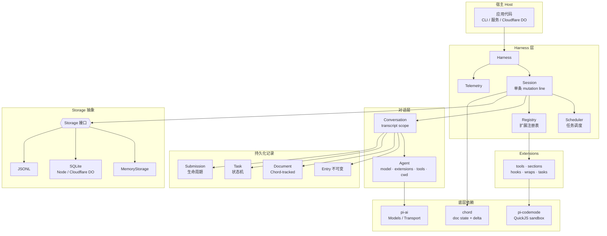
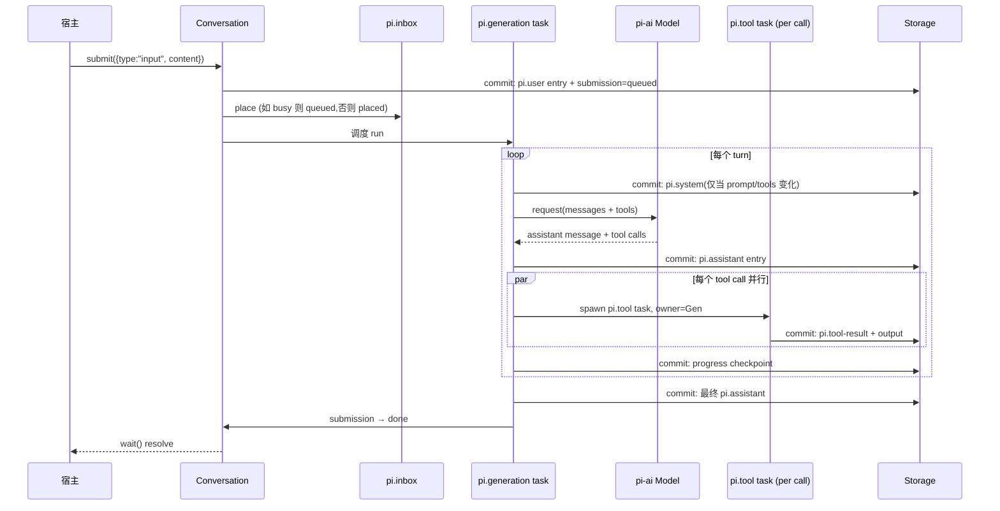
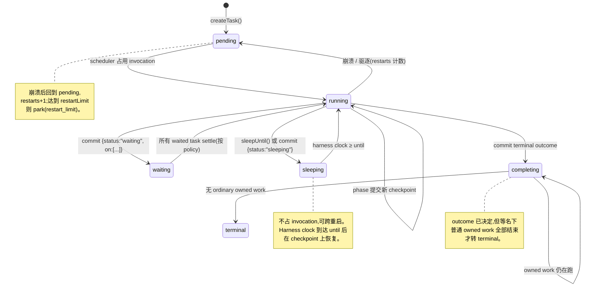
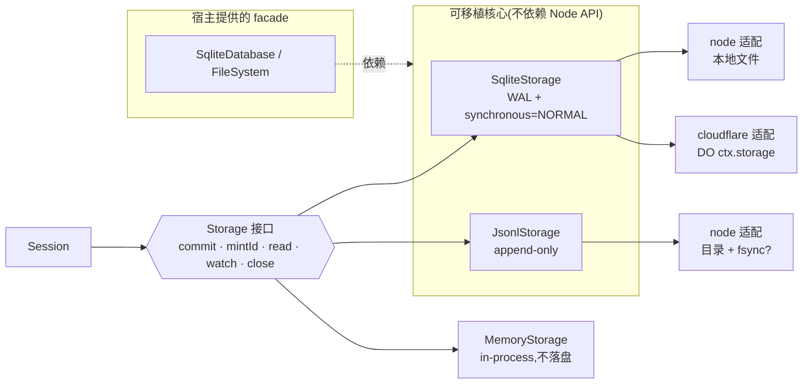
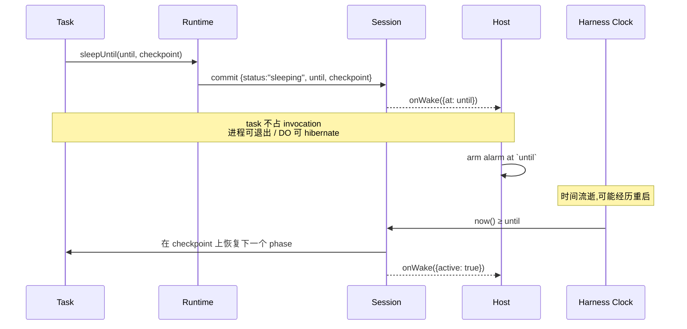
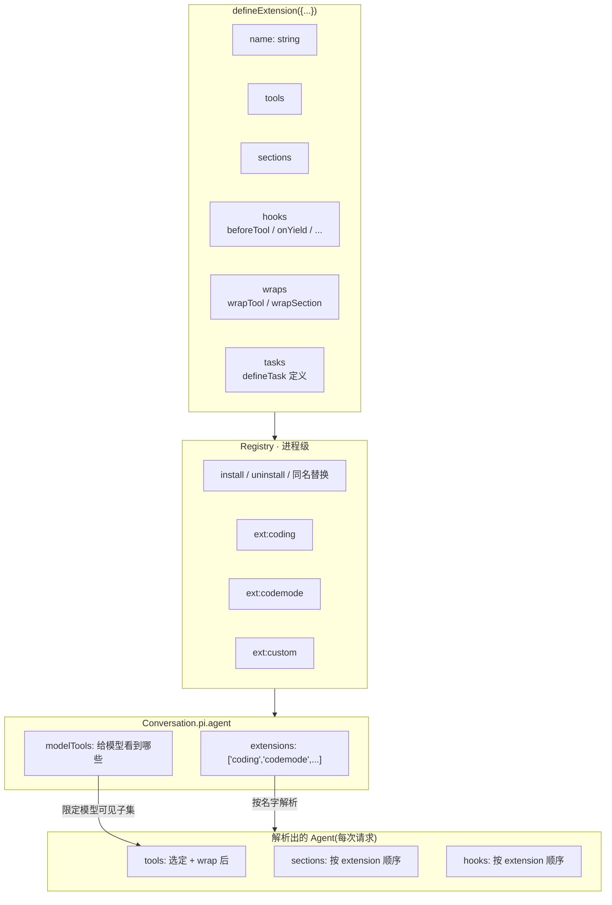
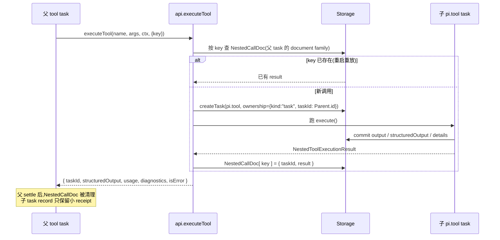
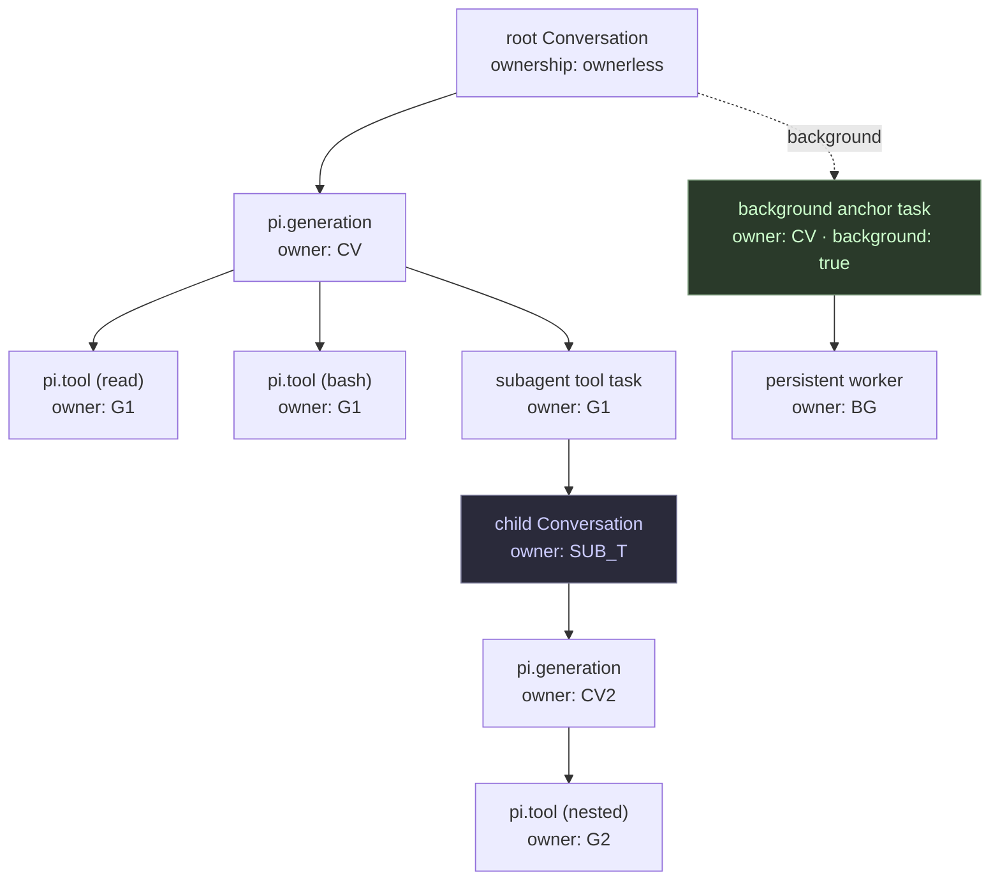

# Pi Durable 功能分析

> 对 `@earendil-works/pi-durable` (v1.3.0) 包的功能性分析。
> 源码路径: `packages/durable/`
> 定位: **可持久化 (durable)、可扩展的 agent 运行时**——对话、模型 turn、工具调用、以及宿主自定义状态全部先落盘、再可见。进程中途崩溃后，再次打开同一存储即可从最后成功提交的位置继续执行。

---

## 1. 总览

`pi-durable` 是 Pi 项目里面向「长时间运行、可中断、可恢复」的智能体场景而设计的运行时。它构建在两个基础之上：

- `@earendil-works/pi-ai`:统一的模型抽象 (`Models`、`Transport`、`Message` 等);
- `@earendil-works/chord`:结构化文档状态 + delta 协议（用于事务性 commit、watch、fork）。

它的核心不变量只有一句话：

> **Session 原子地提交「不可变 entry、完整 task 记录、Chord 跟踪的 document」三者，只有被 commit 的状态才可被观测。**

所有「向外界展示的东西」——流式 partial 输出、partial 工具结果、生成进度——都是这条 commit 线之后的投影。

### 架构总图



分层职责:

- **Host** 负责生命周期(open / close / resume)、环境(`env`)、模型配置(`models`)、可选唤醒回调(`onWake`);
- **Harness / Session** 持有唯一的 mutation line,所有写入(append entry / edit document / create task / admit submission)都走它;
- **Scheduler** 驱动 task 状态机,按 `pending / waiting / sleeping` 决定何时跑下一个 phase;
- **Registry** 进程级,存放 extension;conversation 只存 extension 名字,因此代码可热替换;
- **Storage 抽象** 把 commit / read / watch 解耦到四种具体后端(内存 / SQLite / JSONL / Cloudflare DO);
- **chord** 提供文档状态、delta、watch、fork 协议;
- **pi-ai** 提供模型调用;
- **pi-codemode** 提供 QuickJS 沙箱,让 `codemode` 工具里的脚本能跨重启。

---

## 2. 核心概念 (Concepts)

| 概念 | 含义 |
|---|---|
| **Harness** | 一个打开的存储 + 在它之上跑 agent 的全部机器。所有变更都经过单条原子 commit 线。 |
| **Session** | 真正持有 mutation line 的内部对象，拥有对话、entry、task、submission、document。 |
| **Conversation** | 一个 transcript 作用域。`harness.root()` 首次调用时创建根对话；可以 `fork()`。`Conversation` 句柄本身无状态，用 `id` 比较。 |
| **Entry** | 一条不可变的 transcript 记录:用户消息 (`pi.user`)、模型响应 (`pi.assistant`)、工具结果 (`pi.tool-result`)、系统提示变更 (`pi.system`)、重置 (`pi.reset`)、压缩 (`pi.compaction`)，或用户自定义 kind。 |
| **Commit** | 原子写入。`conversation.commit((tx) => ...)` 可以同时追加 entry、编辑 document、创建 task，全部成功或全部失败。 |
| **Document** | 紧挨着 transcript 存储的、带类型的 JSON 状态；通过 Chord 操作 (op) 变更,偶尔写完整 base。内置 document:`pi.agent`、`pi.provider`、`pi.live`、`pi.inbox`、`pi.usage`。 |
| **Task** | 可持久化的状态机。每一步都写 checkpoint,进程重启后从最后一个 checkpoint 继续。每个 task 必须有一个 owner:所属 conversation,或同 conversation 内的另一个 task。 |
| **Submission** | 交给 conversation 的东西——用户输入或一条要写入的 entry——可以对其 `wait()`。 |
| **Turn / Run** | 一次 turn = 一次模型响应 + 它的工具调用；一次 run = 从一条输入到最终答案的若干 turn。conversation 在 run 期间是 busy 的。 |
| **Extension** | 一个命名 bundle:tools、system prompt sections、hooks、wraps、tasks。 |
| **Registry** | 当前进程安装的 extensions。可以热替换。 |
| **Agent** | 一个 conversation 跑起来所需的一切：model、thinking level、选定的 extensions、tools、instructions、cwd。以名字存在 `pi.agent` 里，每次用时在 registry 里解析。 |

一次「被回答的输入」在内部的样子:

```
submit(input) → pi.user
  pi.generation → pi.system (只有 prompt/tools 变了才写), pi.assistant (含 tool calls)
    pi.tool × n → pi.tool-result × n   (被 generation 拥有并等待)
  pi.generation → pi.assistant (最终答案) → submission 完成
```

### Submit → Run 时序



要点:

- **所有写都在 commit 之后才可观察**;流式输出只是 `pi.live` 中 100ms 一次的部分 commit;
- 工具调用以 `pi.tool` task 形式存在,**被 generation 拥有**,generation 等待它们;
- 每个 tool 调用独立 commit,崩溃重启用 `replay: "safe"` 标记决定是否重跑;
- Submission 的状态机(queued → placed → done / unanswered)与 run 解耦,run 失败时 queued 项可按 `afterFailedRun` 策略处理。

---

## 3. 类型与标识系统

`types.ts` 是整个包的类型骨架。几个关键设计:

### 3.1 名义化 ID (`Id<Kind, Type>`)

```ts
declare const idBrand: unique symbol;
type Id<Kind extends string, Type = unknown> = number & { readonly [idBrand]: { kind: Kind; type: Type } };
type ConversationId = Id<"conversation">;
type EntryId        = Id<"entry">;
type TaskId<R = unknown> = Id<"task", R>;
type SubmissionId   = Id<"submission">;
type DocumentId     = Id<"document">;
```

- ID 在内存、JSON、JSONL、SQLite 里都是普通 number;品牌只在受信的创建/解码边界打上。
- `Seq` 单独一个品牌,防止把实体 ID 误当作文档 commit 点。
- 根对话使用常量 `ROOT_CONVERSATION_ID = 1`。

### 3.2 Document 语义 (`DocumentSemantics`)

文档按**作用域 + 历史 + fork 行为**分三类:

- `scope: "session"` — 单例,跟 Session 同生命周期;
- `scope: "conversation"` — 单例/家族,可 `history: "latest"` 或 `"rewindable"`(支持 `snapshotAsOf()` 历史读);`fork: "initial" | "current" | "asOf"` 决定 fork 时带什么;
- `scope: "task"` — 单例/家族,跟 task 同生命周期。

每个定义必须提供 `checkpointWhen(value, ops, info)` 谓词——这是 1.3.0 的硬要求,不再有默认值,用于决定何时把 delta 合成为完整 base。

### 3.3 Submission 生命周期

`SubmissionRecord` 是 input / write 两种类型 × 多种状态的可辨别联合:

- `input`: `queued → placed → done | unanswered`
- `write`: `queued → done | unanswered`

`requestId` 做去重。重启后用同一个 `requestId` 重新 submit,会拿到同一条 submission。

### 3.4 Task 状态机 (`TaskState<S, R>`)

```
pending → running → (waiting | sleeping) → completing → terminal
                ↘                              ↑
                 ─────────────────────────────┘
```

#### Task 状态机图



- `pending`:可被调度;
- `running`:被一个 in-memory invocation 占据;
- `waiting`:停在 `on: TaskId[]` 上,`policy: "failFast" | "allSettled"`;
- `sleeping`:停在 `until` (Harness 时钟毫秒)上,**不占 invocation**,可跨重启;
- `completing`:已决定 outcome,等自己名下的 work 全部结束才变 terminal;
- `terminal`:永久的 result。

`TaskOutcome<R>`:`completed | failed | aborted | orphaned | faulted`。

### 3.5 TaskDefinition

```ts
type TaskDefinition<I, S extends { phase: string }, R, H> = {
  name: string;
  version: number;
  initial(input: I): S;
  phases: { [P in S["phase"]]: PhaseHandler<I, Extract<S, {phase: P}>, S, R, H> };
  abort(task, runtime, context): Promise<void>;
  migrate?(input, checkpoint, fromVersion): { input: I; checkpoint: S };
  hooks?: H;
};
```

Phase handler 必须通过 `runtime.commit()` 提交一个新的 checkpoint 或 terminal outcome,否则该 task 会被 fault。

---

## 4. 持久化与恢复 (Persist and Resume)

### 4.1 Storage 后端

| 后端 | 入口 | 说明 |
|---|---|---|
| Memory | `MemoryStorage` (包根) | 不落盘 |
| SQLite (Node) | `openNodeSqliteStorage(file)` from `./storage/sqlite/node` | 单文件,WAL + `synchronous=NORMAL`;崩溃安全,电源故障可能丢最新一次 commit |
| JSONL (Node) | `openNodeJsonlStorage(dir, ctx)` from `./storage/jsonl/node` | 目录内 append-only 文件;`{ fsync: true }` 保证 commit 标记前落盘;历史会全留在内存 |
| Cloudflare DO | `openDurableObjectSqliteStorage(ctx.storage)` from `./storage/sqlite/cloudflare` | 单 Durable Object 的 SQLite 存储;commit = DO 的 storage transaction |

#### Storage 分层



设计要点:

- **接口最小**:Session 只看到 `commit / mintId / read / watch / close`,具体后端如何落盘与 Session 无关;
- **可移植核心**:`/storage/sqlite` 与 `/storage/jsonl` 不依赖 Node API,只要宿主给一个异步 `SqliteDatabase` 或 `FileSystem`,就能在 Bun、Cloudflare DO、甚至浏览器里的 OPFS 里跑;
- **命名空间**:SQLite 支持 `{ prefix }` 做表/索引前缀,与宿主表共存一库;
- **Cloudflare DO 协调**:同一 `ctx.storage` 上多个 Pi storage 自动共享操作队列,避免事务冲突;
- **自定义后端**:`registerStorageConformance` 提供 Vitest/Jest conformance 套件,新后端只要跑过这套就能接进 Harness。

SQLite 可以传 `{ prefix: "pi_" }` 做表名/索引命名空间,与宿主表共享同一数据库。Cloudflare 适配器对同一 `ctx.storage` 自动共享操作队列;也可显式拿到 `DurableObjectSqliteDatabase` 协调宿主查询与 Pi 事务。

SQLite 与 JSONL 的核心(`/storage/sqlite`、`/storage/jsonl`)是**可移植的**(不依赖 Node API),可在 Bun、Cloudflare DO 等环境使用,只要给一个异步 `SqliteDatabase` facade 或 `FileSystem`。

自定义后端可跑共享 conformance 套件(`registerStorageConformance` from `./testing`)。

### 4.2 Resume / 重启

- `Harness.open(...)` 打开 Session;
- `harness.resume()` 启动任务调度器,继续上次留下的未完成工作;
- `submit()`、`wait()` 也会隐式启动调度器;
- `harness.submission(id)` 重启后按 ID 重新拿到一条 submission;
- 同一 `requestId` 重发 = 拿到已有的 submission,不会重复提交。

### 4.3 Sleep / Wake

1.3.0 的亮点:

- 一个 task 要等时间,通过结束当前 phase 为 `sleeping` 实现——**sleep 被持久化,期间不占 invocation,可跨重启**;
- 通过 `runtime.sleepUntil(until, checkpoint, ctx)` 或 `runtime.commit(() => ({ status: "sleeping", ... }))`;
- Harness 时钟到达 `until` 时,task 在 `checkpoint` 上恢复;
- 注意:**phase 内没有 sleep**——重启后 phase 会从头跑,所以 wait 之后的工作要放到下一个 phase,所需数据要放进 checkpoint。

`setTimer`(默认 `setTimeout`)用于 phase 内的 pacing(如 progress commit 节流);`now` 默认 `Date.now`,两者都可替换为假时钟。

### 4.4 Cloudflare DO 唤醒模式

```ts
const onWake = (wake: Wake) => armAlarm(wake);
// wake: { active: boolean; at?: number }
```

#### Sleep / Wake 时序



要点:

- `sleeping` 是**持久化的状态**,不是调用栈上的挂起;进程可以随时退出;
- 宿主通过 `onWake` 知道下一次需要进程的时刻(`at`),以及当前是否有 work 可跑(`active`);
- `at` 是最近一个 sleep 的 deadline;`active=true` 表示有 pending / running 的 task;
- 重启后 Session 读 storage,Harness clock 到达 `until` 时把 sleeping task 推进 running;
- `setTimer` 在 DO 上会拒绝 background timer,避免阻止 DO hibernate;foreground timer 被拒绝时回落到 `setTimeout` 并上报。

- 提供 `onWake` 时,Harness 不自己设定时器;它告诉宿主「下一次需要进程」的时刻;
- 宿主保持 alarm,到点调 `resume()`;
- DO 默认的 `setTimer` 会拒绝 background timer,避免阻止 DO hibernate。

---

## 5. 错误处理与恢复 (Failures & Recovery)

三条核心规则:

#### 错误传播

```mermaid
flowchart TB
    ERR[某处抛出错误]
    ERR --> K{错误来源?}

    K --> |"Storage 方法抛错<br/>(含 commit/mintId 的 StorageRequestError)"| FATAL[Session 死亡<br/>SessionFailed]
    K --> |"Storage 读抛 StorageRequestError<br/>(未知 conversation / 错误 cursor)"| READ[只 reject 该读<br/>Session 不受影响]
    K --> |"Task phase throw"| TFAULT[该 task faulted<br/>onReport: task_faulted]
    K --> |"Tool execute throw"| TRES[error result 给模型<br/>onReport: task_error]
    K --> |"Hook throw"| HSK[报告 + 跳过<br/>beforeTool throw → block 该调用]
    K --> |"Commit callback throw"| RB[该 commit rollback]
    K --> |"Listener throw"| LIS[报告,其他 listener 照跑]
    K --> |"RegistryReader.snapshot throw"| FATAL2[Session 死亡<br/>无法调度]

    FATAL --> CLOSE[Harness 自动 close<br/>closed={reason:failed, error}]
    FATAL2 --> CLOSE
    CLOSE --> REOPEN[宿主 reopen<br/>用同 requestId 重投找回 submission]
```

1. **Storage 错误 = Session 死亡**。Storage 方法抛错,`Session` 关闭;此后所有调用和 pending wait 都 reject 为 `SessionFailed`(`cause` 指向原错误);`onReport` 收到一次 `session_failed`。**不重试**,自定义 storage 自己负责重试 transient 故障。重新 open 即可恢复:commit 原子,存储一致;用同一 `requestId` 重投能找回已 admit 的 submission。
2. **无效读只失败该调用**。`StorageRequestError`(未知 conversation、错误 cursor、document 不保留的历史):只 reject 这次读。但**从 `commit()` 或 `mintId()` 抛出的 `StorageRequestError` 同样致命**。
3. **你的代码只失败你自己的单元**:throw 的 task phase → 该 task faulted;throw 的 tool → error result;throw 的 hook → 报告并跳过(`beforeTool` 抛则 block 该调用);throw 的 commit 回调 → 该 commit rollback。Listener 抛错只会被报告,其他 listener 照跑。例外:宿主提供的 `RegistryReader.snapshot()` 抛错 → Harness 无法调度,Session 失败。

### 5.1 崩溃循环保护

- Open 计数:每次 task 被崩溃/驱逐/reset 切断且未变更状态,`restarts += 1`;close 不计;task commit 新状态 → 清零。
- 达到 `settings.restartLimit`(默认 5,`Infinity` 关闭):task 被 park 为 blocked(原因 `restart_limit`),`wake()` 不算它 active,`onReport` 报一次 `task_parked`。
- `harness.retryTask(id)` 手动重跑;`abortTask()` 仍会跑 abort handler;handler 被切断到上限 → task faulted。

### 5.2 `onReport(error, info)`

`ReportInfo` 涵盖:`session_failed` / `task_faulted` / `task_parked` / `migration_failed` / `task_outdated` / `task_error` / `extension_error` / `host_error` / `listener_error`。

### 5.3 失败 run 后的 queued input

`settings.afterFailedRun`:
- `keep`(默认):留在 inbox,等下次输入或 queued write 把它们 place;
- `continue`:下一个 run 接着跑它们;
- `withdraw`:以 `run_failed` 原因 settle 为 `unanswered`。

---

## 6. 扩展系统 (Extensions)

`defineExtension({ name, tools, sections, hooks, wraps, tasks })`。

#### Extension 组合与解析



要点:

- **Extension 是 bundle**:把 tools / sections / hooks / wraps / tasks 打成一包,作为一个部署/选择单位;
- **Registry 是进程级,不持久化**:conversation 只存 extension 名字,因此代码可热替换,存储寿命长于代码;
- **同名 install = 原地替换**:老的 running task 保留老实现,新 phase 用新实现;
- **`wrapTool` / `wrapSection`**:按名字装饰最终胜出者,后装的 extension 可以透明地给先装的加计时、鉴权、改写等横切逻辑;
- **`modelTools`**:conversation 可进一步限定模型看到的 tools 子集,但 tool-to-tool 调用不受影响。

- 同名 install = 原地替换,一步完成;
- Registry 不存任何东西——conversations 只存 extension 名字;所以卸载后重装的扩展会自动被选中它的 conversation 用上;
- 已启动的工作保留老代码:运行中的 tool 用旧实现完成,每个 task phase 在起点解析一次 registry;
- 重启后需要重新 install 同样的 extensions;被 park 的 task 等到其扩展安装后才可运行。

### 6.1 Tools

- `defineTool({ name, description, parameters (TypeBox), execute, structuredOutputSchema?, callers?, replay?, deferred? })`;
- 每次调用都是独立的 `pi.tool` task,在 `execute()` 之前 commit intent;
- `replay: "safe"` 的工具崩溃重启后会重跑,否则模型拿到 `interrupted` error result + 已 commit 的 output;
- 三通道结果:`output`(给模型)/ `structuredOutput`(给调用方)/ `details`(给 UI);
- `bash` / `powershell` 遇到非 0 exit → 带 `exit_code` diagnostic 的 error result,不再 throw。

`tools` 入口(`@earendil-works/pi-durable/tools`)提供 `read` / `write` / `edit` / `bash`,以及打包好的 `CodingTools` 扩展。`read` 把图片作为 image block 返回,受 `inputLimits.images.resize` 约束(默认 2000×2000 / 4.5 MB base64);可选 `Photon` WebAssembly 处理 EXIF 方向/BMP→PNG/缩放。

### 6.2 嵌套工具调用

`api.executeTool(name, args, ctx, { key?, progress? })`:

- 嵌套调用是一个独立的 `pi.tool` task,owned by 调用方;
- 通过 `key`(默认是位置)让 replay-safe 的调用方重启后复用之前的嵌套调用;
- `NestedCallDoc` 只活到调用方 settle;
- `callers: ["model" | "tools"]` 和 conversation 的 `modelTools` 控制可见性;
- `deferred: true` 的工具直到 `modelTools` 显式加载才给模型看到;`tool_search` 扩展用 BM25 搜索 deferred tools 并用 `control.addTools` 加载。

#### 嵌套工具调用时序



要点:

- **key 是 replay 边界**:默认按位置;replay-safe 的父 task 重启后按相同顺序/相同 key 调用,就会复用之前的嵌套 task,而不是重跑;
- **`NestedCallDoc` 是 task-scoped 的 document family**:keyed by `key`,只活到父 settle,避免 transcript 膨胀;
- **结果不回灌 transcript**:父拿到 `structuredOutput` 等;`output`(给模型的那份)只在子 task 的 pi.tool-result 里;
- **崩溃语义**:非 replay-safe 的父崩溃后,其未完成的嵌套调用会被 abandonOnRestart,连同它们名下的 work;
- **深度无界**:默认 `callers` 下 tool 甚至可以调用自己;需要限制时设 `callers`。

### 6.3 Hooks

- `GenerationTask`: `beforeRequest`、`afterResponse`、`onYield`(让 run 继续)、`afterTools`;
- `ToolTask`: `beforeTool`(block 或改写 args)、`afterTool`(替换结果);
- `CompactionTask`: `beforeCompact`(拒绝或提供自定义 summary)。

### 6.4 Sections

`section("name", (input) => string | undefined)`,按 extension 顺序渲染。变化会作为 positional `pi.system` entry 写入 transcript,只发 diff,保护 provider prompt cache。

### 6.5 Wraps

`wrapTool(tool, (original) => ({ ...original, execute: ... }))` 装饰同名 tool 的最终胜出者。

---

## 7. 代码模式 (Code Mode)

`@earendil-works/pi-durable/codemode`:

- 提供 `codemode` tool:模型写 JavaScript,在 QuickJS 沙箱 (`@earendil-works/pi-codemode`) 里以 `await tools.<name>(args)` 调用 conversation 的其他工具,每次调用都是一个嵌套工具 task;
- **可跨重启**:沙箱以确定性方式运行(虚拟时钟、种子随机、UTC);工具把每个交给脚本的结果写入 journal,重启后按相同顺序喂回,脚本重新走相同路径直到新调用;
- 分歧、沙箱指纹或模块版本变化、超过 `timeout_ms` → 以错误结束;
- 提供 `searchTools` / `describeTool` / `describeNamespace`,`namespaces` 配置按前缀分组(如 `mcp__github__`);
- 脚本还能用 `models.*`(catalog、`classify`、`generateImages`,后者是内部工具的嵌套调用);
- `store(key, value)` / `load(key)` 是 per-conversation 的 JSON 存储,fork 从 fork entry 的位置继承。

---

## 8. Conversation 控制

### 8.1 提交模式 (`whenBusy`)

- 默认(follow-up):run 结束后 place,启动下一次 run;
- `steer`:place 在当前 tool round 之后,加入正在进行的 run;
- `reject`:busy 时抛 `ConversationBusy`;
- `write`:不进模型,直接 append entry,即使 busy 也立即 place(仅被 queued reset 挡住)。

### 8.2 Reset / Handoff

`conversation.reset(handoffText?, ctx)` 写一条 `pi.reset`(`head: "self"`),模型不再看到更早的 entry,但它们在存储里。工具可用 `control: { handoff: "..." }` 请求同样的事。

### 8.3 Compaction

- 手动 `root.compact(instructions?, ctx)` 返回 task id;
- 自动:通过 `settings.compaction` 的 `reserveTokens` / `keepRecentTokens` / `backgroundTokens` / `modelOverrides` 控制;
- `modelOverrides` 允许同一 Harness 服务 32k 和 1M 两种窗口;
- provider 报 context 太长 → 自动 compact + 重试一次;
- 失败处理:在 blocking threshold 上失败的 compaction 会让 generation 直接 fail(`Compaction failed: <error>`),避免继续发注定失败的请求;
- `pi.live.compactions` 列出运行中 compaction;`pi.live.compactionFailure` 保留最新失败;agent 事件有 `compaction_start` / `compaction_end`。

### 8.4 Per-Conversation Agent

`await root.configure({ model, thinkingLevel, extensions, tools, modelTools, instructions, cwd }, ctx)` 在 `pi.agent` 中存下选择;unset 字段跟随 host;`null` 重置为 host 默认。

### 8.5 Fork 与 Subagent

- `fork(entryId, options, ctx)` 继承到 `entryId` 为止的历史,带父方那时的 agent,但得到新的 `pi.provider` 身份;
- 任务自有的 conversation:在 `api.commit()` 中 `tx.createConversation({ ownership: { kind: "task", taskId: api.taskId } })`,适合 subagent;
- abort 级联:abort task → 先 abort 它拥有的 work → 最后才跑自己的 abort handler;
- `{ background: true }` 的 task 是边界:它拥有的 work 在父 abort 时存活,也不让父 busy。

#### Conversation / Task 所有权树



要点:

- **每个 task 都有 owner**:要么是其 conversation(顶层 task),要么是另一个 task(子 task);
- **每个 conversation 可有 owner task**:subagent 创建 conversation 时把 owning task 记下,用于 attribution、subtree abort、subtree idle 遍历;
- **Abort 自底向上**:abort 一个 task 时,先 abort 它名下的 work,等它们都结束后才跑它自己的 abort handler;这让每个 task 自己清理自己的 effects;
- **Busy 自顶向下**:父 task 只有在其名下所有普通 owned work 都 idle 后才 idle;
- **`background: true` 是边界**:abort 不跨它传播,父的 idle 也不等它;典型用法是「持久 subagent anchor」——父 tool 调用结束,子 conversation 还能继续跑;
- **Fork 与 ownership 分离**:`fork()` 的 `parent` 管历史继承,`owner` 管 attribution 和 abort/idle 拓扑,两者正交。

---

## 9. 观测面 (View / Watch / Events)

- `viewState()` → Chord state,每次 commit 后更新(`entries` / `docs["pi.live"]` / `docs["pi.inbox"]` / `docs["pi.usage"]` / `docs["pi.agent"]` / `docs["pi.provider"]`);
- `watch()` → 同上,但回调拿到每次 commit 的精确 Chord ops;慢 watch 最多积压 100 帧,超过则合成一帧最新 view;
- `watchEvents()` (实验性) → coding-agent 风格的事件流:`message_start` / `message_update` / `tool_execution_start` ...;事件由 commit 派生,每 commit 一批;落后 100 批以上收到新的 `snapshot`;
- 部分 answer 与工具输出默认最多 100ms commit 一次(可通过 `settings.progress` 调整)。

#### 观测派生链

```mermaid
flowchart LR
    TX[Session commit]
    TX --> |原子写入| REC[新 record:<br/>entry / task / document op / submission]
    REC --> |订阅 commit| V1[viewState / watch<br/>Chord state + ops]
    REC --> |派生| V2[watchEvents<br/>coding-agent 风格事件]
    REC --> |更新| V3[docs[pi.live]<br/>partial output / tool progress]
    REC --> |事件| V4[Telemetry<br/>pi.durable.entry / submission / checkpoint]
    REC --> |回调| V5[onReport<br/>diagnostics]

    V1 --> UI[UI / 远程 client]
    V2 --> UI
    V3 --> UI
    V4 --> TEL[telemetry backend]
    V5 --> LOG[host logger / breaker]
```

**所有观测面都源自同一条 commit 线**,这是「commit-first observability」的直接推论:

- 不存在「先展示再 commit」的路径——partial 输出也是 commit 的结果(只是 commit 得很频繁);
- 慢 consumer 不会拖慢 Session:`watch()` 最多积压 100 帧,超过则合成一帧最新 view;`watchEvents()` 落后 100 批就发 `snapshot` 重置;
- 重启后新的 consumer 直接从当前 state 开始,不需要 replay 历史事件。

---

## 10. 遥测 (Telemetry)

`HarnessOptions.telemetry` + `DURABLE_TELEMETRY_SCHEMA`:

- `pi.durable.submit`:公开 submit 的 admission span;每个 input 起一个新 root trace,并 link 到 caller 的当前 span;重复 `requestId` 保留原 submission 与 carrier;
- `pi.durable.phase`:每个 task 的每个 run/abort phase 一个 span,包含决策 commit,不含下一次 phase / durable wait / restart;属性:`task.id`、`phase`、`attempt`、`resumed`、`outcome`;
- 失败 phase:错误状态分类固定 (`task_faulted` / `task_failed` / `task_orphaned`),diagnostic 截到 500 字符;`aborted` 保持 `ok`;
- `pi.durable.report`:每次 `onReport` 同时发一个事件(无 span 时由 NOOP span 吞掉);`pi.durable.reports` 按 `type` 计数;report 遥测不含错误 payload;
- `pi.durable.entry` / `pi.durable.submission` / `pi.durable.checkpoint` / `pi.durable.replay`;
- 可选 **propagation**:把不透明 `trace` carrier 存在 submission / task JSON 里,无存储迁移;
- 指标:`pi.durable.phase.duration`、`pi.durable.tasks.active`;
- **属性里永远不放消息、参数或结果**,只放 ID 和控制元数据——内容从 transcript 反查。

---

## 11. Settings (运行策略)

通过 `HarnessOptions.settings` 传入,每次使用都重新读取,从不存储,因此可以用 getter 做 live:

- `extensions`:默认选中集合;
- `stream.timeoutMs`;
- `retry.maxRetries`;
- `compaction.{ enabled, reserveTokens, keepRecentTokens, backgroundTokens, modelOverrides }`;
- `progress.{ partialIntervalMs, outputIntervalMs }`;
- `toolExecution: "parallel" | ...`;
- `contextRetentionMs` / `documentRetentionMs`(后者是 1.2.0 引入的使用驱动 document cache);
- `followUpMode` / `steeringMode`;
- `afterFailedRun`;
- `restartLimit`(默认 5)。

`HarnessOptions.models` / `HarnessOptions.settings` / `HarnessOptions.env` 也可以传 getter,让 host 在不开 Harness 的情况下切换模型或设置。

---

## 12. 环境抽象 (Environment)

`ExecutionEnv`(来自 `./env`):

- 每次 tool / section / `runtime.env()` 调用都会重建,接收 conversation id、agent `cwd`、committed reads;
- `openBinaryReader()` 读字节范围,`openDirReader()` 分页目录,`exec(argv, { onOutput }, ctx)` 不通过 shell 跑程序,区分 stdout/stderr;
- `id` 字段让相同 id 看到相同文件/路径(每 conversation 一个容器或一个沙箱目录);
- 可选 `listFiles(path, options, ctx)`:有界、忽略 .gitignore 的树状 listing;
- `NodeExecutionEnv`(from `./env/node`)提供 Node 实现;pi-env 项目提供 `RemoteExecutionEnv` / `LocalExecutionEnv`;
- 可用 `registerEnvConformance` 跑 conformance 测试。

---

## 13. Task 图与检查

- `harness.taskGraph(ctx)`:Session 全部 live task 的 Chord state;每节点有 owner edge、status、是否 background、是否 abort-marked、拥有的 conversations;
- `harness.watchTaskGraph(ctx)`:同上,但是 watch;
- `harness.inspect()`:报告 task 为何无法运行(`missing_task` / `task_too_old` / `migration_failed` / `restart_limit`);
- `TaskGraph` 仅列 live task——subagent 的 owner task terminal 后,其 conversation 中后来的 task 变成顶层节点;`ConversationRecord.owner` 把它连回父。

---

## 14. 自定义状态 (Your Own State)

```ts
const Todos = defineDoc<{ items: string[] }>({
  kind: "app.todos", version: 1,
  scope: "conversation", history: "latest", fork: "initial",
  initial: () => ({ items: [] }),
  checkpointWhen: () => false,
});

await root.commit(async (tx) => {
  (await tx.doc(Todos, root.id)).items.push("write docs");
}, context);

await harness.snapshot(Todos, root.id, context);
```

- `HarnessOptions.conversationCreated(tx, conversation)`:每个 create/fork commit 都会跑,方便给每个 conversation 都挂上你的 document;
- `init` 在 `createConversation()` / `fork()` / `root()` 里做 per-call 数据;
- Extension 通过 `api` / `input.read` 读自己的 document,缺失当默认。

---

## 15. Usage / 成本

每个 conversation 在 `docs["pi.usage"]` 里保留:

- 按 `provider/model` 的模型响应 token / cost;
- 按 tool 名的 tool usage;
- 失败和 abort 的尝试也计入。

`harness.usage(ctx)` 返回整个 Session 的汇总。

---

## 16. 关键模块索引 (src/)

| 路径 | 内容 |
|---|---|
| `src/index.ts` | 公共 API 出口 |
| `src/types.ts` | 核心类型骨架(ID、Seq、Record、State、Task、Submission、Document) |
| `src/documents.ts` | `defineDoc` / `defineDocFamily`、address 解析、record 校验、materialize |
| `src/entries.ts` | 内置 entry kind:`pi.user` / `pi.assistant` / `pi.system` / `pi.tool-result` / `pi.reset` / `pi.compaction` |
| `src/tasks.ts` | `defineTask` |
| `src/ids.ts` | `idFromNumber` / `seqFromNumber`(受信边界打品牌) |
| `src/errors.ts` | `ReadAfterWrite` / `StorageRequestError` / `SessionFailed` / `ConversationBusy` |
| `src/timers.ts` | `nativeTimer` / `hostTimers`(处理 Worker 与 unref 的差异) |
| `src/truncate.ts` | 工具输出截断(行 / 字节双限制,永不返回半行) |
| `src/search.ts` | BM25 工具搜索(`tokenize` / `rankDocuments`),代码模式与 `tool_search` 用 |
| `src/harness/` | Harness、Session、agent、registry、scheduler、generation / tool / compaction task、view、events、live/inbox/provider/usage/agent/provider document、task graph、telemetry |
| `src/storage/memory.ts` | `MemoryStorage` |
| `src/storage/sqlite/` | 可移植 SQLite 核心 + `node` / `cloudflare` 适配 |
| `src/storage/jsonl/` | 可移植 JSONL 核心 + `node` 适配 |
| `src/env/` | `ExecutionEnv` 接口与 Node 实现 |
| `src/tools/` | `read` / `write` / `edit` / `bash` / `CodingTools` |
| `src/images/` | Photon WebAssembly 图像处理(`node` 用 worker,`cloudflare` 在主线程) |
| `src/codemode/` | `codemode` 工具 + QuickJS 沙箱 + 重启 journal 重放 |
| `src/tool-search/` | `tool_search` 扩展(BM25 搜索 deferred tools) |
| `src/session/` | `createSession` 的裸 Session(不含 Harness) |
| `src/testing/` | `registerStorageConformance` / `registerEnvConformance` |

---

## 17. 近期演进要点 (1.2 / 1.3 / Unreleased)

- **1.3.0** — SQLite 表名前缀命名空间;Cloudflare DO 多 storage 协调操作队列。
- **Unreleased** ——
  - Durable sleep (`sleeping` 状态 + `sleepUntil`),让 retry backoff、deferred poll、compaction retry 都能腾出进程;
  - `HarnessOptions.setTimer` / `now`:可挂假时钟,可让 DO 自行唤醒;
  - `Harness.wake()` + `HarnessOptions.onWake`:告诉宿主下一次需要进程的时间;
  - **崩溃循环保护**:`restarts` 计数 + `restartLimit` park;
  - `onReport(error, info)` 统一诊断通道;
  - `settings.afterFailedRun` 决定失败 run 后 queued input 的去向;
  - `settings.compaction.modelOverrides`:同一 Harness 服务大小窗口;
  - **Telemetry schema**(`DURABLE_TELEMETRY_SCHEMA`):内容无关的 span/event/metric;
  - 移除 `TaskRuntime.sleep()`,换成 phase 结束式的 `sleepUntil`;
  - SQLite 自动迁移到 schema v2(老版本无法再打开)。
- **1.2.0** —— 嵌套工具调用 (`executeTool`)、结构化输出、`callers` / `modelTools`、deferred 工具 + `tool_search`、`abandonOnRestart`、codemode 扩展、Photon 图像处理、document 缓存基于使用驱逐、scheduler 大规模优化。

---

## 18. 设计要点 / 取舍

1. **Commit-first observability**:所有可见状态都来自一条原子 commit 线,这是 durable 的语义根基——watch、event、view、partial 输出都是投影。
2. **Task 即状态机**:任何需要跨重启的工作(task、generation、tool call、compaction、用户自定义)都走 `defineTask`;phase handler 必须 commit 进展,否则 fault。这让「崩溃后重放」变成一等公民,而不是事后补丁。
3. **ID 品牌擦除**:运行时是 number,只在边界打品牌——利于序列化、SQLite、JSONL,而不损失类型安全。
4. **Registry 不进存储**:conversation 只存扩展名。代码可热替换,存储寿命超过代码。
5. **Host-first 计时**:通过 `setTimer` / `now` / `onWake`,同一份代码能跑在裸 Node、长连接服务、以及会被驱逐的 Cloudflare DO 上。
6. **内容与遥测分离**:telemetry 属性里只放 ID,要内容去 transcript 查——这是面向长期存储与合规的取舍。
7. **三层错误语义**:Storage 死、读请求错、用户代码错,各自影响范围不同,避免了「要么全重试、要么全放弃」的二元。
8. **Document cache 基于使用**:5,000 conversation 不再把 26,000 document 永远留在内存。
9. **Nested tool calls 作为 replay 边界**:key + journal 让「模型脚本」这种看似脆弱的东西在崩溃后也能正确恢复。
10. **Chord 作为基础**:commit、watch、delta、fork 全部复用 Chord 协议,durable 不必重新发明乐观并发。

---

## 19. 适用场景

- 长对话、长任务、跨进程恢复的 coding agent;
- 多租户 host(每个 conversation 一个 sandbox / 目录 / 容器);
- 边缘运行时(Cloudflare DO 的 hibernate/wake 模型原生支持);
- 需要「可观测 + 可恢复 + 可 fork」的任何 agent 应用;
- 把「工具调用」本身当成可审计、可重试、可嵌套的持久化工作单元的系统。

---

## 20. 相关资源

- 源码:`packages/durable/`
- 规范(规范性):`packages/durable/docs/spec.md` (~300KB)
- README(用户手册):`packages/durable/README.md` (~64KB)
- CHANGELOG:`packages/durable/CHANGELOG.md`
- 可运行示例:`packages/durable/test/examples/00` ~ `31`
- 依赖:
  - `@earendil-works/pi-ai` (模型 / 传输);
  - `@earendil-works/pi-codemode` (QuickJS 沙箱);
  - `@earendil-works/chord` (文档状态与 delta);
  - `@earendil-works/pi-telemetry` (可选遥测);
  - `@silvia-odwyer/photon` (可选 WebAssembly 图像处理);
  - `diff`、`typebox`。
